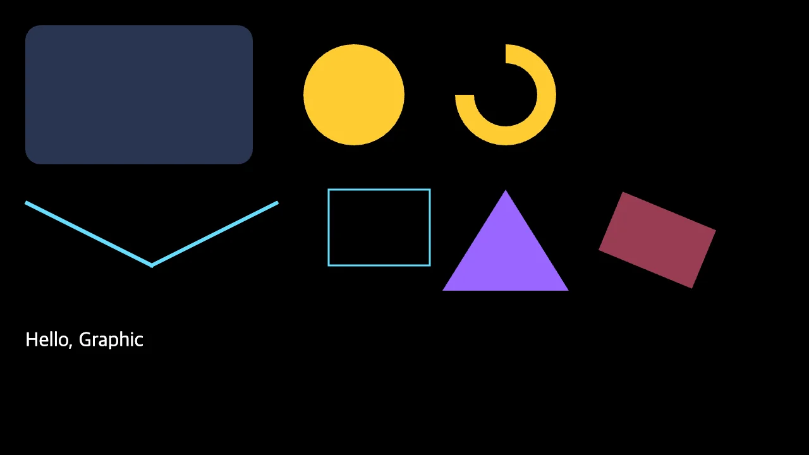
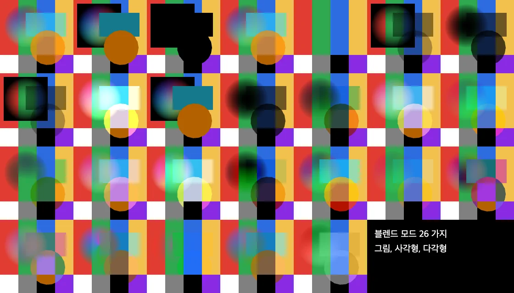
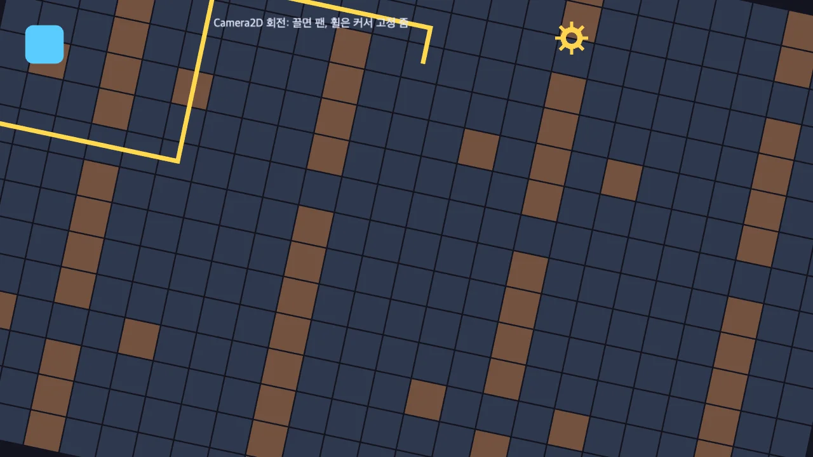

# Drawing

There are two ways to draw. Attach drawing components (`Paint`, `Sprite`, `Text`, `RichText` and the decoration components) to nodes, and the engine draws them along with the node tree. Inside a scene's `preDraw`, `draw` and `postDraw`, or a component's `draw`, draw directly with `Graphic`. This chapter covers both ways, blend modes, and `Camera2D`, which views the world.

## Drawing directly with Graphic

`Graphic` is a renderer that builds a Canvas2D style model (top left origin, pixel units, a state stack) on top of WebGL2. A scene's drawing methods receive it as an argument. The engine sets view coordinates (`viewManager.applyViewRect(graphic)`) before each scene draws, so a scene draws in view coordinates from the start. (see the "Engine and Scenes" chapter)



| Group | Methods |
| --- | --- |
| Color | `setFillColor(color)`, `setStrokeColor(color)`. A `Color`, or a `"#rgb"`, `"#rgba"`, `"#rrggbb"`, `"#rrggbbaa"`, `"rgb(...)"` or `"rgba(...)"` string |
| State | `pushState()`, `popState()` (push and restore transform, opacity, blend, colors, font and tint), `translate(x, y)`, `rotate(radian)`, `scale(x, y)`, `setGlobalAlpha(value)` |
| Filled shapes | `drawRect(rect)`, `drawRoundRect(rect, roundSize)`, `drawCircle(center, radius)`, `drawRing(center, innerRadius, outerRadius, startRadian, endRadian)`, `drawConvexPolygon(positions, color)` |
| Lines | `drawLine(positions, size)`, `drawLineLoop(positions, size)`, `drawStrokeRect(rect, lineWidth)`, `drawStrokeRoundRect(rect, roundSize, lineWidth)`, `drawStrokeCircle(center, radius, lineWidth)`, `drawArc(center, radius, startRadian, endRadian, lineWidth)`, `drawLineSegments(positionValues, size)` |
| Images | `drawImage(image, position, size)`, `drawImageWithImageRect(image, position, size, imageRect)`, `drawImageWithNineSlice(image, position, size, nineSlice)` |
| Text | `setFontString(fontString)`, `setTextAlign(textAlign)`, `setTextBaseline(textBaseline)`, `drawFillText(text, x, y)`, `drawStrokeText(text, x, y, lineWidth)`, `measureText(text)` |

Filled shapes and `drawFillText` use the fill color; lines and `drawStrokeText` use the stroke color. Angles are in radians, with 0 pointing right and increasing clockwise on screen.

```javascript
import { Engine, EngineConfiguration, Scene, Vector2, Rect, Color } from "./build/vanilla.js";

class ShapeScene extends Scene {
	preDraw(graphic) {
		super.preDraw(graphic);
		const engine = this.getEngine();
		const viewManager = engine.getViewManager();
		viewManager.applyViewRect(graphic);
	}

	draw(graphic) {
		super.draw(graphic);
		graphic.setFillColor("#2a3550");
		graphic.drawRoundRect(Rect.create(40, 40, 360, 220), 24);

		graphic.setFillColor(new Color(1, 0.8, 0.2, 1));
		graphic.drawCircle(Vector2.create(560, 150), 80);
		graphic.drawRing(Vector2.create(800, 150), 50, 80, -Math.PI / 2, Math.PI);

		graphic.setStrokeColor("#66ddff");
		graphic.drawLine([Vector2.create(40, 320), Vector2.create(240, 420), Vector2.create(440, 320)], 6);
		graphic.drawStrokeRect(Rect.create(520, 300, 160, 120), 3);

		const triangle = [Vector2.create(800, 300), Vector2.create(900, 460), Vector2.create(700, 460)];
		graphic.drawConvexPolygon(triangle, new Color(0.6, 0.4, 1, 1));

		graphic.pushState();
		graphic.translate(1040, 380);
		graphic.rotate(Math.PI / 8);
		graphic.setGlobalAlpha(0.6);
		graphic.setFillColor("#ff6688");
		graphic.drawRect(Rect.create(-80, -50, 160, 100));
		graphic.popState();

		graphic.setFillColor("#ffffff");
		graphic.setFontString("32px sans-serif");
		graphic.setTextAlign("left");
		graphic.setTextBaseline("top");
		graphic.drawFillText("Hello, Graphic", 40, 520);
	}
}

const engineConfiguration = new EngineConfiguration();
engineConfiguration.referenceResolutionSize = Vector2.create(1280, 720);
engineConfiguration.autoResizeOnWindowResize = true;
const engine = new Engine(engineConfiguration);
engine.run(new ShapeScene());
```

Use the same methods inside a component's `draw(graphic)`. There the origin is the top left of the node's content area, and the node's position, rotation, scale and opacity are already applied.

## Drawing components

| Component | Draws |
| --- | --- |
| `Paint` | A single color rectangle the size of the content (`setColor`, `setRoundSize`, default color white) |
| `Sprite` | An image. Extends `Paint`. Without an image it fills like `Paint` (default color transparent) |
| `Text` | Text in one font, one size and one color (multiple lines possible) |
| `RichText` | Text whose style changes per segment through markup. Extends `Text` |

Components draw inside the node's content size. If the node has no content size (0, 0), nothing is visible.

## Sprite

```javascript
import { Engine, EngineConfiguration, Scene, WorldNode, Sprite, ImageAsset, Vector2, Rect, Color } from "./build/vanilla.js";

class SpriteScene extends Scene {
	async load(engine) {
		await super.load(engine);
		const imageAsset = new ImageAsset();
		await imageAsset.load("examples/assets/spritesheet.png");
		const root = this.getRoot();

		const wholeNode = new WorldNode();
		wholeNode.setContentSize(Vector2.create(300, 300));
		wholeNode.setLocalPosition(Vector2.create(220, 360));
		const wholeSprite = wholeNode.addComponent(Sprite);
		wholeSprite.setImage(imageAsset);
		root.addChild(wholeNode);

		const frameNode = new WorldNode();
		frameNode.setContentSize(Vector2.create(200, 200));
		frameNode.setLocalPosition(Vector2.create(560, 360));
		const frameSprite = frameNode.addComponent(Sprite);
		frameSprite.setImage(imageAsset);
		frameSprite.setImageRect(Rect.create(200, 0, 200, 200));
		root.addChild(frameNode);

		const tintNode = new WorldNode();
		tintNode.setContentSize(Vector2.create(200, 200));
		tintNode.setLocalPosition(Vector2.create(800, 360));
		const tintSprite = tintNode.addComponent(Sprite);
		tintSprite.setImage(imageAsset);
		tintSprite.setImageRect(Rect.create(0, 0, 200, 200));
		tintSprite.setColor(new Color(1, 0.2, 0.2, 0.5));
		root.addChild(tintNode);

		const tiledNode = new WorldNode();
		tiledNode.setContentSize(Vector2.create(180, 400));
		tiledNode.setLocalPosition(Vector2.create(1080, 360));
		const tiledSprite = tiledNode.addComponent(Sprite);
		tiledSprite.setImage(imageAsset);
		tiledSprite.setImageRect(Rect.create(0, 200, 100, 100));
		tiledSprite.setSpriteDrawMode("tiled");
		root.addChild(tiledNode);
	}

	preDraw(graphic) {
		super.preDraw(graphic);
		const engine = this.getEngine();
		const viewManager = engine.getViewManager();
		viewManager.applyViewRect(graphic);
	}
}

const engineConfiguration = new EngineConfiguration();
engineConfiguration.referenceResolutionSize = Vector2.create(1280, 720);
engineConfiguration.autoResizeOnWindowResize = true;
const engine = new Engine(engineConfiguration);
engine.run(new SpriteScene());
```

- `setImage(image)` takes an `ImageAsset` or an `HTMLImageElement`. The image is stretched to the node's content size.
- `setImageRect(rect)` draws only one piece of the image. A zero rectangle means the whole image. `setFrame(frame)` sets a `Frame` (image and rectangle) at once. (`SpriteAtlas` is in the "Loading Assets" chapter)
- `setSpriteDrawMode(mode)`: `"simple"` (default, stretch), `"sliced"` (nine slice), `"tiled"` (fills by repeating the piece at its size, cutting off what overflows).
- `"sliced"` takes the border widths from `setNineSlice(rect)`. The rectangle's `x` is the left, `y` the top, `width` the right and `height` the bottom width. If the content size is smaller than the sum of the borders, nothing is drawn.
- If the alpha of `setColor(color)` is greater than 0, that color covers only the image's shape (its opaque area), at the alpha ratio.
- `setHorizontalFlip` and `setVerticalFlip` flip around the left (top) edge of the content area, so the image is drawn outside the content area, to the left (above). To flip in place, give the node a negative local scale. (`node.setLocalScaleXY(-1, 1)`, which flips around the pivot)

## Text

```javascript
import { Engine, EngineConfiguration, Scene, WorldNode, Paint, Text, RichText, TextAlign, TextBaseline, Vector2, Color } from "./build/vanilla.js";

class TextScene extends Scene {
	initialize(engine) {
		super.initialize(engine);
		const root = this.getRoot();

		const titleNode = new WorldNode();
		titleNode.setContentSize(Vector2.create(800, 80));
		titleNode.setLocalPosition(Vector2.create(640, 100));
		const title = titleNode.addComponent(Text);
		title.setText("vanilla.js");
		title.setFontSize(64);
		title.setBold(true);
		title.setTextColor("#ffe08a");
		title.setStrokeColor("#402000");
		title.setStrokeWidth(4);
		root.addChild(titleNode);

		const bodyNode = new WorldNode();
		bodyNode.setContentSize(Vector2.create(520, 200));
		bodyNode.setLocalPosition(Vector2.create(400, 330));
		const bodyPaint = bodyNode.addComponent(Paint);
		bodyPaint.setColor(new Color(0, 0, 0, 0.4));
		const body = bodyNode.addComponent(Text);
		body.setText("Text wraps inside the node width when a word wrap width is set or the text has a line break.");
		body.setFontSize(26);
		body.setTextAlign(TextAlign.left);
		body.setTextBaseline(TextBaseline.top);
		body.setWordWrapWidth(500);
		body.setLineSpacing(1.4);
		root.addChild(bodyNode);

		const richNode = new WorldNode();
		richNode.setContentSize(Vector2.create(600, 60));
		richNode.setLocalPosition(Vector2.create(960, 330));
		const rich = richNode.addComponent(RichText);
		rich.setFontSize(30);
		rich.setText("<b>Bold</b>, <color=#ff6666>red</color>, <size=40>big</size> and <u>underline</u>");
		root.addChild(richNode);

		const buttonNode = new WorldNode();
		buttonNode.setContentSize(Vector2.create(200, 60));
		buttonNode.setLocalPosition(Vector2.create(960, 480));
		const buttonPaint = buttonNode.addComponent(Paint);
		buttonPaint.setColor("#3366cc");
		buttonPaint.setRoundSize(12);
		const buttonText = buttonNode.addComponent(Text);
		buttonText.setText("A very long button caption");
		buttonText.setFontSize(28);
		buttonText.setFitWidth(180);
		root.addChild(buttonNode);
	}

	preDraw(graphic) {
		super.preDraw(graphic);
		const engine = this.getEngine();
		const viewManager = engine.getViewManager();
		viewManager.applyViewRect(graphic);
	}
}

const engineConfiguration = new EngineConfiguration();
engineConfiguration.referenceResolutionSize = Vector2.create(1280, 720);
engineConfiguration.autoResizeOnWindowResize = true;
const engine = new Engine(engineConfiguration);
engine.run(new TextScene());
```

`Text` defaults to size 32, white, center alignment (`"center"`), middle baseline (`"middle"`), stroke width 0, line spacing 1.25 and the system font.

- Text is placed inside the node's content area. Horizontally it goes to the left edge for `left`, the right edge for `right`, and the center otherwise; vertically to the top for `top`, the bottom for `bottom`, `alphabetic` and `ideographic`, and the middle otherwise.
- If `setWordWrapWidth(width)` is greater than 0 or the text contains `"\n"`, it is drawn on multiple lines. Multi-line text without a wrap width wraps at the node width. `setWrapMode("char")` breaks at characters regardless of words. (default `"word"`)
- `setFitWidth(width, minimumRatio)` shrinks single-line text that overflows that width, down to the minimum ratio of the set size (default 0.55). Use it for button captions whose length differs per language.
- `setVisibleCharacterCount(count)` shows only that many characters from the start. (-1 shows all; for typewriter effects)
- `setFont(font)` takes a `FontAsset` or a `FontFace`. Loading fonts is covered in the "Loading Assets" chapter.

## RichText

`RichText.setText` reads markup and splits the text into segments. Styles a segment does not set follow the `Text` settings.

| Tag | Meaning |
| --- | --- |
| `<b>...</b>`, `<i>...</i>` | Bold, italic |
| `<u>...</u>`, `<s>...</s>` | Underline, strikethrough |
| `<color=#RRGGBB>...</color>`, `<color=#RRGGBBAA>...</color>` | Color |
| `<color=red>...</color>` | Named color (22 names such as red, green, blue, white, black, yellow, cyan, magenta, gray, orange, purple) |
| `<size=N>...</size>` | Font size |

Unknown tags show as plain text. To build segments in code without markup, use `appendSegment(text, attributes)`. The attributes are `fontFace`, `fontSize`, `textColor`, `strokeColor`, `strokeWidth`, `bold`, `italic`, `underline` and `strikethrough`, with colors given as `Color`.

```javascript
import { WorldNode, RichText, Color, Vector2 } from "./build/vanilla.js";

const node = new WorldNode();
node.setContentSize(Vector2.create(600, 60));
const richText = node.addComponent(RichText);
richText.appendSegment("HP ", { bold: true });
richText.appendSegment("120", { textColor: new Color(0.4, 1, 0.4, 1), fontSize: 40 });
richText.appendSegment(" / 150", { textColor: new Color(0.7, 0.7, 0.7, 1) });
const segments = richText.getSegments();
console.log(segments.length);
```

A `RichText` with segments draws them left to right on one line. Alignment and baseline are computed from the total segment width and the largest font size.

## Blend modes

Blend modes accept all 26 Canvas2D composite operation names. Components use `Sprite.setSpriteBlendMode(name)`, and direct drawing uses `graphic.setBlendMode(name)`. The default is `"source-over"`.



- Fixed function blending: `source-over`, `source-in`, `source-out`, `source-atop`, `destination-over`, `destination-in`, `destination-out`, `destination-atop`, `lighter`, `copy`, `xor`, `multiply`, `screen`
- Shader mixing: `overlay`, `darken`, `lighten`, `color-dodge`, `color-burn`, `hard-light`, `soft-light`, `difference`, `exclusion`, `hue`, `saturation`, `color`, `luminosity`

The 13 shader mixed modes copy the area under each draw from the current screen and mix it with the W3C Compositing and Blending formulas. In these modes nothing is batched, and every draw costs one extra area copy. `multiply` is shader mixed only when drawing into a render target. Unknown names are drawn as `source-over`.

```javascript
import { Engine, EngineConfiguration, Scene, Vector2, Color } from "./build/vanilla.js";

class BlendScene extends Scene {
	preDraw(graphic) {
		super.preDraw(graphic);
		const engine = this.getEngine();
		const viewManager = engine.getViewManager();
		viewManager.applyViewRect(graphic);
	}

	draw(graphic) {
		super.draw(graphic);
		const blendModes = ["source-over", "lighter", "multiply", "screen", "difference"];
		for (let index = 0; index < blendModes.length; ++index) {
			const centerX = 160 + index * 240;
			graphic.setFillColor(new Color(0.9, 0.3, 0.2, 1));
			graphic.drawCircle(Vector2.create(centerX - 40, 360), 90);
			graphic.pushState();
			graphic.setBlendMode(blendModes[index]);
			graphic.setFillColor(new Color(0.2, 0.5, 0.9, 1));
			graphic.drawCircle(Vector2.create(centerX + 40, 360), 90);
			graphic.popState();
		}
	}
}

const engineConfiguration = new EngineConfiguration();
engineConfiguration.referenceResolutionSize = Vector2.create(1280, 720);
engineConfiguration.autoResizeOnWindowResize = true;
const engine = new Engine(engineConfiguration);
engine.run(new BlendScene());
```

Wrapping with `pushState` and `popState` restores the blend mode too. Unlike Canvas2D, `source-in`, `source-out`, `destination-in`, `destination-atop` and `copy` change only the inside of the drawn shape.

## Decoration components

| Component | What it does | Main methods (defaults) |
| --- | --- | --- |
| `Mask` | Clips drawing of children to the node's content area. Clips rotated nodes correctly, and children in clipped areas do not receive touches | `setRoundSize` (0) |
| `Outline` | Draws only a border, a rounded rectangle or a circle (the line stays inside the content area) | `setColor` (white), `setLineWidth` (1), `setRoundSize` (0), `setCircle` (false) |
| `ShadowText` | Bakes single-line text with a shadow into one canvas and draws it. Fading the node fades text and shadow as one image. Shrinks text to fit when it overflows | `setText`, `setTextStyle(fontSize, isBold, textColor)` (16, false, `"#ffffff"`), `setShadow(color, opacity, offset, blur)`, `setFitMinimumRatio` (0.6) |
| `SoftShade` | A soft shade that darkens the area behind text | `setShade(shape, color, opacity, fadeWidth)` (`SoftShadeShape.band`, `"#000000"`, 0.5, 0) |
| `ShadowImage` | An image with a shadow, drawn as large as fits inside the node, keeping its ratio, centered | `setImage(image, imageRect)`, `setImageColor`, `setShadow(color, opacity, offset, blur)` |

Colors for `ShadowText`, `SoftShade` and `ShadowImage` are `"#rrggbb"` strings. `SoftShadeShape.band` is a band darkest along the middle line that fades toward the top and bottom, and `SoftShadeShape.bottom` is a vertical gradient darkest at the bottom.

```javascript
import { Engine, EngineConfiguration, Scene, WorldNode, Paint, Mask, Outline, ShadowText, SoftShade, SoftShadeShape, Vector2, Rect, Color } from "./build/vanilla.js";

class DecorationScene extends Scene {
	initialize(engine) {
		super.initialize(engine);
		const root = this.getRoot();

		const panel = new WorldNode();
		panel.setContentSize(Vector2.create(480, 300));
		panel.setLocalPosition(Vector2.create(400, 360));
		const panelPaint = panel.addComponent(Paint);
		panelPaint.setColor("#1d2333");
		panelPaint.setRoundSize(20);
		const mask = panel.addComponent(Mask);
		mask.setRoundSize(20);
		root.addChild(panel);

		const bigCircle = new WorldNode();
		bigCircle.setContentSize(Vector2.create(320, 320));
		bigCircle.setLocalPosition(Vector2.create(460, 280));
		const circlePaint = bigCircle.addComponent(Paint);
		circlePaint.setColor(new Color(1, 0.6, 0.2, 1));
		circlePaint.setRoundSize(160);
		panel.addChild(bigCircle);

		const frame = new WorldNode();
		frame.setContentSize(Vector2.create(480, 300));
		frame.setLocalPosition(Vector2.create(240, 150));
		const outline = frame.addComponent(Outline);
		outline.setColor("#8899cc");
		outline.setLineWidth(3);
		outline.setRoundSize(20);
		panel.addChild(frame);

		const shadeNode = new WorldNode();
		shadeNode.setContentSize(Vector2.create(560, 120));
		shadeNode.setLocalPosition(Vector2.create(960, 360));
		const softShade = shadeNode.addComponent(SoftShade);
		softShade.setShade(SoftShadeShape.band, "#000000", 0.7, 80);
		root.addChild(shadeNode);

		const captionNode = new WorldNode();
		captionNode.setContentSize(Vector2.create(520, 80));
		captionNode.setLocalPosition(Vector2.create(960, 360));
		const shadowText = captionNode.addComponent(ShadowText);
		shadowText.setText("Shadow Text");
		shadowText.setTextStyle(48, true, "#ffffff");
		shadowText.setShadow("#000000", 0.8, 4, 6);
		root.addChild(captionNode);
	}

	preDraw(graphic) {
		super.preDraw(graphic);
		const engine = this.getEngine();
		const viewManager = engine.getViewManager();
		viewManager.applyViewRect(graphic);
		graphic.setFillColor("#5a6b7a");
		graphic.drawRect(Rect.create(700, 0, 580, 720));
	}
}

const engineConfiguration = new EngineConfiguration();
engineConfiguration.referenceResolutionSize = Vector2.create(1280, 720);
engineConfiguration.autoResizeOnWindowResize = true;
const engine = new Engine(engineConfiguration);
engine.run(new DecorationScene());
```

`Mask` draws nothing during the component drawing step; it starts clipping right before the node draws its children and ends right after. So the `Paint` on the same node is not clipped, only the children are. A node draws all its own components before its children, so to show a border (`Outline`) above the children, put it on the last child node as in the example above.

## Camera2D

`Camera2D` is not a component but an object the scene holds. It has the world position it looks at (`position`, placed at the center of the screen), a zoom (`zoom`, default 1, clamped to the `setZoomRange` range, which defaults to 0.1 to 8) and a rotation (`rotation`, in degrees, around the center of the screen), and applies that transform to whatever is drawn between `begin(graphic)` and `end(graphic)`.



| Method | Description |
| --- | --- |
| `setViewSize(size)` | Screen size. Give it the view size every frame or on resize (default 960 x 640) |
| `setPosition`, `setZoom`, `setRotation` | Set directly |
| `setWorldBounds(rect)` | Keeps the visible area inside this rectangle (`null` means no limit) |
| `setZoomRange(minimum, maximum)` | Zoom range |
| `follow(targetPositions, rate, timeDelta)` | Follows the target (the middle of several targets) smoothly, independent of frame rate |
| `panByScreen(deltaX, deltaY)`, `fling(velocityX, velocityY)` | Drag in screen pixels, inertia on release |
| `zoomAt(anchorScreen, zoomFactor)` | Zooms while keeping the world point under a screen point fixed |
| `tweenTo(position, zoom, duration)` | Moves smoothly to a position and zoom (default 0.4 seconds) |
| `tick(timeDelta)` | Updates inertia, tweening and bounds clamping |
| `screenToWorld(position)`, `worldToScreen(position)` | Convert coordinates |

```javascript
import { Engine, EngineConfiguration, Scene, Camera2D, Vector2, Rect, Color } from "./build/vanilla.js";

class CameraScene extends Scene {
	#camera;
	#elapsedSeconds;

	constructor() {
		super();
		this.#camera = new Camera2D();
		this.#elapsedSeconds = 0;
	}

	initialize(engine) {
		super.initialize(engine);
		this.#camera.setWorldBounds(Rect.create(0, 0, 2400, 1600));
		this.#camera.setPosition(Vector2.create(400, 400));
		this.#camera.setZoom(1.5);
	}

	tick(timeDelta) {
		super.tick(timeDelta);
		this.#elapsedSeconds += timeDelta;
		const engine = this.getEngine();
		const viewManager = engine.getViewManager();
		const viewSize = viewManager.getViewSize();
		this.#camera.setViewSize(viewSize);
		const target = Vector2.create(400 + this.#elapsedSeconds * 200, 400 + this.#elapsedSeconds * 100);
		this.#camera.follow([target], 4, timeDelta);
		this.#camera.setRotation(Math.sin(this.#elapsedSeconds) * 10);
		this.#camera.tick(timeDelta);
	}

	preDraw(graphic) {
		super.preDraw(graphic);
		const engine = this.getEngine();
		const viewManager = engine.getViewManager();
		viewManager.applyViewRect(graphic);
	}

	draw(graphic) {
		this.#camera.begin(graphic);
		for (let row = 0; row < 16; ++row) {
			for (let column = 0; column < 24; ++column) {
				const isDark = (row + column) % 2 === 0;
				graphic.setFillColor(isDark ? "#283040" : "#3a4660");
				graphic.drawRect(Rect.create(column * 100, row * 100, 100, 100));
			}
		}
		graphic.setFillColor(new Color(1, 0.8, 0.2, 1));
		graphic.drawCircle(Vector2.create(400 + this.#elapsedSeconds * 200, 400 + this.#elapsedSeconds * 100), 30);
		this.#camera.end(graphic);
		super.draw(graphic);
	}
}

const engineConfiguration = new EngineConfiguration();
engineConfiguration.referenceResolutionSize = Vector2.create(1280, 720);
engineConfiguration.autoResizeOnWindowResize = true;
const engine = new Engine(engineConfiguration);
engine.run(new CameraScene());
```

The example above draws the node tree with `super.draw(graphic)` after ending the camera, so nodes stay fixed on screen regardless of the camera. (HUD) To view the node tree through the camera as well, call `super.draw(graphic)` between `begin` and `end`.

## Drawing settings

Set these on the `Graphic` obtained with `engine.getGraphic()`.

- `setImageSmoothingEnabled(false)`: stretches images with the nearest pixel. Used by pixel art games. (on by default)
- `setImageMipmapEnabled(true)`: reduces shimmering when a large image is drawn much smaller. (off by default)
- `setBatchingEnabled`, `setCullingEnabled`: batching and off-screen culling. Both are on by default. Culling skips a node only when it is off screen and every enabled component on it reports drawing only inside the content area or reports the rectangle it draws.

## Things to watch

- Draw images only after they have loaded. Load them with `await imageAsset.load(...)` in the scene's `load`, then build the nodes.
- `Sprite.setImage` accepts only `ImageAsset` and `HTMLImageElement` and silently ignores anything else (such as a canvas). Draw a canvas with `graphic.drawImage` or `ShadowImage`.
- Strings for `Paint.setColor` and `Text.setTextColor` must start with `"#"` or `"rgb"`. Passing an unknown string format to `Graphic.setFillColor` gives white.
- The draw mode and blend mode name tables (`SpriteDrawMode`, `SpriteBlendMode`) are not public names, so write them as strings such as `"tiled"` and `"lighter"`.
- Shader mixed blend modes cost an area copy per draw and are not batched, so heavy use slows rendering.
- Text is baked into a texture per string and style and kept in a cache. (up to 512 entries, dropping the least recently used) Text that changes often, such as a number that changes every frame, is baked again every time it changes.

## Related classes

Graphic, Color, Colors, Rect, Paint, Sprite, Text, RichText, TextAlign, TextBaseline, Mask, Outline, ShadowText, SoftShade, SoftShadeShape, ShadowImage, Camera2D, ImageAsset, Frame
