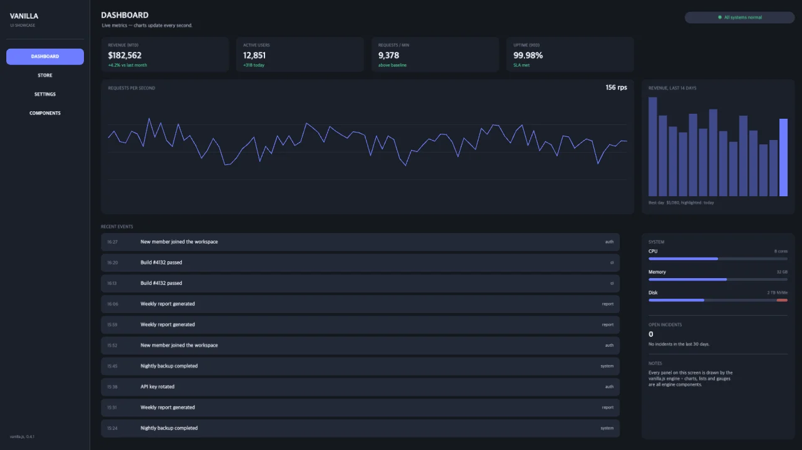
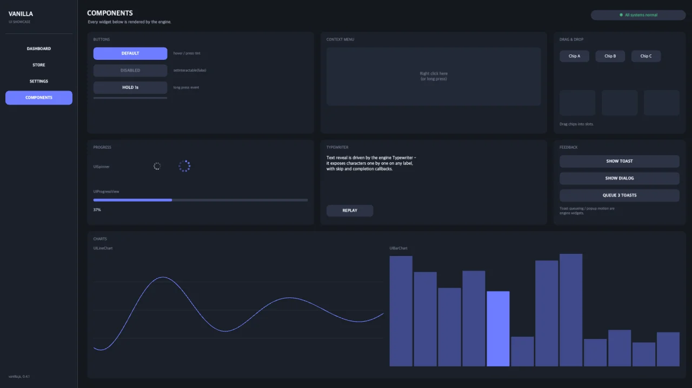

# UI

This chapter covers putting UI such as buttons, labels, and sliders on screen. It goes through `UIScene`, the scene for UI; widget components attached to nodes; complete widgets that are nodes themselves; `UIDocument`, which reads UI Editor documents; two layout methods (`NodeLayout` and the constraint-based `LayoutSolver`); window stacking (`UIWindowLayer`); and button feedback (`ButtonMotion`). Nodes and components themselves are covered in the "Nodes and Components" chapter, and how touches reach nodes in the "Input" chapter.



## Two kinds of UI

The engine's UI comes in two kinds, depending on how nodes are placed.

- **The WorldNode line.** Attach widget components (the `UIView` family, such as `UILabel`, `UIButton`, and `UISlider`) to a `WorldNode`, and set position and size yourself with pivot, anchor, `setLocalPosition`, and `setContentSize`. Complete widgets that derive from `WorldNode`, such as `UIInputField`, `UIDropdown`, `UIDialog`, `UIToast`, and `UIWindow`, are created with `new` and added with `addChild`. Every widget that receives touches belongs to this line.
- **The UINode line.** A `UINode` is a node with eight variables: left, right, top, bottom, width, height, center X, and center Y. When you add constraints, `LayoutSolver` solves their values. Use it for layouts that grow and shrink with the screen size and safe area. Pressable widgets such as `UIButton` can also go on a `UINode`, and they are pressed at the position the solver computed.

Both lines are used in a `UIScene`.

## UIScene

`UIScene` is a UI scene derived from `Scene`. It comes with the following.

- Touch routing. In `initialize` it creates a `TouchRecognizer` that sends touches to the widgets under the root. A plain `Scene` also passes touches to widgets through the scene's `TouchRaycaster`. To pass drag gestures in scroll views too, replace it with `setTouchRaycaster(new TouchRecognizer())` (as `examples/uisample` does).
- A loading screen. It draws a black background, a centered image (`setLoadingImageUrl`), and a bar at the bottom. By default it shows for at least 3000 milliseconds and skips ahead when the screen is pressed. Change this with `setLoadingMinDurationMs(milliseconds)`.
- An asset loading hook, `loadAssets()`. When overriding it, call `await super.loadAssets()` first.
- Background color `setSceneBackgroundColor(color)` (default black) and view scale mode `setViewScaleMode(mode)` (default `ViewScaleMode.none`).
- A constraint solver (`getSolver()`), a screen guide node (`getScreenNode()`), and a safe area guide node (`getSafeAreaLayoutGuide()`). These are used in the "Constraint layout" section below.
- Developer tools. They are not created when `EngineConfiguration.useDevTools` is off.

Below is a scene with a title label and one button. The button node gets a `Paint` (background), a `UIButton` (press handling), and a `UILabel` (text) together.

```javascript
import { Engine, EngineConfiguration, UIScene, WorldNode, Paint, UIButton, UILabel, Pivot, Vector2, Color } from "./build/vanilla.js";

class MenuScene extends UIScene {
	constructor() {
		super();
		this.setLoadingMinDurationMs(0);
		this.setSceneBackgroundColor(new Color(0.08, 0.09, 0.12, 1));
	}

	initialize(engine) {
		super.initialize(engine);
		const root = this.getRoot();

		const titleNode = new WorldNode();
		titleNode.setPivot(Pivot.topLeft);
		titleNode.setAnchor(Pivot.topLeft);
		titleNode.setLocalPosition(Vector2.create(40, 40));
		titleNode.setContentSize(Vector2.create(400, 48));
		const titleLabel = titleNode.addComponent(UILabel);
		titleLabel.setText("Main Menu");
		titleLabel.setFontSize(32);
		titleLabel.setTextColor(new Color(0.95, 0.96, 1, 1));
		root.addChild(titleNode);

		const buttonNode = new WorldNode();
		buttonNode.setName("StartButton");
		buttonNode.setPivot(Pivot.topLeft);
		buttonNode.setAnchor(Pivot.topLeft);
		buttonNode.setLocalPosition(Vector2.create(40, 120));
		buttonNode.setContentSize(Vector2.create(200, 56));
		const buttonPaint = buttonNode.addComponent(Paint);
		buttonPaint.setColor(new Color(0.23, 0.51, 0.96, 1));
		buttonPaint.setRoundSize(12);
		const button = buttonNode.addComponent(UIButton);
		const buttonLabel = buttonNode.addComponent(UILabel);
		buttonLabel.setText("Start");
		buttonLabel.setFontSize(22);
		button.setClickedEvent((clickedButton) => {
			titleLabel.setText("Started");
		});
		button.setLongPressSeconds(0.8);
		button.setLongPressedEvent((pressedButton) => {
			titleLabel.setText("Long pressed");
		});
		root.addChild(buttonNode);
	}
}

const engineConfiguration = new EngineConfiguration();
engineConfiguration.referenceResolutionSize = Vector2.create(1280, 720);
engineConfiguration.autoResizeOnWindowResize = true;
const engine = new Engine(engineConfiguration);
engine.run(new MenuScene());
```

## Widget components

These widgets are attached to a `WorldNode` with `addComponent`. They use the node's content size (`setContentSize`) as their area.



| Class | Purpose |
| --- | --- |
| `UIView` | A panel with a background color (`setBackgroundColor`) and a content node (`getContent()`). Base class of the widgets below |
| `UILabel` | Text. When attached, it adds and uses both `Text` and `RichText` |
| `UIImageView` | Image. When attached, it creates and uses a `Sprite` |
| `UIButton` | Press handling and press tint |
| `UIToggleButton` | On/off button (derives from `UIButton`) |
| `UISlider` | A bar you drag to pick a value |
| `UIProgressView` | Progress bar (no input) |
| `UIScrollView` | An area you drag to scroll. It also attaches a `Mask` so children are clipped |

`UIView` family widgets create one content node (`content`) under their node when attached. Children that go inside the widget are added to `getContent()`.

### UIButton

- `UIButton` draws nothing itself. It blends a tint into the colors of components on the same node and the nodes below it (`Paint`, `Sprite`, text, and so on). The press tint defaults to `(0, 0, 0, 0.3)`, the hover tint to `(1, 1, 1, 0.12)`, and the transition time to 0.3 seconds; change them with `setPressedTintColor`, `setHoverTintColor`, and `setTransitionDuration`. Exclude things from tinting with `excludeNodeFromTint(node)` and `excludeComponentFromTint(component)`.
- Events: `setClickedEvent`, `setClickEvent` (on a click these two are called in that order), `setPressedEvent`, `setReleasedEvent`, `setHoverEvent`, and `setLongPressedEvent`. Each function receives the button. A click only happens when the release position is inside the button.
- A long press fires once the moment it passes `setLongPressSeconds` (default 0.5 seconds), and the click from that press is swallowed.
- With `setInteractable(false)` the button cannot be pressed and is darkened (`(0, 0, 0, 0.5)`).
- `setMinimumPressedSeconds(seconds)` keeps the pressed look for that long even on a short press before handling the release (default 0).

### Other widgets

- `UILabel`: `setText`, `setFontSize`, `setTextColor`, `setTextAlign`, `setTextBaseline`, `setBold`, `setWordWrapWidth` (0 means one line), and `setFitWidth` (shrinks the font size to fit that width). With `useRichText(true)` it reads `<b>`, `<i>`, `<u>`, `<s>`, `<color=...>`, and `<size=N>` markup.
- `UIImageView`: `setImage` (`HTMLImageElement`, `OffscreenCanvas`, `ImageAsset`), `setImageRect`, `setColor` (tint), `setDrawMode` (`"simple"`, `"sliced"`, `"tiled"`), and `setNineSlice`.
- `UIToggleButton`: `setToggledEvent`, `getIsOn`, and `setOnTintColor`. `setIsOn(isOn)` changes only the state without calling events.
- `UISlider`: `setRange(min, max)` (default 0 to 1), `setValue`, `getValue`, and `setValueChangedEvent`. Its look is set with `setTrackColor`, `setFillColor`, `setThumbColor`, `setThumbRadius` (default 16), `setTrackThickness` (0 or less uses the whole node), `setCornerRadius`, and `setDirection("horizontal" or "vertical")`.
- `UIProgressView`: `setRange`, `setValue`, `setTrackColor`, `setFillColor`, `setCornerRadius`, and `setDirection`. The value only changes from code.

```javascript
import { Engine, EngineConfiguration, UIScene, WorldNode, Paint, UILabel, UIImageView, UIToggleButton, UISlider, UIProgressView, ImageAsset, Pivot, Vector2, Rect, Color } from "./build/vanilla.js";

function createBoxNode(x, y, width, height) {
	const node = new WorldNode();
	node.setPivot(Pivot.topLeft);
	node.setAnchor(Pivot.topLeft);
	node.setLocalPosition(Vector2.create(x, y));
	node.setContentSize(Vector2.create(width, height));
	return node;
}

class WidgetScene extends UIScene {
	#imageAsset;

	constructor() {
		super();
		this.setLoadingMinDurationMs(0);
		this.#imageAsset = new ImageAsset();
	}

	async loadAssets() {
		await super.loadAssets();
		await this.#imageAsset.load("examples/assets/spritesheet.png");
	}

	initialize(engine) {
		super.initialize(engine);
		const root = this.getRoot();

		const imageNode = createBoxNode(40, 40, 160, 160);
		const imageView = imageNode.addComponent(UIImageView);
		imageView.setImage(this.#imageAsset);
		imageView.setImageRect(Rect.create(0, 0, 200, 200));
		root.addChild(imageNode);

		const valueNode = createBoxNode(240, 40, 320, 32);
		const valueLabel = valueNode.addComponent(UILabel);
		valueLabel.useRichText(true);
		valueLabel.setText("Volume <b>50</b>");
		valueLabel.setFontSize(20);
		root.addChild(valueNode);

		const progressNode = createBoxNode(240, 140, 320, 12);
		const progressView = progressNode.addComponent(UIProgressView);
		progressView.setTrackColor(new Color(1, 1, 1, 0.15));
		progressView.setFillColor(new Color(0.3, 0.8, 0.5, 1));
		progressView.setCornerRadius(6);
		progressView.setValue(0.5);
		root.addChild(progressNode);

		const sliderNode = createBoxNode(240, 90, 320, 32);
		const slider = sliderNode.addComponent(UISlider);
		slider.setRange(0, 100);
		slider.setValue(50);
		slider.setTrackThickness(6);
		slider.setCornerRadius(3);
		slider.setValueChangedEvent((changedSlider) => {
			const value = Math.round(changedSlider.getValue());
			valueLabel.setText("Volume <b>" + value + "</b>");
			progressView.setValue(value / 100);
		});
		root.addChild(sliderNode);

		const toggleNode = createBoxNode(240, 180, 160, 48);
		const togglePaint = toggleNode.addComponent(Paint);
		togglePaint.setColor(new Color(0.25, 0.6, 0.35, 1));
		togglePaint.setRoundSize(10);
		const toggleLabel = toggleNode.addComponent(UILabel);
		toggleLabel.setText("Mute");
		toggleLabel.setFontSize(18);
		const toggleButton = toggleNode.addComponent(UIToggleButton);
		toggleButton.setOnTintColor(new Color(0, 0, 0, 0.4));
		toggleButton.setToggledEvent((button) => {
			const isOn = button.getIsOn();
			slider.setInteractable(!isOn);
		});
		root.addChild(toggleNode);
	}
}

const engineConfiguration = new EngineConfiguration();
engineConfiguration.referenceResolutionSize = Vector2.create(640, 360);
const engine = new Engine(engineConfiguration);
engine.run(new WidgetScene());
```

### UIScrollView

The content size of the node with the scroll view is the visible area, and items are added to `getContent()`. You must tell it the full draggable size with `setScrollContentSize(size)`, and it only scrolls when that is larger than the visible area.

- Turn off an axis with `setHorizontal(false)` or `setVertical(false)`.
- `setScrollMode("clamp")` never goes past the edges (default); `"elastic"` resists past the edges and springs back when released.
- Show scroll bars with `setShowsVerticalScrollBar(true)` and `setShowsHorizontalScrollBar(true)`.
- `setScrollOffset(offset)` moves the position. Scrolling down makes y negative.
- There are also `setDragSensitivity` (drag multiplier, default 1), `setWheelScrollScale` (wheel multiplier), and `setPassesCrossAxisDrag(true)` (a finger dragged mostly along the non-scrolling axis is passed to the inner widget, for example a horizontal slider inside a vertical list).
- When a press lands inside a scroll view, `TouchRecognizer` delays delivering it by 150 milliseconds, and if the finger moves more than 10 pixels it cancels the inner widget's press and hands the drag to the scroll view.

```javascript
import { Engine, EngineConfiguration, UIScene, UIScrollView, UILabel, WorldNode, Paint, Color, Pivot, Vector2 } from "./build/vanilla.js";

class ListScene extends UIScene {
	constructor() {
		super();
		this.setLoadingMinDurationMs(0);
	}

	initialize(engine) {
		super.initialize(engine);
		const viewportNode = new WorldNode();
		viewportNode.setPivot(Pivot.topLeft);
		viewportNode.setAnchor(Pivot.topLeft);
		viewportNode.setContentSize(Vector2.create(320, 240));
		viewportNode.setLocalPosition(Vector2.create(160, 60));
		const scrollView = viewportNode.addComponent(UIScrollView);
		scrollView.setBackgroundColor(new Color(0.1, 0.12, 0.16, 1));
		scrollView.setHorizontal(false);
		scrollView.setScrollMode("elastic");
		scrollView.setShowsVerticalScrollBar(true);

		const rowCount = 20;
		const rowHeight = 40;
		const content = scrollView.getContent();
		for (let rowIndex = 0; rowIndex < rowCount; ++rowIndex) {
			const rowNode = new WorldNode();
			rowNode.setPivot(Pivot.topLeft);
			rowNode.setAnchor(Pivot.topLeft);
			rowNode.setContentSize(Vector2.create(296, rowHeight - 4));
			rowNode.setLocalPosition(Vector2.create(8, rowIndex * rowHeight + 2));
			const rowPaint = rowNode.addComponent(Paint);
			rowPaint.setColor(new Color(1, 1, 1, 0.06));
			const rowLabel = rowNode.addComponent(UILabel);
			rowLabel.setText("Row " + rowIndex);
			content.addChild(rowNode);
		}
		scrollView.setScrollContentSize(Vector2.create(320, rowCount * rowHeight));
		const root = this.getRoot();
		root.addChild(viewportNode);
	}
}

const engineConfiguration = new EngineConfiguration();
engineConfiguration.referenceResolutionSize = Vector2.create(640, 360);
const engine = new Engine(engineConfiguration);
engine.run(new ListScene());
```

## Complete widgets

These widgets derive from `WorldNode` and have their look and behavior built into one node. Create them with `new` and add them.

- `UIInputField`: a text field drawn on the canvas. By default the canvas reads the keyboard directly, mostly for ASCII input. For Korean IME, mobile soft keyboards, or the system clipboard, use a hidden DOM `<input>` with `setUseDOMInput(true)`, and also call `setEngine(engine)`. Call `attach()` to start receiving input and `detach()` when removing it. It has `setPlaceholder`, `setText`, `getText`, `setMaxLength` (0 means unlimited), `setFontSize` (default 28), `setOnChange((text) => {})`, `setOnSubmit((text) => {})`, `focus`, `blur`, and `selectAll`. A right-click shows a cut, copy, and paste menu.
- `UIDropdown`: shows the current value on a header button and opens a list when pressed. `new UIDropdown({ width, height, optionHeight, fontSize, baseColor, popupColor, highlightColor, textColor })` (defaults: width 180, height 30, row height 28, font 12). It has `setOptionList`, `getSelectedIndex`, `getSelectedText`, and `setChangedEvent`; `setSelectedIndex` changes the selection without calling the event.
- `UIToast`: `show(message)` slides a pill-shaped notice up from the bottom, holds it briefly, and removes it. Calling it several times queues the messages. `new UIToast({ width, height, restY, restX, holdSeconds, fontSize, backgroundColor, textColor })` (defaults: 400 x 48, `restY` 560, hold 1.8 seconds).
- `UIDialog`: shows a dimming overlay, a centered card, and confirm and cancel buttons with one call, `show(message, { onConfirm, onCancel, confirmText, cancelText })`. Without `onCancel` it becomes an alert with only a confirm button, and pressing the overlay counts as cancel. The default button labels are Korean ("확인", "취소"), so pass labels for other languages.

Add `UIToast` and `UIDialog` as the last children of the root so they draw on top. There are also widgets such as `UIContextMenu`, `UISpinner`, `UIListView`, `UILineChart`, `UIBarChart`, and `UIProgressRing` (see `examples/uishowcase`).

```javascript
import { Engine, EngineConfiguration, UIScene, UIInputField, UIDropdown, UIToast, UIDialog, WorldNode, Paint, UIButton, UILabel, Pivot, Vector2, Color } from "./build/vanilla.js";

class FormScene extends UIScene {
	constructor() {
		super();
		this.setLoadingMinDurationMs(0);
	}

	initialize(engine) {
		super.initialize(engine);
		const root = this.getRoot();

		const inputField = new UIInputField();
		inputField.setEngine(engine);
		inputField.setLocalPosition(Vector2.create(40, 40));
		inputField.setContentSize(Vector2.create(360, 56));
		inputField.setPlaceholder("Player name");
		inputField.setMaxLength(16);
		root.addChild(inputField);
		inputField.attach();

		const dropdown = new UIDropdown({ width: 200, height: 36, fontSize: 16 });
		dropdown.setLocalPosition(Vector2.create(420, 50));
		dropdown.setOptionList(["Low", "Medium", "High"]);
		dropdown.setSelectedIndex(1);
		root.addChild(dropdown);

		const buttonNode = new WorldNode();
		buttonNode.setPivot(Pivot.topLeft);
		buttonNode.setAnchor(Pivot.topLeft);
		buttonNode.setLocalPosition(Vector2.create(40, 130));
		buttonNode.setContentSize(Vector2.create(160, 48));
		const buttonPaint = buttonNode.addComponent(Paint);
		buttonPaint.setColor(new Color(0.23, 0.51, 0.96, 1));
		buttonPaint.setRoundSize(10);
		const button = buttonNode.addComponent(UIButton);
		const buttonLabel = buttonNode.addComponent(UILabel);
		buttonLabel.setText("Save");
		buttonLabel.setFontSize(18);
		root.addChild(buttonNode);

		const toast = new UIToast({ width: 320, height: 40, restY: 320 });
		const dialog = new UIDialog();
		root.addChild(toast);
		root.addChild(dialog);

		inputField.setOnSubmit((text) => {
			toast.show("Hello, " + text);
		});
		dropdown.setChangedEvent((changedDropdown) => {
			const selectedText = changedDropdown.getSelectedText();
			toast.show("Quality: " + selectedText);
		});
		button.setClickedEvent(() => {
			const playerName = inputField.getText();
			dialog.show("Save as " + playerName + "?", {
				confirmText: "Save",
				cancelText: "Cancel",
				onConfirm: () => {
					toast.show("Saved");
				},
				onCancel: () => {
					toast.show("Canceled");
				},
			});
		});
		toast.show("Ready");
	}
}

const engineConfiguration = new EngineConfiguration();
engineConfiguration.referenceResolutionSize = Vector2.create(640, 360);
const engine = new Engine(engineConfiguration);
engine.run(new FormScene());
```

## Reading UI Editor documents with UIDocument

A `.uiasset.json` saved by the UI Editor (the authoring tool itself is in the "Authoring Tools" chapter) is a document that writes a `WorldNode` tree as JSON. `UIDocument.fromJsonText(jsonText)` brings that text back to a live node tree and returns its root node. The restored nodes are ordinary engine nodes, so find them by name and attach behavior.

- Documents do not hold image data, only paths (`imagePath`). To connect images, set a function that turns a path into an `HTMLImageElement` with `UIDocument.setImageResolver((imagePath) => image)` before `fromJsonText`. Without it, nodes are restored without images.
- `UIDocument.toJsonText(rootNode, isPretty)` does the reverse and writes a node tree as JSON text.
- The node type handled by default is `WorldNode`, and the components are `Paint`, `Sprite`, `Text`, `RichText`, `Mask`, `Outline`, `SoftShade`, `ShadowText`, `UIProgressRing`, `UILabel`, `UIImageView`, `UIButton`, `UIToggleButton`, `UIProgressView`, `UISlider`, `UIScrollView`, and `ShadowImage` (`UIDocument.getComponentTypeNames()`). Add the remaining types the editors use all at once with `UIDocument.registerEditorTypes()`, or one at a time with `registerNodeType(typeName, nodeType)` and `registerComponentType(typeName, componentType)`. Types missing from the tables produce a warning on load.
- An invalid document (one without `root`) throws.

```javascript
import { Engine, EngineConfiguration, UIScene, UIDocument, UIButton, UIProgressView, TextAsset, Vector2 } from "./build/vanilla.js";

class DocumentScene extends UIScene {
	#textAsset;
	#progressView;
	#elapsedSeconds;

	constructor() {
		super();
		this.setLoadingMinDurationMs(0);
		this.#textAsset = new TextAsset();
		this.#progressView = null;
		this.#elapsedSeconds = 0;
	}

	async loadAssets() {
		await super.loadAssets();
		this.#textAsset.setNoCache(true);
		await this.#textAsset.load("examples/uisample/assets/title.uiasset.json");
	}

	initialize(engine) {
		super.initialize(engine);
		const jsonText = this.#textAsset.text;
		const documentRootNode = UIDocument.fromJsonText(jsonText);
		const root = this.getRoot();
		root.addChild(documentRootNode);

		const startButtonNode = documentRootNode.findDescendantByName("StartButton");
		const startButton = startButtonNode.getComponent(UIButton);
		startButton.setClickedEvent(() => {
			console.log("start");
		});
		const progressNode = documentRootNode.findDescendantByName("ProgressTrack");
		this.#progressView = progressNode.getComponent(UIProgressView);
	}

	tick(timeDelta) {
		super.tick(timeDelta);
		this.#elapsedSeconds += timeDelta;
		const progress = Math.sin(this.#elapsedSeconds) * 0.5 + 0.5;
		this.#progressView.setValue(progress);
	}
}

const engineConfiguration = new EngineConfiguration();
engineConfiguration.referenceResolutionSize = Vector2.create(960, 640);
const engine = new Engine(engineConfiguration);
engine.run(new DocumentScene());
```

## Building declaratively with NodeLayout

Instead of creating nodes one by one and keeping them in local variables, this builder writes a node hierarchy as a chain. Start with `NodeLayout.create(nodeClass)` (`WorldNode` if omitted), chain `name`, `active`, `pivot(pivot)`, `anchor(x, y)`, `anchoredPosition(x, y)`, `localPosition(x, y)`, `contentSize(x, y)`, `localScale(x, y)`, `maskEnabled(enabled)`, `component(componentType, callback)`, `children(...layouts)`, and `apply(callback)` (for settings the builder lacks), and `build(parent)` creates the node, adds it to `parent`, and returns it. Positions and sizes are given as two numbers without `Vector2`.

```javascript
import { Engine, EngineConfiguration, UIScene, NodeLayout, WorldNode, Paint, UILabel, UIButton, Pivot, Vector2, Color } from "./build/vanilla.js";

class LayoutScene extends UIScene {
	constructor() {
		super();
		this.setLoadingMinDurationMs(0);
	}

	initialize(engine) {
		super.initialize(engine);
		const root = this.getRoot();
		NodeLayout.create(WorldNode)
			.name("Panel")
			.pivot(Pivot.topLeft)
			.anchor(0, 0)
			.localPosition(170, 60)
			.contentSize(300, 240)
			.component(Paint, (paint) => {
				paint.setColor(new Color(0.13, 0.15, 0.2, 1));
				paint.setRoundSize(16);
			})
			.children(
				NodeLayout.create(WorldNode)
					.name("Title")
					.pivot(Pivot.topLeft)
					.anchor(0, 0)
					.localPosition(24, 20)
					.contentSize(252, 40)
					.component(UILabel, (label) => {
						label.setText("Settings");
						label.setFontSize(24);
					}),
				NodeLayout.create(WorldNode)
					.name("CloseButton")
					.pivot(Pivot.topLeft)
					.anchor(0, 0)
					.localPosition(24, 168)
					.contentSize(252, 48)
					.component(Paint, (paint) => {
						paint.setColor(new Color(0.23, 0.51, 0.96, 1));
						paint.setRoundSize(10);
					})
					.component(UIButton, (button) => {
						button.setClickedEvent(() => {
							console.log("close");
						});
					})
					.component(UILabel, (label) => {
						label.setText("Close");
						label.setFontSize(18);
					})
			)
			.build(root);
	}
}

const engineConfiguration = new EngineConfiguration();
engineConfiguration.referenceResolutionSize = Vector2.create(640, 360);
const engine = new Engine(engineConfiguration);
engine.run(new LayoutScene());
```

The static method `NodeLayout.arrangeFan(nodeList, options)` spreads several nodes along an arc, like cards in a hand.

## Constraint layout: UINode and LayoutSolver

`UINode` is a node whose position and size are set by constraints (the same idea as UIKit Auto Layout).

- The anchor getters `leftAnchor`, `rightAnchor`, `topAnchor`, `bottomAnchor`, `widthAnchor`, `heightAnchor`, `centerXAnchor`, and `centerYAnchor` (plus `leadingAnchor`, `trailingAnchor`, `firstBaselineAnchor`, and `lastBaselineAnchor`) return a new `LayoutExpression` on every call.
- Expressions make new expressions with `add`, `subtract`, `multiply`, and `divide`, and make a `LayoutConstraint` with `equalTo`, `lessThanOrEqualTo`, and `greaterThanOrEqualTo`. The right-hand side can be a number, a variable, or an expression.
- Constraints made this way are required constraints. For constraints that may give way, use a new constraint with a changed strength, such as `constraint.withStrength(LayoutStrength.strong)`. Strengths are `required`, `strong`, `medium`, and `weak`, and the stronger one wins in a conflict. Adding a required constraint that cannot be satisfied makes the solver throw.
- Add constraints to a node with `node.addConstraint(constraint)`. Every frame, `UIScene` attaches the `UINode`s in the tree to its solver and solves the values. Read the solved values with `getLeft()`, `getTop()`, `getWidth()`, `getHeight()`, `getCenterX()`, and `getCenterY()`.
- `getScreenNode()` is a guide fixed at the top left (0, 0) whose width and height follow the view size. `getSafeAreaLayoutGuide()` is a guide inset from it by the safe area (it reads the CSS `env()` insets).
- A `UINode`'s left and top values are absolute coordinates relative to the UI tree root. Even when the parent is a `UINode`, a child's values are not relative to the parent.
- Nodes with a natural size, such as text, have an intrinsic content size (`getIntrinsicContentSize`), and `setContentHuggingPriority` and `setContentCompressionResistancePriority` decide how strongly they resist growing and shrinking (`LayoutPriority.defaultLow` 250, `defaultHigh` 750, `required` 1000). `UILabel` makes its node remeasure the intrinsic size when the text changes.
- Use `setLayoutMargins({ top, left, bottom, right })` (all 8 by default) and `getLayoutMarginsGuide()` for an inner margin guide.

```javascript
import { Engine, EngineConfiguration, UIScene, UINode, UILabel, Paint, LayoutStrength, Vector2, Color } from "./build/vanilla.js";

class ConstraintScene extends UIScene {
	constructor() {
		super();
		this.setLoadingMinDurationMs(0);
		this.setSceneBackgroundColor(new Color(0.08, 0.09, 0.12, 1));
	}

	initialize(engine) {
		super.initialize(engine);
		const root = this.getRoot();
		const safeAreaGuide = this.getSafeAreaLayoutGuide();
		const screenNode = this.getScreenNode();

		const headerNode = new UINode();
		const headerPaint = headerNode.addComponent(Paint);
		headerPaint.setColor(new Color(0.2, 0.45, 0.85, 1));
		const headerLabel = headerNode.addComponent(UILabel);
		headerLabel.setText("Header");
		headerLabel.setFontSize(20);
		root.addChild(headerNode);

		const safeLeftAnchor = safeAreaGuide.leftAnchor;
		const safeRightAnchor = safeAreaGuide.rightAnchor;
		const safeTopAnchor = safeAreaGuide.topAnchor;
		const headerLeftAnchor = headerNode.leftAnchor;
		const headerRightAnchor = headerNode.rightAnchor;
		const headerTopAnchor = headerNode.topAnchor;
		const headerHeightAnchor = headerNode.heightAnchor;
		headerNode.addConstraint(headerLeftAnchor.equalTo(safeLeftAnchor.add(16)));
		headerNode.addConstraint(headerRightAnchor.equalTo(safeRightAnchor.subtract(16)));
		headerNode.addConstraint(headerTopAnchor.equalTo(safeTopAnchor.add(16)));
		headerNode.addConstraint(headerHeightAnchor.equalTo(56));

		const cardNode = new UINode();
		const cardPaint = cardNode.addComponent(Paint);
		cardPaint.setColor(new Color(0.13, 0.15, 0.2, 1));
		root.addChild(cardNode);

		const screenWidthAnchor = screenNode.widthAnchor;
		const screenCenterXAnchor = screenNode.centerXAnchor;
		const screenCenterYAnchor = screenNode.centerYAnchor;
		const cardWidthAnchor = cardNode.widthAnchor;
		const cardHeightAnchor = cardNode.heightAnchor;
		const cardCenterXAnchor = cardNode.centerXAnchor;
		const cardCenterYAnchor = cardNode.centerYAnchor;
		const halfWidthConstraint = cardWidthAnchor.equalTo(screenWidthAnchor.multiply(0.5));
		cardNode.addConstraint(halfWidthConstraint.withStrength(LayoutStrength.strong));
		cardNode.addConstraint(cardWidthAnchor.lessThanOrEqualTo(480));
		cardNode.addConstraint(cardHeightAnchor.equalTo(160));
		cardNode.addConstraint(cardCenterXAnchor.equalTo(screenCenterXAnchor));
		cardNode.addConstraint(cardCenterYAnchor.equalTo(screenCenterYAnchor));
	}
}

const engineConfiguration = new EngineConfiguration();
engineConfiguration.referenceResolutionSize = Vector2.create(640, 360);
engineConfiguration.autoResizeOnWindowResize = true;
const engine = new Engine(engineConfiguration);
engine.run(new ConstraintScene());
```

The solver also works on its own without the engine. Create variables with `LayoutVariable` and expressions with `LayoutExpression.fromVariable(variable)`. Register variables whose values you push in from outside with `addEditVariable(variable, strength)` and give values with `suggestValue(variable, value)`. Calling `updateVariables()` writes the solved values into the variables.

```javascript
import { LayoutSolver, LayoutVariable, LayoutExpression, LayoutStrength } from "./build/vanilla.js";

const solver = new LayoutSolver();
const viewWidth = new LayoutVariable("viewWidth");
const left = new LayoutVariable("left");
const width = new LayoutVariable("width");
const viewWidthExpression = LayoutExpression.fromVariable(viewWidth);
const leftExpression = LayoutExpression.fromVariable(left);
const rightExpression = leftExpression.add(width);
const rightMarginExpression = viewWidthExpression.subtract(16);
solver.addConstraint(leftExpression.equalTo(16));
solver.addConstraint(rightExpression.equalTo(rightMarginExpression));
solver.addEditVariable(viewWidth, LayoutStrength.strong);
solver.suggestValue(viewWidth, 640);
solver.updateVariables();
const wideWidth = width.getValue();
solver.suggestValue(viewWidth, 360);
solver.updateVariables();
const narrowWidth = width.getValue();
console.log(wideWidth, narrowWidth);
```

## Window stacking

`UIWindowLayer` is a layer that stacks `UIWindow`s over an area. Only the top window is visible, and when it closes the window below shows again.

- Put the layer as the last child of the area node (usually the root), and report the area size with `setViewSize(width, height)` whenever it changes. To dim the safe area too, also report `setViewBleed(top, right, bottom, left)`.
- `openWindow(window)` stacks a window on top (or raises it if already open), and `closeWindow(window)`, `closeTopWindow()` (where a device back button goes; returns `true` if it closed one), and `closeAllWindows()` close them. Read the state with `hasOpenWindow()`, `getWindowCount()`, `getTopWindow()`, and `findWindow(name)`; `setWindowChangeEvent(() => {})` is called when a window opens or closes, which is where you pause the game while a window is open.
- The layer grows by the UI scale (`UIScale.read`) so text stays readable on small screens. With `setUIScaleOptions(null)` it does not grow.

`UIWindow` dims the whole area (presses do not reach what is behind) and shows a panel in the middle. Add content to `getPanelNode()`. The panel widens with the area but not beyond `setMaximumWidth` (default 480), keeping `setMargin` (default 16) from the area edges. Its height is `setPanelHeight` (default 240), and subclasses override `layoutContent(panelWidth)` to place content and return the height. Pressing outside (the dimmed area) closes it; turn that off with `setOutsideCloseEnabled(false)`. There are also `setPanelColor`, `setDimColor`, `setCloseEvent`, and `close()`. Opening and closing animate with `PopupMotion`.

`UIConfirmWindow` is a `UIWindow` with a title, a message, and cancel and confirm buttons. Create it with `new UIConfirmWindow(name, { title, message, cancelText, confirmText })` (the default button labels are Korean "취소" and "확인") and set `setConfirmEvent` and `setCancelEvent`. Pressing confirm calls the confirm event and then closes; closing with the cancel button, an outside press, `closeTopWindow`, or `closeAllWindows` calls the cancel event. Long messages scroll inside the text area only. With `setRightToLeft(true)` the button order is reversed.

```javascript
import { Engine, EngineConfiguration, UIScene, UIWindowLayer, UIWindow, UIConfirmWindow, WorldNode, UILabel, Pivot, Vector2 } from "./build/vanilla.js";

class WindowScene extends UIScene {
	#windowLayer;

	constructor() {
		super();
		this.setLoadingMinDurationMs(0);
		this.#windowLayer = null;
	}

	initialize(engine) {
		super.initialize(engine);
		const root = this.getRoot();
		const windowLayer = new UIWindowLayer();
		root.addChild(windowLayer);
		this.#windowLayer = windowLayer;
		this.updateWindowLayerSize();
		windowLayer.setWindowChangeEvent(() => {
			const isPaused = windowLayer.hasOpenWindow();
			console.log("paused", isPaused);
		});

		const settingsWindow = new UIWindow("settings");
		settingsWindow.setPanelHeight(200);
		const labelNode = new WorldNode();
		labelNode.setPivot(Pivot.topLeft);
		labelNode.setAnchor(Pivot.topLeft);
		labelNode.setLocalPosition(Vector2.create(24, 24));
		labelNode.setContentSize(Vector2.create(300, 40));
		const label = labelNode.addComponent(UILabel);
		label.setText("Settings");
		label.setFontSize(24);
		const panelNode = settingsWindow.getPanelNode();
		panelNode.addChild(labelNode);
		windowLayer.openWindow(settingsWindow);

		const confirmWindow = new UIConfirmWindow("quit", {
			title: "Quit",
			message: "Do you really want to quit?",
			cancelText: "Cancel",
			confirmText: "Quit",
		});
		confirmWindow.setConfirmEvent(() => {
			console.log("quit");
		});
		confirmWindow.setCancelEvent(() => {
			console.log("stay");
		});
		windowLayer.openWindow(confirmWindow);
	}

	resize(canvasNativeSize) {
		super.resize(canvasNativeSize);
		this.updateWindowLayerSize();
	}

	updateWindowLayerSize() {
		const windowLayer = this.#windowLayer;
		if (windowLayer === null) {
			return;
		}
		const engine = this.getEngine();
		const viewManager = engine.getViewManager();
		const viewSize = viewManager.getViewSize();
		windowLayer.setViewSize(viewSize.x, viewSize.y);
	}
}

const engineConfiguration = new EngineConfiguration();
engineConfiguration.referenceResolutionSize = Vector2.create(640, 360);
engineConfiguration.autoResizeOnWindowResize = true;
const engine = new Engine(engineConfiguration);
engine.run(new WindowScene());
```

## ButtonMotion

Adds size feedback to buttons. Calling `attachButtonMotion(node)` on a node that already has a `UIButton` reads the button state every frame and scales the node around its center. It does not touch colors.

- The styles are `ButtonMotionStyle.normal` (1.06x on hover, 0.92x while pressed, a bounce to 1.04x on release) and `ButtonMotionStyle.inset` (buttons inside windows: no growth, the background lightens with a white inner ring on hover, 0.96x when pressed).
- Set the style per button with `buttonMotion.setStyle(style)`, or for every button under a node with `setButtonMotionArea(node, style)`. If neither is set, it is `normal`.
- `shakeButton(node)` shakes a button left and right when it cannot be pressed.
- Hover feedback is not used on touch-first devices.

```javascript
import { Engine, EngineConfiguration, UIScene, UIButton, UILabel, Paint, WorldNode, Color, Pivot, Vector2, ButtonMotionStyle, attachButtonMotion, shakeButton } from "./build/vanilla.js";

class ButtonMotionScene extends UIScene {
	constructor() {
		super();
		this.setLoadingMinDurationMs(0);
	}

	initialize(engine) {
		super.initialize(engine);
		const buttonNode = new WorldNode();
		buttonNode.setPivot(Pivot.topLeft);
		buttonNode.setAnchor(Pivot.topLeft);
		buttonNode.setContentSize(Vector2.create(160, 48));
		buttonNode.setLocalPosition(Vector2.create(240, 156));
		const buttonPaint = buttonNode.addComponent(Paint);
		buttonPaint.setColor(new Color(0.36, 0.42, 1, 1));
		buttonPaint.setRoundSize(10);
		const button = buttonNode.addComponent(UIButton);
		const buttonLabel = buttonNode.addComponent(UILabel);
		buttonLabel.setText("Buy");
		buttonLabel.setFontSize(18);
		const buttonMotion = attachButtonMotion(buttonNode);
		buttonMotion.setStyle(ButtonMotionStyle.normal);
		let coinCount = 40;
		button.setClickedEvent(() => {
			if (coinCount < 100) {
				shakeButton(buttonNode);
				return;
			}
			coinCount -= 100;
		});
		const root = this.getRoot();
		root.addChild(buttonNode);
	}
}

const engineConfiguration = new EngineConfiguration();
engineConfiguration.referenceResolutionSize = Vector2.create(640, 360);
const engine = new Engine(engineConfiguration);
engine.run(new ButtonMotionScene());
```

## Things to watch out for

- The `UIScene` loading screen shows for 3 seconds by default. Pass `setLoadingMinDurationMs(0)` to skip it.
- A plain `Scene` also sends touches to widgets. If there are widgets inside scroll views, replace its raycaster with `setTouchRaycaster(new TouchRecognizer())`.
- Touch hit testing applies to nodes that have `isInteractable` and `contains`. Both `WorldNode` and `UINode` work, and attaching a `UIButton` turns on the node's `isInteractable`.
- `UIButton` does not draw a background. Attach a `Paint` or `UIImageView` to the same node for its look.
- `UIInputField` only receives keys after `attach()`, and `detach()` removes the handlers it put on the document. Korean input only works with `setUseDOMInput(true)`.
- The default button labels of `UIDialog` and `UIConfirmWindow` are Korean.
- Set the `UIDocument` image resolver before `fromJsonText`.

## Related classes

UIScene, UINode, UIView, UILabel, UIImageView, UIControl, UIButton, UIToggleButton, UISlider, UIProgressView, UIScrollView, UIInputField, UIDropdown, UIToast, UIDialog, UIDocument, NodeLayout, LayoutSolver, LayoutVariable, LayoutExpression, LayoutConstraint, LayoutStrength, LayoutPriority, UIWindowLayer, UIWindow, UIConfirmWindow, UIScale, ButtonMotion, ButtonMotionStyle, TouchRecognizer
