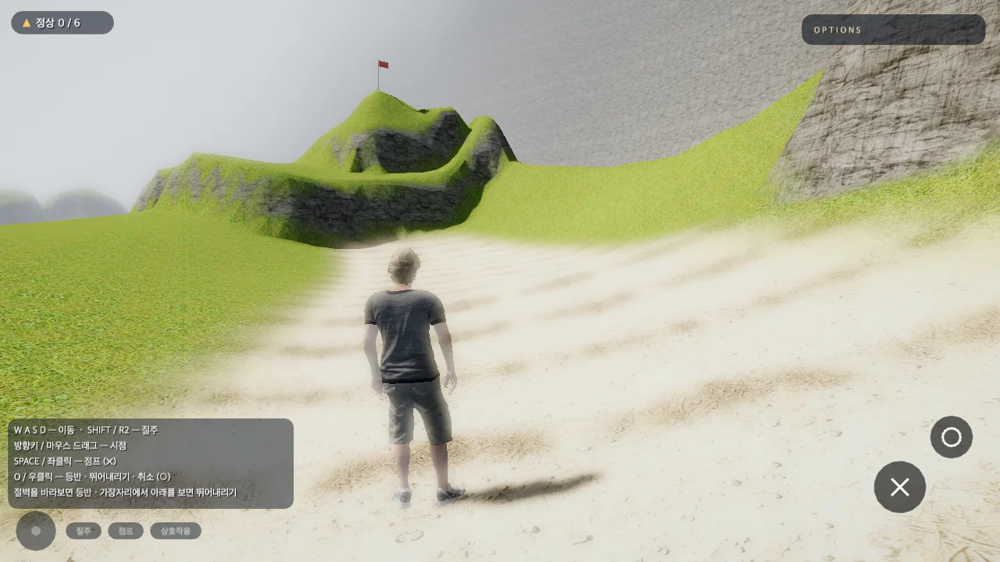
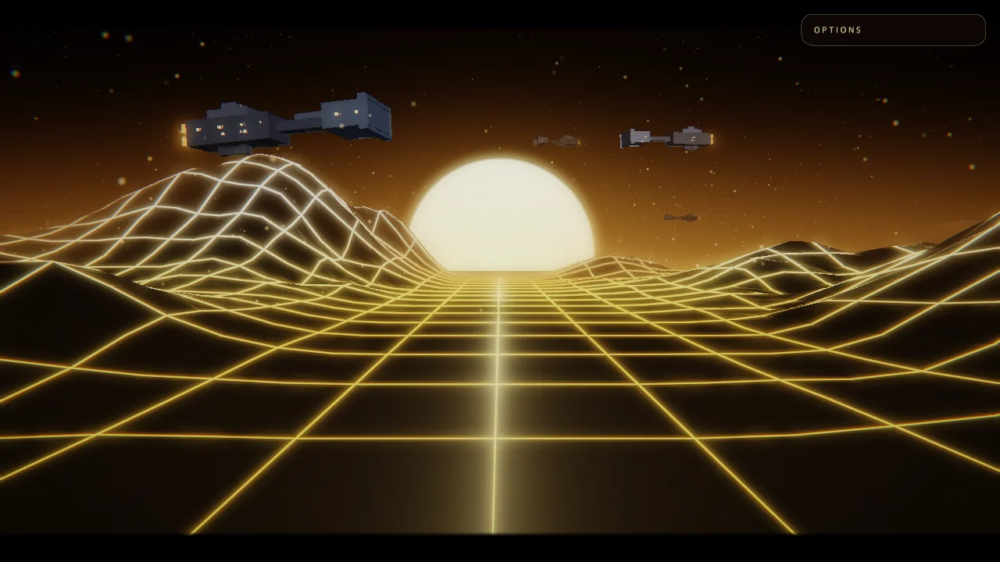
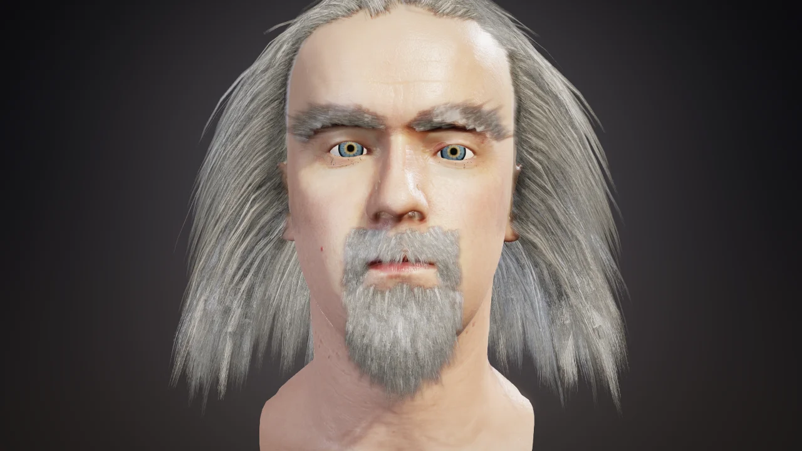
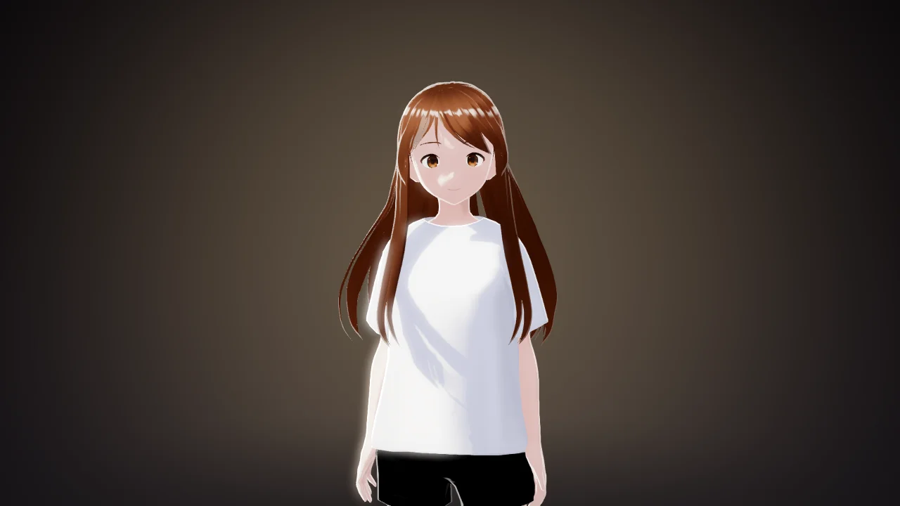
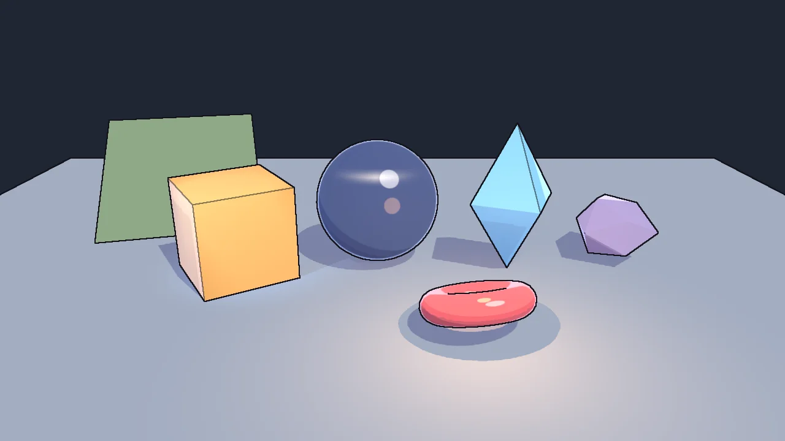
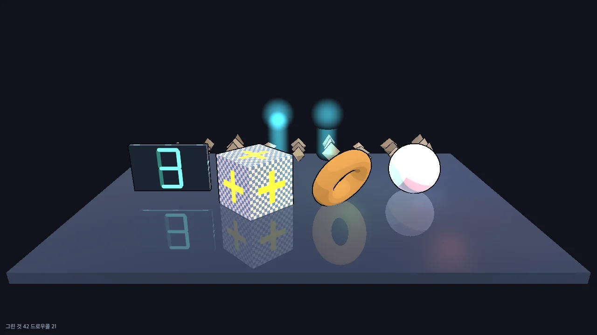

# 3D

This chapter covers how to load glTF (GLB) and FBX models, play their animations, and draw them in 3D between the engine's 2D drawing. It walks through `SkinnedModel`, which holds a model, `SkinnedModelRenderer`, which draws it, `Camera3D`, which handles view and projection, the `Material` class, `ShadowMap` for shadows, `RenderTarget` for off-screen drawing, `BloomEffect` and `FullscreenPass` for post-processing, and ends with a short introduction to toon 3D.



The 3D source lives under `src/graphics3d`. ("3D" in the README, and the screen-wide pass `FullscreenPass` is in `src/core`)

## How 3D is organized

The 3D side is not a scene graph of nodes and components. The loader creates a `SkinnedModel` instance with its meshes, bones, skins, materials, and animations all connected, and the game holds the model matrix and camera matrices itself and passes them to the renderer. The model holds only data and pose; drawing and environment state (sun, fog, shadows) belong to the renderer.

| Class | What it does |
| --- | --- |
| `SkinnedModel` | A model instance read from GLB (binary glTF) or binary FBX. Pose computation, animation crossfades, morph weights |
| `SkinnedModelRenderer` | Draws models with a skinning PBR shader. Holds sun direction, fog, and shadow receiving state (one per scene) |
| `Camera3D` | Perspective or orthographic projection and the view position. View and projection matrices, conversion between world points and screen positions |
| `Material` | Metallic-roughness PBR values and textures |
| `ShadowMap` | A depth texture and light matrix for directional light shadows |
| `RenderTarget` | An off-screen framebuffer (color, depth, multisample, float color) |
| `FullscreenPass` | One triangle covering the whole screen plus a fragment shader |
| `BloomEffect`, `MultiLevelBloomEffect` | Bloom that extracts and blurs bright areas |

## Fitting 3D into the engine's screen

The engine's `Graphic` (2D) and the 3D classes share the same `WebGL2RenderingContext`. Get the context with `graphic.getWebGL2RenderingContext()`. To draw 3D between 2D drawing, wrap it in `graphic.runExternalPass(callback, options)`.

- It first draws the pending 2D batch, clears the depth buffer (not when `options.clearDepth` is `false`), forgets its cached state, and then calls `callback(webGL2RenderingContext)`.
- Inside `callback` you may freely change the program, vertex array, viewport, blending, depth, and face culling. When it finishes (even if it throws), `restoreRenderState` restores the viewport, 2D program, and vertex array, turns blending on, and turns depth testing and face culling off.
- The framebuffer binding and stencil state are not restored. If you drew to a render target, bind the default framebuffer (`null`) again at the end of `callback`, and do not change the stencil.

The example below loads `fox.glb`, plays the walk animation, draws 3D first in the scene's `draw`, and then draws the 2D nodes (a text label) on top with `super.draw`.

```javascript
import { Engine, EngineConfiguration, Scene, WorldNode, Text, SkinnedModel, SkinnedModelRenderer, Camera3D, Matrix4, Vector2, Vector3, Colors } from "./build/vanilla.js";

class FoxScene extends Scene {
	#skinnedModelRenderer;
	#foxModel;
	#camera;
	#modelMatrix;
	#angle;

	constructor() {
		super();
		this.#skinnedModelRenderer = null;
		this.#foxModel = null;
		this.#camera = new Camera3D();
		this.#modelMatrix = Matrix4.createIdentity();
		this.#angle = 0;
	}

	async load(engine) {
		await super.load(engine);
		const graphic = engine.getGraphic();
		const webGL2RenderingContext = graphic.getWebGL2RenderingContext();
		const skinnedModelRenderer = new SkinnedModelRenderer(webGL2RenderingContext);
		skinnedModelRenderer.setSunDirection(0.45, 0.76, 0.47);
		skinnedModelRenderer.setFogRange(300, 800);
		const foxModel = await SkinnedModel.loadFromUrl(webGL2RenderingContext, "examples/ancientmountain/assets/fox.glb", skinnedModelRenderer);
		foxModel.playAnimation("Walk", 0);
		this.#skinnedModelRenderer = skinnedModelRenderer;
		this.#foxModel = foxModel;

		const camera = this.#camera;
		camera.setPerspective(Math.PI / 3, 1, 2000);
		const eyePosition = Vector3.create(0, 80, 220);
		const targetPosition = Vector3.create(0, 45, 0);
		camera.lookAt(eyePosition, targetPosition);

		const labelNode = new WorldNode();
		labelNode.setContentSize(Vector2.create(400, 60));
		labelNode.setLocalPosition(Vector2.create(640, 80));
		const text = labelNode.addComponent(Text);
		text.setFontSize(40);
		text.setTextColor(Colors.white);
		text.setText("fox.glb");
		const root = this.getRoot();
		root.addChild(labelNode);
	}

	tick(timeDelta) {
		super.tick(timeDelta);
		this.#angle += timeDelta * 0.5;
		this.#modelMatrix = Matrix4.createRotationY(this.#angle);
		const foxModel = this.#foxModel;
		foxModel.update(timeDelta);
	}

	draw(graphic) {
		const canvas = graphic.getCanvas();
		const width = canvas.width;
		const height = canvas.height;
		const camera = this.#camera;
		const skinnedModelRenderer = this.#skinnedModelRenderer;
		const foxModel = this.#foxModel;
		const modelMatrix = this.#modelMatrix;
		graphic.runExternalPass((webGL2RenderingContext) => {
			webGL2RenderingContext.viewport(0, 0, width, height);
			webGL2RenderingContext.enable(webGL2RenderingContext.DEPTH_TEST);
			webGL2RenderingContext.enable(webGL2RenderingContext.CULL_FACE);
			webGL2RenderingContext.disable(webGL2RenderingContext.BLEND);
			camera.setAspectRatio(width / height);
			const viewProjectionMatrix = camera.getViewProjectionMatrix();
			const viewProjectionElements = viewProjectionMatrix.getElements();
			const modelMatrixElements = modelMatrix.getElements();
			const eyePosition = camera.getEyePosition();
			skinnedModelRenderer.draw(foxModel, viewProjectionElements, modelMatrixElements, eyePosition.x, eyePosition.y, eyePosition.z);
		});
		super.draw(graphic);
	}
}

const engineConfiguration = new EngineConfiguration();
engineConfiguration.referenceResolutionSize = Vector2.create(1280, 720);
engineConfiguration.autoResizeOnWindowResize = true;
const engine = new Engine(engineConfiguration);
engine.run(new FoxScene());
```

- Create one `SkinnedModelRenderer(webGL2RenderingContext)` per scene. Models build their materials with this renderer's shader when loaded, so create it before the models.
- `SkinnedModel.loadFromUrl(webGL2RenderingContext, url, skinnedModelRenderer)` fetches a GLB file and returns the model. It throws when the response fails and when the file is not a GLB (wrong header). Read bytes you already have with `loadFromBytes(webGL2RenderingContext, arrayBuffer, skinnedModelRenderer)` (such as `arrayBuffer()` of a `Blob` loaded with `BlobAsset`).
- `update(deltaTime)` advances time, samples the pose, and computes the joint matrices. Even a static model without animation needs one call before drawing to compute the matrices of its default pose.
- The matrices for `draw(skinnedModel, viewProjectionElements, modelMatrixElements, cameraX, cameraY, cameraZ)` are column-major `Float32Array`s of 16 values; `Matrix4.getElements()` returns this form. The camera position is used for specular lighting and fog distance.
- The renderer does not touch depth testing, face culling, or blending. The caller sets them before drawing.
- The renderer starts with sun direction (0, 1, 0), fog color (0.8, 0.85, 0.92), fog distance 55 to 250, and shadow strength 0. Change them with `setSunDirection(x, y, z)`, `setFogColor(red, green, blue)`, and `setFogRange(startDistance, endDistance)`. Fog distances are in world units, so raise them for large models as in the example (the fox is about 79 units tall).
- Build model matrices with functions such as `Matrix4.createTranslation`, `createRotationY`, and `createScale`. `multiply`, `translate`, `rotateY`, and `scale` accumulate by multiplying on the right (`this = this x other`).

You can also draw 3D on your own canvas with your own `requestAnimationFrame` loop instead of the engine loop. The Ancient Mountain example ([`examples/ancientmountain`](https://github.com/ddukbaek2/vanilla.js/blob/release/examples/ancientmountain)) does this, building its own shadow depth pass, scene pass, and bloom.

## Camera3D

`Camera3D` holds a perspective or orthographic projection and a view position, and recomputes its matrices only on the first read after a value changes. Coordinates are right-handed with y up, and the camera looks toward -Z. It starts as a perspective camera with a vertical field of view of 0.8 radians, aspect ratio 1, distances 0.1 to 1000, and the eye at (0, 0, 10) looking at the origin.

```javascript
import { Camera3D, Rect, Vector2, Vector3 } from "./build/vanilla.js";

const camera = new Camera3D();
camera.setPerspective(Math.PI / 3, 0.1, 500);
camera.setAspectRatio(1280 / 720);
const eyePosition = Vector3.create(0, 10, 20);
const targetPosition = Vector3.create(0, 0, 0);
camera.lookAt(eyePosition, targetPosition);

const viewRect = Rect.create(0, 0, 1280, 720);
const screenPoint = camera.projectToView(0, 2, 0, viewRect);
console.log(screenPoint.x, screenPoint.y, screenPoint.depth, screenPoint.isInFront);

const tapPosition = Vector2.create(640, 500);
const groundPoint = camera.unprojectToPlane(tapPosition, 0, viewRect);
if (groundPoint !== null) {
	console.log(groundPoint.x, groundPoint.y, groundPoint.z);
}

camera.setOrthographic(30, 0.1, 500);
console.log(camera.isOrthographic(), camera.readViewDepth(0, 0, 0));
```

- `setPerspective(fieldOfViewRadian, nearDistance, farDistance)`, `setOrthographic(orthographicHeight, nearDistance, farDistance)` (width is height x aspect ratio), `setAspectRatio(aspectRatio)` (set it whenever the drawing rectangle changes), and `lookAt(eyePosition, targetPosition, upDirection = Vector3.up())`.
- `getViewMatrix()`, `getProjectionMatrix()`, `getViewProjectionMatrix()`, and `getInverseViewProjectionMatrix()` return the stored matrices. Do not modify them; `clone()` anything you want to change.
- `projectToView(x, y, z, viewRect, result)` maps a world point to a position inside `viewRect` (origin at the top left, growing downward) and returns `{ x, y, depth, isInFront }`. If the point is behind the eye plane, `isInFront` is false and x, y are 0. Use it to place labels or buttons over 3D points. Pass `result` to fill it instead of creating a new object every frame.
- `unprojectToPlane(viewPosition, planeHeight, viewRect)` returns the world point (`Vector3`) where the ray from a screen position meets the horizontal plane `y = planeHeight`, or `null` when they do not meet. Use it to find where the ground was tapped.
- `readViewDepth(x, y, z)` is the depth measured along the camera's view direction (negative behind the eye plane). Use it to sort transparent things from far to near.
- `setMatrices(viewMatrix, projectionMatrix)` lets you use matrices computed by the game as they are. Calling `setPerspective`, `setOrthographic`, or `lookAt` drops them and goes back to computed matrices.

## Animation

See the names of the clips in a model file with `getAnimationNameList()`. `fox.glb` has `Survey`, `Walk`, and `Run`.

```javascript
import { SkinnedModel, SkinnedModelRenderer, Quaternion } from "./build/vanilla.js";

const canvas = document.createElement("canvas");
const webGL2RenderingContext = canvas.getContext("webgl2");
const skinnedModelRenderer = new SkinnedModelRenderer(webGL2RenderingContext);
const foxModel = await SkinnedModel.loadFromUrl(webGL2RenderingContext, "examples/ancientmountain/assets/fox.glb", skinnedModelRenderer);
console.log(foxModel.getAnimationNameList());

foxModel.playAnimation("Survey", 0);
foxModel.update(0.5);
foxModel.playAnimation("Run", 0.3);
foxModel.setTimeScale(1.5);
foxModel.update(0.1);

const headTilt = Quaternion.createFromEuler(0, 0, 0.3);
foxModel.setJointRotationOffset("Head", headTilt);
foxModel.update(0.016);
foxModel.clearJointRotationOffsets();

foxModel.destroy();
```

- `playAnimation(animationName, fadeDuration = 0.25)` blends from the current clip to the new clip over `fadeDuration` seconds; 0 switches immediately. It does nothing when the name matches the clip already playing or does not exist.
- Clips always loop. There is no play-once option or end notification, so when you need one, the game measures time against the clip length and moves to the next clip.
- `setTimeScale(timeScale)` sets the playback speed. (Initially 1)
- `setJointRotationOffset(jointNamePart, offsetRotation)` multiplies a `Quaternion` onto the local rotation of every node whose name contains `jointNamePart`. It applies after the animation is sampled, so use it for procedural poses such as turning the head. `clearJointRotationOffsets()` removes them all. (The fox's head bone is named `b_Head_05`)
- Handle morph targets (glTF `weights` and their animation) with `setMorphWeight(targetName, weight)` and `getMorphWeight(targetName)`. You can also add targets from code with `addMorphTarget(drawableIndex, targetName, positionDeltas, normalDeltas)`. Each drawable can have up to 96 targets.
- The joint matrix array in the default skinning shader has 96 entries.
- `destroy()` deletes the model's GL resources (vertex arrays, buffers, morph textures, and the textures of materials this model built while loading).

## Adding FBX models and animations

Read binary FBX with `SkinnedModel.loadFromFbxUrl(webGL2RenderingContext, url, skinnedModelRenderer)`. (Use `loadFromFbxBytes` for bytes already loaded) For FBX files with each animation clip exported separately, `addAnimationsFromFbxUrl(url, clipName, ignoreTranslation = false)` adds clips to a model with the same skeleton. It reconnects channels to the current model's nodes by matching bone names, and when `ignoreTranslation` is true it drops translation channels. (For clips with root motion baked in while the game controls position)

```javascript
import { SkinnedModel, SkinnedModelRenderer } from "./build/vanilla.js";

const canvas = document.createElement("canvas");
const webGL2RenderingContext = canvas.getContext("webgl2");
const skinnedModelRenderer = new SkinnedModelRenderer(webGL2RenderingContext);
const characterModel = await SkinnedModel.loadFromFbxUrl(webGL2RenderingContext, "examples/ancientmountain/assets/mannequin.fbx", skinnedModelRenderer);
await characterModel.addAnimationsFromFbxUrl("examples/ancientmountain/assets/anims/idle.fbx", "Idle");
await characterModel.addAnimationsFromFbxUrl("examples/ancientmountain/assets/anims/walk.fbx", "Walk");
await characterModel.addAnimationsFromFbxUrl("examples/ancientmountain/assets/anims/climb.fbx", "Climb", true);
characterModel.playAnimation("Idle", 0);
characterModel.update(0);
console.log(characterModel.getAnimationNameList());
```

The example mannequin (Quaternius, CC0) is in meters, so it is used at its own size. A model exported in centimeters is shrunk by multiplying its model matrix by 0.01.

## Material

When a model is loaded, `Material` instances are built automatically from the file's materials. To change to a different texture or color, build a material and put it on a drawable with `setMaterial(drawableIndex, material)`.

```javascript
import { SkinnedModel, SkinnedModelRenderer, Material } from "./build/vanilla.js";

const canvas = document.createElement("canvas");
const webGL2RenderingContext = canvas.getContext("webgl2");
const skinnedModelRenderer = new SkinnedModelRenderer(webGL2RenderingContext);
const foxModel = await SkinnedModel.loadFromUrl(webGL2RenderingContext, "examples/ancientmountain/assets/fox.glb", skinnedModelRenderer);

const description = Material.createDefaultDescription();
description.baseColorFactor = [1, 0.85, 0.7];
description.metallicFactor = 0;
description.roughnessFactor = 0.6;
description.baseColorImage = await Material.loadImageDescription("examples/assets/spritesheet.png", { flipY: false, anisotropy: 4 });
const shaderProgram = skinnedModelRenderer.getShaderProgram();
const material = await Material.createFromDescription(webGL2RenderingContext, shaderProgram, description);
foxModel.setMaterial(0, material);

const drawableList = foxModel.getDrawableList();
console.log(drawableList.length, material.getRoughnessFactor());

foxModel.destroy();
material.destroy();
```

- `Material.createDefaultDescription()` returns a description with white color, metallic 0, roughness 1, emissive 0, and eight empty image fields (`baseColorImage`, `normalImage`, `metallicRoughnessImage`, `glossinessImage`, `occlusionImage`, `emissiveImage`, `specularImage`, `opacityImage`). Empty image fields become 1x1 solid textures.
- Image descriptions come from `Material.loadImageDescription(url, options)` (fetching) or `Material.createImageDescription(bytes, mimeType, options)` (from bytes already loaded). `options` is `{ flipY, isColorData, anisotropy }` (defaults `false`, `false`, 0). When `isColorData` is true, the image is treated as sRGB color and uploaded as `SRGB8_ALPHA8` so it is read decoded to linear. Materials built from model files do not turn this on. `anisotropy` is the anisotropic filtering level and is ignored on devices without the extension.
- Give `Material.createFromDescription(webGL2RenderingContext, shaderProgram, description)` the shader of the renderer that will use the material (`skinnedModelRenderer.getShaderProgram()`).
- Texture unit 0 is base color, 1 is reserved for the shadow map (not used by materials), and 2 to 8 are normal, metallic-roughness, glossiness, occlusion, emissive, specular, and opacity. Bind extra textures your shader defines with `setTexture(uniformName, textureUnit, glTexture)` from unit 9 on.
- Materials with an opacity image use alpha cutout (discarding transparent parts of hair cards). If you attach one later, turn it on with `setUseAlphaCutout(true)`.
- Materials put in with `setMaterial` are not deleted by the model's `destroy()`. Call `material.destroy()` when you are done. (It deletes only the default slot textures and leaves textures added with `setTexture`)

## Shadows and post-processing

For shadows, first draw a pass that renders only depth from the light's position (the depth pass), then read that depth texture in the main pass. Post-processing such as bloom draws the main pass into a `RenderTarget` instead of the screen, processes that texture, and composites the result onto the screen. The example below draws, inside an engine scene, a depth pass, a main pass into a multisample render target, bloom, and compositing in that order.





```javascript
import { Engine, EngineConfiguration, Scene, SkinnedModel, SkinnedModelRenderer, Camera3D, ShadowMap, RenderTarget, BloomEffect, FullscreenPass, Matrix4, Vector2, Vector3 } from "./build/vanilla.js";

const COMPOSITE_FRAGMENTSHADER_SOURCE = `#version 300 es
precision highp float;
in vec2 fragmentTextureCoordinate;
uniform sampler2D sceneTexture;
uniform sampler2D bloomTexture;
uniform float bloomStrength;
out vec4 outputColor;
void main() {
	vec3 sceneColor = texture(sceneTexture, fragmentTextureCoordinate).rgb;
	vec3 bloomColor = texture(bloomTexture, fragmentTextureCoordinate).rgb;
	outputColor = vec4(sceneColor + bloomColor * bloomStrength, 1.0);
}
`;

class PostProcessScene extends Scene {
	#skinnedModelRenderer;
	#foxModel;
	#camera;
	#modelMatrix;
	#angle;
	#shadowMap;
	#sceneRenderTarget;
	#bloomEffect;
	#compositePass;

	constructor() {
		super();
		this.#skinnedModelRenderer = null;
		this.#foxModel = null;
		this.#camera = new Camera3D();
		this.#modelMatrix = Matrix4.createIdentity();
		this.#angle = 0;
		this.#shadowMap = null;
		this.#sceneRenderTarget = null;
		this.#bloomEffect = null;
		this.#compositePass = null;
	}

	async load(engine) {
		await super.load(engine);
		const graphic = engine.getGraphic();
		const webGL2RenderingContext = graphic.getWebGL2RenderingContext();
		const skinnedModelRenderer = new SkinnedModelRenderer(webGL2RenderingContext);
		skinnedModelRenderer.setSunDirection(0.45, 0.76, 0.47);
		skinnedModelRenderer.setFogRange(300, 800);
		skinnedModelRenderer.setShadowStrength(0.8);
		const foxModel = await SkinnedModel.loadFromUrl(webGL2RenderingContext, "examples/ancientmountain/assets/fox.glb", skinnedModelRenderer);
		foxModel.playAnimation("Run", 0);
		this.#skinnedModelRenderer = skinnedModelRenderer;
		this.#foxModel = foxModel;

		this.#shadowMap = new ShadowMap(webGL2RenderingContext, 1024);
		this.#sceneRenderTarget = new RenderTarget(webGL2RenderingContext, 2, 2, true, { sampleCount: 4 });
		const bloomEffect = new BloomEffect(webGL2RenderingContext);
		bloomEffect.setThreshold(0.6, 0.9);
		bloomEffect.setIterationCount(3);
		this.#bloomEffect = bloomEffect;
		this.#compositePass = new FullscreenPass(webGL2RenderingContext, COMPOSITE_FRAGMENTSHADER_SOURCE);

		const camera = this.#camera;
		camera.setPerspective(Math.PI / 3, 1, 2000);
		const eyePosition = Vector3.create(0, 80, 220);
		const targetPosition = Vector3.create(0, 45, 0);
		camera.lookAt(eyePosition, targetPosition);
	}

	tick(timeDelta) {
		super.tick(timeDelta);
		this.#angle += timeDelta * 0.5;
		this.#modelMatrix = Matrix4.createRotationY(this.#angle);
		const foxModel = this.#foxModel;
		foxModel.update(timeDelta);
	}

	draw(graphic) {
		const canvas = graphic.getCanvas();
		const width = canvas.width;
		const height = canvas.height;
		graphic.runExternalPass((webGL2RenderingContext) => {
			this.drawShadowPass(webGL2RenderingContext);
			this.drawScenePass(webGL2RenderingContext, width, height);
			this.drawCompositePass(webGL2RenderingContext, width, height);
		});
		super.draw(graphic);
	}

	drawShadowPass(webGL2RenderingContext) {
		const shadowMap = this.#shadowMap;
		const skinnedModelRenderer = this.#skinnedModelRenderer;
		const foxModel = this.#foxModel;
		const modelMatrix = this.#modelMatrix;
		const focusPosition = Vector3.create(0, 40, 0);
		const lightDirection = Vector3.create(-0.45, -0.76, -0.47);
		shadowMap.updateLightMatrix(focusPosition, lightDirection, 150, 1, 600);
		const lightViewProjectionMatrix = shadowMap.getLightViewProjectionMatrix();
		const lightViewProjectionElements = lightViewProjectionMatrix.getElements();
		const modelMatrixElements = modelMatrix.getElements();
		shadowMap.beginRender();
		webGL2RenderingContext.disable(webGL2RenderingContext.BLEND);
		skinnedModelRenderer.drawDepth(foxModel, lightViewProjectionElements, modelMatrixElements);
		const depthTexture = shadowMap.getDepthTexture();
		const resolution = shadowMap.getResolution();
		skinnedModelRenderer.setShadowMap(depthTexture, lightViewProjectionElements, 1 / resolution);
	}

	drawScenePass(webGL2RenderingContext, width, height) {
		const sceneRenderTarget = this.#sceneRenderTarget;
		const skinnedModelRenderer = this.#skinnedModelRenderer;
		const foxModel = this.#foxModel;
		const modelMatrix = this.#modelMatrix;
		const camera = this.#camera;
		sceneRenderTarget.resize(width, height);
		sceneRenderTarget.bind();
		webGL2RenderingContext.clearColor(0.16, 0.2, 0.26, 1);
		webGL2RenderingContext.clear(webGL2RenderingContext.COLOR_BUFFER_BIT | webGL2RenderingContext.DEPTH_BUFFER_BIT);
		webGL2RenderingContext.enable(webGL2RenderingContext.DEPTH_TEST);
		webGL2RenderingContext.enable(webGL2RenderingContext.CULL_FACE);
		camera.setAspectRatio(width / height);
		const viewProjectionMatrix = camera.getViewProjectionMatrix();
		const viewProjectionElements = viewProjectionMatrix.getElements();
		const modelMatrixElements = modelMatrix.getElements();
		const eyePosition = camera.getEyePosition();
		skinnedModelRenderer.draw(foxModel, viewProjectionElements, modelMatrixElements, eyePosition.x, eyePosition.y, eyePosition.z);
		sceneRenderTarget.resolve();
	}

	drawCompositePass(webGL2RenderingContext, width, height) {
		const sceneRenderTarget = this.#sceneRenderTarget;
		const bloomEffect = this.#bloomEffect;
		const compositePass = this.#compositePass;
		const sceneColorTexture = sceneRenderTarget.getColorTexture();
		bloomEffect.resize(width, height);
		bloomEffect.render(sceneColorTexture);
		const bloomTexture = bloomEffect.getResultTexture();

		webGL2RenderingContext.bindFramebuffer(webGL2RenderingContext.FRAMEBUFFER, null);
		webGL2RenderingContext.viewport(0, 0, width, height);
		compositePass.useProgram();
		const sceneTextureLocation = compositePass.getUniformLocation("sceneTexture");
		const bloomTextureLocation = compositePass.getUniformLocation("bloomTexture");
		const bloomStrengthLocation = compositePass.getUniformLocation("bloomStrength");
		webGL2RenderingContext.uniform1i(sceneTextureLocation, 0);
		webGL2RenderingContext.uniform1i(bloomTextureLocation, 1);
		webGL2RenderingContext.uniform1f(bloomStrengthLocation, 0.8);
		webGL2RenderingContext.activeTexture(webGL2RenderingContext.TEXTURE0);
		webGL2RenderingContext.bindTexture(webGL2RenderingContext.TEXTURE_2D, sceneColorTexture);
		webGL2RenderingContext.activeTexture(webGL2RenderingContext.TEXTURE1);
		webGL2RenderingContext.bindTexture(webGL2RenderingContext.TEXTURE_2D, bloomTexture);
		compositePass.draw();
		webGL2RenderingContext.activeTexture(webGL2RenderingContext.TEXTURE0);
	}
}

const engineConfiguration = new EngineConfiguration();
engineConfiguration.referenceResolutionSize = Vector2.create(1280, 720);
engineConfiguration.autoResizeOnWindowResize = true;
const engine = new Engine(engineConfiguration);
engine.run(new PostProcessScene());
```

### ShadowMap

- `new ShadowMap(webGL2RenderingContext, resolution = 2048)` builds a depth texture `resolution` pixels on a side (24-bit, compare sampling) and a depth-only framebuffer.
- `updateLightMatrix(focusPosition, lightDirection, extent, nearDistance, farDistance)` computes an orthographic light matrix covering `extent` (half width from the center) around `focusPosition`. `lightDirection` is the direction the light travels, so its sign is the opposite of the renderer's `setSunDirection` (the side the sun is on). The light's eye sits `(nearDistance + farDistance) / 2` away from the focus, opposite to the light, and is snapped to texels so shadow edges do not shimmer when moving.
- `beginRender()` binds that framebuffer, sets the viewport, turns on depth testing, and clears depth. Then call `skinnedModelRenderer.drawDepth(model, lightViewProjectionElements, modelMatrixElements)` for each model that casts shadows.
- Before the main pass, set `skinnedModelRenderer.setShadowMap(depthTexture, lightViewProjectionElements, texelSize)` and `setShadowStrength(strength)` (0 means no shadows are received).
- `destroy()` deletes the framebuffer and depth texture.

This example has no floor, so only the shadow the fox casts on itself is visible. For another mesh such as a floor to receive shadows, that mesh's shader must read the same depth texture and light matrix.

### RenderTarget

- In `new RenderTarget(webGL2RenderingContext, width, height, useDepth, options)`, `options` is `{ colorAttachmentCount = 1, useFloatColor = false, useDepthTexture = false, sampleCount = 0, depthBits = 16 }` (all defaults when `null`).
- `bind()` binds the framebuffer and sets the viewport to its size. `resize(width, height)` does nothing when the size is unchanged and rebuilds the resources otherwise.
- With `sampleCount` of 2 or more, it draws into multisample renderbuffers and `resolve()` resolves them into the color texture (and depth texture). Call `resolve()` before reading the textures. If the device accepts fewer samples, it lowers the count to the largest supported value below it, and if it cannot, it builds without multisampling (`getSampleCount()`). Without multisampling, `resolve()` does nothing.
- `useFloatColor` gives RGBA16F color (HDR), and a `colorAttachmentCount` of 2 or more gives multiple color attachments (MRT). Get textures with `getColorTexture(attachmentIndex)` and `getDepthTexture()`.

### BloomEffect and FullscreenPass

- `BloomEffect` extracts bright areas at half resolution and repeats horizontal and vertical Gaussian blurs. Use `resize(sceneWidth, sceneHeight)`, `render(sceneColorTexture)`, and `getResultTexture()` in that order, and add the result texture in a composite pass.
- `setThreshold(thresholdStart, thresholdEnd)` (initially 0.5 and 0.95) sets the brightness, taken as the largest of the three channels, where extraction starts and where it is full. `setIterationCount(iterationCount)` (initially 2) is how many times a blur pair repeats. Its buffers start as RGBA8, so values above 1 are clipped; `setUseFloatColor(true)` rebuilds them as RGBA16F to blur HDR values as they are.
- `render` turns off depth testing and blending, leaves texture unit 0 active, and changes the framebuffer binding. To draw to the screen afterward, bind the default framebuffer again and set the viewport.
- `MultiLevelBloomEffect(webGL2RenderingContext, levelCount = 5, useFloatColor = true)` is a multi-level bloom that blurs while halving and adds back while doubling. It uses `setThreshold(threshold, knee)` (initially 1 and 0.25), and is used in the same order as `BloomEffect`.
- `FullscreenPass(webGL2RenderingContext, fragmentShaderSource)` draws one triangle covering the whole screen. The fragment shader is GLSL ES 3.00 and receives `in vec2 fragmentTextureCoordinate` (0 to 1) and `in vec2 fragmentCoordinate` (-1 to 1). Call `useProgram()`, `getUniformLocation(uniformName)`, set uniforms, then `draw()`, and delete it with `destroy()`.

## Other 3D classes

- `HumanSkinRenderer`: a renderer that builds skin, eye, and hair shading on top of the skinning path of `SkinnedModelRenderer`. It draws into several buffers (MRT), and the caller does the compositing.
- `SubsurfaceScatteringEffect`: screen-space subsurface scattering. It blurs the irradiance texture while watching depth to soften skin.
- `AmbientOcclusionEffect`: screen-space ambient occlusion. It computes how occluded each point is from depth and normal buffers.
- Pass fragment shader (and vertex shader) source to the `SkinnedModelRenderer` constructor to build different shading on the same skinning and morph path. A replacement vertex shader must keep the same attributes and output conventions as the default, and uses the `MORPH_GLSL` snippet for morph targets.
- `drawWireframe(skinnedModel, viewProjectionElements, modelMatrixElements, red, green, blue, alpha)` draws edge lines. The caller sets the blending and depth state.

The first three are used by the Old Face example ([`examples/oldface`](https://github.com/ddukbaek2/vanilla.js/blob/release/examples/oldface)).

## Toon 3D

Toon 3D is a separate 3D set drawn with cel shading (`src/graphics3d/toon`). This chapter only lists what exists.







- `ToonRenderer`: the cel-shading renderer, with shell outlines, instancing, and shadows.
- `MeshBuilder` and shape functions such as `createBoxGeometry`, GLB reading functions such as `readGlbArrays`: functions that build mesh arrays and functions that read meshes from GLB. (exported by name, same as the Rust version)
- `ToonLightSet`, `ToonMaterial`: light sets (including point lights) and material shader snippets.
- `ToonDrawQueue`: a queue that holds the models and stage callbacks for one frame and draws them in order of opaque bodies, outlines, then transparent things.
- `ToonScreenOutline`, `ToonVfx`, `ToonPostProcess`: screen-space outlines, 3D effects, and post-processing (MSAA, multi-level bloom, color grading).
- `ToonView3D`: a component that draws toon 3D inside a node's rectangle. It uses `runExternalPass` internally.

See how it is used in the source of [`examples/toonmaterial`](https://github.com/ddukbaek2/vanilla.js/blob/release/examples/toonmaterial).

## Things to watch for

- `runExternalPass` does not restore the framebuffer binding. If you drew to a render target, bind the default framebuffer at the end.
- The renderer does not set depth testing, face culling, or blending. Turn them on and off before drawing 3D.
- Models move only when `update` is called every frame, and even static models need one call before drawing.
- Clips always loop. For play-once behavior, the game measures time and switches clips.
- The light direction of `ShadowMap.updateLightMatrix` has the opposite sign of the renderer's sun direction.
- Call `destroy()` on materials put in with `setMaterial` and on any `ShadowMap`, `RenderTarget`, `BloomEffect`, or `FullscreenPass` you built when you are done with them.
- The engine's draw statistics (such as `getLastFrameDrawCallCount`) do not include 3D passes.

## Related classes

SkinnedModel, SkinnedModelRenderer, Camera3D, Material, ShadowMap, RenderTarget, FullscreenPass, BloomEffect, MultiLevelBloomEffect, HumanSkinRenderer, SubsurfaceScatteringEffect, AmbientOcclusionEffect, Matrix4, Vector3, Quaternion, Graphic, ToonRenderer, ToonView3D
