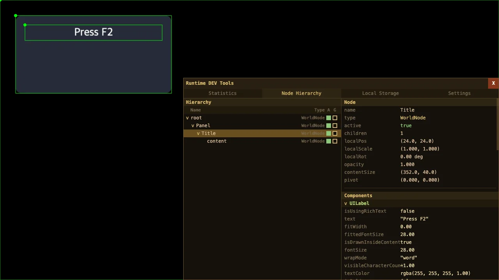

# Developer Tools

This chapter covers features for showing information on screen, inspecting nodes, and measuring device performance during development. It walks through the developer tools panel opened with F2, the engine statistics overlay (`useStatistics`), gizmos, draw statistics, frame capture for verification, `FrameProbe` and `GraphicsQualityGovernor` for spotting slow devices, and `BuildInfo` for reading the deployed version.

## The F2 developer tools panel

When `EngineConfiguration.useDevTools` is on (the default is `true`), `UIScene` creates the developer tools panel during initialization. Press F2 in the game and the panel opens docked to the bottom right of the canvas; press it again to close it. The base `Scene` does not create the panel, so derive from `UIScene` to use it.



```javascript
import { Engine, EngineConfiguration, UIScene, WorldNode, Paint, UILabel, Pivot, Vector2, Color } from "./build/vanilla.js";

class DebugScene extends UIScene {
	constructor() {
		super();
		this.setLoadingMinDurationMs(0);
	}

	initialize(engine) {
		super.initialize(engine);
		const panelNode = new WorldNode();
		panelNode.setName("Panel");
		panelNode.setPivot(Pivot.topLeft);
		panelNode.setAnchor(Pivot.topLeft);
		panelNode.setLocalPosition(Vector2.create(40, 40));
		panelNode.setContentSize(Vector2.create(400, 200));
		const paint = panelNode.addComponent(Paint);
		paint.setColor(new Color(0.15, 0.17, 0.22, 1));
		paint.setRoundSize(16);

		const titleNode = new WorldNode();
		titleNode.setName("Title");
		titleNode.setPivot(Pivot.topLeft);
		titleNode.setAnchor(Pivot.topLeft);
		titleNode.setLocalPosition(Vector2.create(24, 24));
		titleNode.setContentSize(Vector2.create(352, 40));
		const label = titleNode.addComponent(UILabel);
		label.setText("Press F2");
		label.setFontSize(28);
		panelNode.addChild(titleNode);

		const root = this.getRoot();
		root.addChild(panelNode);
	}
}

const engineConfiguration = new EngineConfiguration();
engineConfiguration.referenceResolutionSize = Vector2.create(1280, 720);
engineConfiguration.autoResizeOnWindowResize = true;
engineConfiguration.useDevTools = true;
const engine = new Engine(engineConfiguration);
engine.run(new DebugScene());
```

The panel starts at 810 x 520 (at least 300 x 200). Drag the title bar to move it, drag edges and corners to resize it, and drag the center divider to change the left and right split. The close button at the right of the title bar also closes it. While the panel is open and the pointer is over it, `UIScene` does not pass touches (`touchPress`, `touchMove`, `touchRelease`, `touchCancel`, `touchWheel`) on to UI nodes. If your scene handles touches itself, skip them while `isDevToolsCapturingInput()` is true.

The panel has four tabs. Node Hierarchy is the tab shown first.

| Tab | Shows |
| --- | --- |
| Statistics | Platform (engine version, platform, browser), Screen (window, canvas, reference resolution, view scale mode, view area, input positions), Time (time since start, engine time, FPS, frame interval), Memory (Chrome only, JS heap sizes) |
| Node Hierarchy | On the left, the node tree from the scene root (name, type, active A and gizmo G boxes); on the right, the selected node's name, type, active state, child count, position, scale, rotation, opacity, content size, pivot, and for each attached component the values readable through `get` and `is` methods |
| Local Storage | The keys and values in `LocalStorage`. + Add adds one, Clear removes all, and the × on a row removes one. Selecting a row shows Edit Key, Edit Value, Duplicate, and Remove buttons |
| Settings | Toggles for Dim Background, Show All Gizmos, Show Height Aspect Guide, Show Width Aspect Guide, and Show FPS |

- Clicking a node's A box toggles its `setActive`, and the G box toggles its `setGizmoVisible`. Clicking a component header in the inspector collapses or expands that component's values.
- Adding, editing, and removing in the Local Storage tab ask through the browser's `prompt` and `confirm` dialogs. Clear calls `LocalStorage.clear()`, so it removes every value on the same origin.
- Dim Background darkens the screen outside the panel. Show All Gizmos (on at first) draws every node's gizmos while the panel is open. The two aspect guides are drawn only when the view scale mode is a stretch mode (`stretchWidth`, `stretchHeight`, `stretchShort`, and their `Expand` variants); they draw rectangles centered on the screen based on the height (width = height x 1, 0.75, 0.5) or on the width (height = width x 1, 0.75, 0.5). The Show FPS box saves its value, but nothing in the current source reads it, so nothing changes on screen.
- Settings are saved as JSON under the `hierarchy.settings` key in `LocalStorage` and persist across restarts.

Where the panel must not be visible to users, such as release builds, turn it off with `engineConfiguration.useDevTools = false`. When off, the panel is not created and F2 is ignored.

## The engine statistics overlay

When `EngineConfiguration.useStatistics` is on (the default is `false`), the engine draws a statistics overlay at the top left after drawing every scene each frame. It works with any kind of scene and uses the engine's default font chain (`16px default`) scaled by 1.4.

```javascript
import { Engine, EngineConfiguration, Scene, WorldNode, Paint, Vector2, Color } from "./build/vanilla.js";

class StatisticsScene extends Scene {
	async load(engine) {
		await super.load(engine);
		const root = this.getRoot();
		for (let index = 0; index < 20; ++index) {
			const boxNode = new WorldNode();
			boxNode.setContentSize(Vector2.create(40, 40));
			boxNode.setLocalPosition(Vector2.create(200 + index * 45, 500));
			const paint = boxNode.addComponent(Paint);
			paint.setColor(new Color(0.3, 0.6, 0.9, 1));
			root.addChild(boxNode);
		}
	}
}

const engineConfiguration = new EngineConfiguration();
engineConfiguration.referenceResolutionSize = Vector2.create(1280, 720);
engineConfiguration.useStatistics = true;
const engine = new Engine(engineConfiguration);
engine.run(new StatisticsScene());
```

The overlay shows the engine version (`engineVersion`), platform and browser names, canvas size (`canvasNativeSize`), reference resolution, view scale mode, view area (`viewNativeRect`), view size, input positions (canvas and view coordinates), engine time, FPS, frame interval, and the previous frame's draw call, vertex, and triangle counts plus the number of nodes skipped for being off screen.

## Gizmos

Gizmos are markers you look at only during development (areas, pivots, sight ranges, and so on). Scenes, nodes, and components each have `setGizmoVisible(isVisible)`, `isGizmoVisible()`, and an overridable `drawGizmos(graphic)`. All are off at first.

- Scene: with `setGizmoVisible(true)`, the engine calls the scene's `drawGizmos(graphic)` after its `preDraw`, `draw`, and `postDraw`. The default `drawGizmos` of `Scene` draws nothing, so override it.
- Node: with `setGizmoVisible(true)`, `drawGizmos` is called in the node's coordinate space after the node is drawn (including its children). `WorldNode` draws the content area outline and a dot at the pivot (radius 4) in green, then calls `drawGizmos` on components whose gizmos are on.
- Component: called only from inside the node's `drawGizmos`. To see a component's gizmo, turn on both the component and the node.
- `graphic.setForceGizmosVisible(true)` makes every node call `drawGizmos` regardless of its own setting. The panel's Show All Gizmos uses this.

```javascript
import { Engine, EngineConfiguration, Scene, WorldNode, Paint, Component, Vector2, Color } from "./build/vanilla.js";

class SightGizmo extends Component {
	#radius;

	constructor() {
		super();
		this.#radius = 120;
	}

	drawGizmos(graphic) {
		super.drawGizmos(graphic);
		const node = this.getNode();
		const contentSize = node.getContentSize();
		const center = Vector2.create(contentSize.x * 0.5, contentSize.y * 0.5);
		graphic.setStrokeColor("#ffcc00");
		graphic.drawStrokeCircle(center, this.#radius, 2);
	}
}

class GizmoScene extends Scene {
	async load(engine) {
		await super.load(engine);
		const enemyNode = new WorldNode();
		enemyNode.setContentSize(Vector2.create(80, 80));
		enemyNode.setLocalPosition(Vector2.create(640, 360));
		const paint = enemyNode.addComponent(Paint);
		paint.setColor(new Color(0.8, 0.3, 0.3, 1));
		const sightGizmo = enemyNode.addComponent(SightGizmo);
		sightGizmo.setGizmoVisible(true);
		enemyNode.setGizmoVisible(true);
		const root = this.getRoot();
		root.addChild(enemyNode);
		this.setGizmoVisible(true);
	}

	drawGizmos(graphic) {
		super.drawGizmos(graphic);
		const engine = this.getEngine();
		const viewManager = engine.getViewManager();
		viewManager.applyViewRect(graphic);
		const viewSize = viewManager.getViewSize();
		graphic.setStrokeColor("#00ffff");
		graphic.drawLine([Vector2.create(viewSize.x * 0.5, 0), Vector2.create(viewSize.x * 0.5, viewSize.y)], 1);
		graphic.drawLine([Vector2.create(0, viewSize.y * 0.5), Vector2.create(viewSize.x, viewSize.y * 0.5)], 1);
	}
}

const engineConfiguration = new EngineConfiguration();
engineConfiguration.referenceResolutionSize = Vector2.create(1280, 720);
const engine = new Engine(engineConfiguration);
engine.run(new GizmoScene());
```

When a scene's `drawGizmos` is called, the coordinate space is whatever the earlier drawing left behind. To draw in view coordinates, call `viewManager.applyViewRect(graphic)` first, as in the example. Node and component `drawGizmos` calls happen in the node's coordinate space (the top left of the content area is 0, 0).

## Reading draw statistics

The values shown in the overlay can also be read from code. Before drawing the scenes, the engine stores the previous frame's values and starts counting the current frame from zero.

- `graphic.getLastFrameDrawCallCount()`, `getLastFrameVertexCount()`, `getLastFrameTriangleCount()`: draw calls, vertices, and triangles in the previous frame. Only the 2D path is counted; 3D renderers and screen effect passes are not.
- `graphic.getLastFrameCulledNodeCount()`: nodes whose components were skipped in the previous frame for being off screen.
- `timeManager.getFramePerSecond()`: frames counted over the last second (0 during the first second).

```javascript
import { Engine, EngineConfiguration, Scene, WorldNode, Paint, Vector2, Color } from "./build/vanilla.js";

class ProfileScene extends Scene {
	#elapsedSeconds;

	constructor() {
		super();
		this.#elapsedSeconds = 0;
	}

	async load(engine) {
		await super.load(engine);
		const root = this.getRoot();
		for (let index = 0; index < 100; ++index) {
			const boxNode = new WorldNode();
			boxNode.setContentSize(Vector2.create(20, 20));
			boxNode.setLocalPosition(Vector2.create((index % 10) * 120 + 60, Math.floor(index / 10) * 70 + 40));
			const paint = boxNode.addComponent(Paint);
			paint.setColor(new Color(0.9, 0.6, 0.2, 1));
			root.addChild(boxNode);
		}
	}

	tick(timeDelta) {
		super.tick(timeDelta);
		this.#elapsedSeconds += timeDelta;
		if (this.#elapsedSeconds < 0.5) {
			return;
		}
		this.#elapsedSeconds = 0;
		const engine = this.getEngine();
		const graphic = engine.getGraphic();
		const timeManager = engine.getTimeManager();
		const drawCallCount = graphic.getLastFrameDrawCallCount();
		const triangleCount = graphic.getLastFrameTriangleCount();
		const culledNodeCount = graphic.getLastFrameCulledNodeCount();
		const framePerSecond = timeManager.getFramePerSecond();
		console.log(framePerSecond, drawCallCount, triangleCount, culledNodeCount);
	}
}

const engineConfiguration = new EngineConfiguration();
engineConfiguration.referenceResolutionSize = Vector2.create(1280, 720);
const engine = new Engine(engineConfiguration);
engine.run(new ProfileScene());
```

## Frame capture for verification

`engine.requestFrameCapture(frameNumber)` returns a Promise that receives the canvas as a PNG data URL once that frame has been drawn. If the number has already passed, the current frame is captured. The frame number becomes 1 when `run` is called and goes up by 1 each time a frame finishes (`getFrameNumber()`).

```javascript
import { Engine, EngineConfiguration, Scene, WorldNode, Paint, Vector2, Color } from "./build/vanilla.js";

class CaptureScene extends Scene {
	async load(engine) {
		await super.load(engine);
		const boxNode = new WorldNode();
		boxNode.setContentSize(Vector2.create(200, 200));
		boxNode.setLocalPosition(Vector2.create(640, 360));
		const paint = boxNode.addComponent(Paint);
		paint.setColor(new Color(0.4, 0.8, 0.5, 1));
		const root = this.getRoot();
		root.addChild(boxNode);
	}
}

const engineConfiguration = new EngineConfiguration();
engineConfiguration.referenceResolutionSize = Vector2.create(1280, 720);
const engine = new Engine(engineConfiguration);
engine.run(new CaptureScene());

const capturePromise = engine.requestFrameCapture(30);
capturePromise.then((dataUrl) => {
	console.log(engine.getFrameNumber(), dataUrl.length);
});
```

You can also request captures through the page address without changing code. The engine reads the query when it is created.

```text
index.html?capture=120,240&captureName=shot_{frame}.png&captureExit=1
```

- `capture`: frame numbers to capture (comma separated). If none is valid, 120 is used.
- `captureName`: the file name to download. `{frame}` is replaced with the frame number. The default is `capture_{frame}.png`.
- `captureExit=1`: calls `exitApplication()` after the last capture. (In a Capacitor app it exits the app; on the web it tries to close the window)

Each capture logs the file name and canvas size to the console. Use it for verification that compares screens in a headless browser.

Capture mode is deterministic. Time advances by 1/60 second per frame instead of real time, and both the wait that keeps the loading screen up for 0.3 more seconds after a scene loads and the minimum display time of `GameScene` and `UIScene` are counted on this engine clock. While loading takes real time, such as downloading assets, the frame number and the clock stand still, and counting starts once everything has arrived. So capturing the same example twice gives byte-identical images for the same frame number. (Both engines behave the same; only the loading screen frames during the download follow the download speed)

## Spotting slow devices

`FrameProbe` measures frame intervals during the first few seconds after start to decide whether the device is slow. It is a calculator that does not import the engine or the browser, so the caller passes in the frame interval and the maximum FPS.

- After a warm-up (2 seconds at first) from the start of measuring, it watches each frame's interval for the probe duration (4 seconds at first). The first seconds stutter while models and images load. Change both with `setSeconds(warmupSeconds, probeSeconds)`.
- The target interval is one step of the maximum FPS (when the maximum FPS is 0, the value of `setUnlimitedTargetFramePerSecond`, initially 60). Frames longer than 1.4 times the target interval count as slow, and the device is slow when slow frames make up a share of 0.25 or more. Change both with `setSlowFrameThreshold(slowFrameRatio, slowFrameShare)`. (Why 1.4 times: on a 90 Hz screen with a maximum of 60, the engine draws every other refresh at a steady interval of about 22 ms, which is not the device being slow)
- Call `measureFrame(frameSeconds, maximumFramePerSecond)` every frame; it returns `true` on the frame where measuring finishes. Then read `isFinished()` and `isSlow()`. `readSlowFrameShare()` is the share of slow frames so far.
- Once a device is judged slow, it is not measured again. If the window is hidden before measuring finishes, call `restart()` to start over. If it was not slow, you can measure once more in a heavy scene with `measureAgain()`.

## Choosing graphics quality

`GraphicsQualityGovernor` uses settings and a `FrameProbe` to decide whether to take the light path (`isLite()`), and applies a render pixel ratio limit per path. What to cut on the light path (shadows, outlines, effects, draw counts) is up to the game, which reads `isLite()`.

- The order that decides the light path: override (`setLiteOverride`, `applySearchText`), then the quality setting (`setQuality`; `GraphicsQuality.low` is always light, `high` never), then automatic (`auto`, the default). In automatic mode it is light when `setAutoLiteDefault(true)` was set (to go light before measuring, as on touch devices) or when the `FrameProbe` judged the device slow.
- `applySearchText(searchText, liteKey = "light")` overrides to the light path when the address query contains `light`, or always to the normal path when its value is `"0"` or `"false"`.
- Call `update(frameSeconds, maximumFramePerSecond)` every frame; it measures frames only in automatic mode and returns `true` on the frame where the light path changed.
- Give a render pixel ratio limit per path with `setRenderPixelRatioLimits(normal, lite)` (0 means no limit), and `applyRenderPixelRatio(viewManager)` applies it through `ViewManager.setMaxRenderPixelRatio`. It does nothing when the value is unchanged.
- Use `getFrameProbe()` to get the inner `FrameProbe` and change its warm-up or thresholds.

```javascript
import { Engine, EngineConfiguration, Scene, GraphicsQualityGovernor, GraphicsQuality, Vector2 } from "./build/vanilla.js";

class QualityScene extends Scene {
	#governor;

	constructor() {
		super();
		const governor = new GraphicsQualityGovernor();
		governor.setQuality(GraphicsQuality.auto);
		governor.applySearchText(window.location.search);
		governor.setRenderPixelRatioLimits(0, 1.5);
		const frameProbe = governor.getFrameProbe();
		frameProbe.setSeconds(2, 4);
		this.#governor = governor;
	}

	initialize(engine) {
		super.initialize(engine);
		const viewManager = engine.getViewManager();
		this.#governor.applyRenderPixelRatio(viewManager);
	}

	tick(timeDelta) {
		super.tick(timeDelta);
		const engine = this.getEngine();
		const timeManager = engine.getTimeManager();
		const frameSeconds = timeManager.getUnscaleDeltaTime();
		const maximumFramePerSecond = engine.getMaximumFramePerSecond();
		const governor = this.#governor;
		const isChanged = governor.update(frameSeconds, maximumFramePerSecond);
		if (isChanged) {
			const viewManager = engine.getViewManager();
			governor.applyRenderPixelRatio(viewManager);
			console.log("lite", governor.isLite());
		}
	}
}

const engineConfiguration = new EngineConfiguration();
engineConfiguration.referenceResolutionSize = Vector2.create(1280, 720);
engineConfiguration.maximumFramePerSecond = 60;
const engine = new Engine(engineConfiguration);
engine.run(new QualityScene());
```

## Build information

`BuildInfo` reads the version written by the deploy build once when the app starts, so you can show it somewhere such as a corner of the settings screen. `load()` reads in this order and never throws on failure.

1. The `content` of `<meta name="build-version" content="...">` in the page head. If present, that text is used as is. Change the name with `setMetaName`.
2. Otherwise, it fetches the file given to the constructor (initially `./version.json`; change it with `setVersionJsonPath`; an empty string skips the fetch) without the cache (`cache: "no-cache"`), so an old version label does not stick around after a new version is uploaded.
3. If neither exists, the version set with `setPackageVersion`, or an empty string.

```text
<meta name="build-version" content="2026-11-26 07:30 (a1b2c3d)">
```

```json
{ "version": "1.2.0", "date": "2026-11-26", "time": "07:30", "hash": "a1b2c3d" }
```

When read from `version.json`, the text has the form `"date time (hash)"`; without a hash it is `version`, and without that an empty string (`BuildInfo.composeText`). If your game formats versions differently, build it yourself from the object returned by `readVersionData()`.

```javascript
import { BuildInfo } from "./build/vanilla.js";

const buildInfo = new BuildInfo("./version.json");
buildInfo.setPackageVersion("0.4.0-dev");
const versionText = await buildInfo.load();
console.log(versionText, buildInfo.isLoaded(), buildInfo.readVersionData());

const composedText = BuildInfo.composeText({ version: "1.2.0", date: "2026-11-26", time: "07:30", hash: "a1b2c3d" });
console.log(composedText);
```

`readText()` returns the text read (meta, then version.json, then the package version), `readVersionData()` the object read from `version.json` (`null` if it was read from meta or could not be read), and `isLoaded()` whether reading has finished (a failure still counts as finished).

## Things to watch for

- The developer tools panel is created by `UIScene`. In a scene derived directly from `Scene`, F2 does not open it.
- In release builds, turn `useDevTools` off and leave `useStatistics` off.
- Pressing Clear in the panel's Local Storage tab removes every saved value on the same origin.
- A component's gizmo is drawn only when its node's gizmo is drawn.
- Draw statistics count only the 2D path. Draw calls from 3D passes are not included.
- Once `FrameProbe` judges a device slow, it never measures again.

## Related classes

EngineConfiguration, Engine, UIScene, Scene, Component, WorldNode, Graphic, TimeManager, ViewManager, LocalStorage, FrameProbe, GraphicsQualityGovernor, GraphicsQuality, BuildInfo
