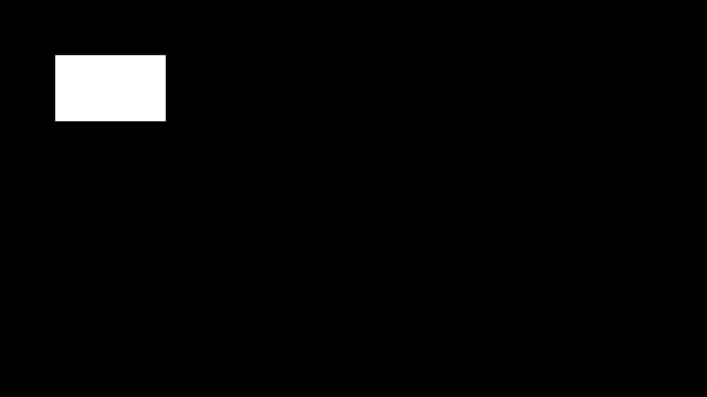

# Getting Started

```html
<canvas id="mainCanvas"></canvas>
<script type="module">
	import { Engine, EngineConfiguration, Scene, Vector2, Rect, Colors } from "./build/vanilla.js";

	class MainScene extends Scene {
		draw(graphic) {
			super.draw(graphic);
			graphic.setFillColor(Colors.white);
			graphic.drawRect(Rect.create(100, 100, 200, 120));
		}
	}

	const engineConfiguration = new EngineConfiguration();
	engineConfiguration.canvasId = "mainCanvas";
	engineConfiguration.referenceResolutionSize = Vector2.create(1280, 720);
	engineConfiguration.autoResizeOnWindowResize = true;
	const engine = new Engine(engineConfiguration);
	engine.run(new MainScene());
</script>
```



To build the bundle yourself, use esbuild.

```bash
esbuild import.js --bundle --outfile=build/vanilla.js --format=esm --keep-names --sourcemap '--banner:js=/*! vanilla.js | (c) 2026 vanillapunch | MIT License | https://github.com/ddukbaek2/vanilla.js/blob/release/LICENSE | Third-party notices: https://github.com/ddukbaek2/vanilla.js/blob/release/THIRD_PARTY_LICENSES.md */'
esbuild import.js --bundle --outfile=build/vanilla.min.js --format=esm --minify --keep-names '--banner:js=/*! vanilla.js | (c) 2026 vanillapunch | MIT License | https://github.com/ddukbaek2/vanilla.js/blob/release/LICENSE | Third-party notices: https://github.com/ddukbaek2/vanilla.js/blob/release/THIRD_PARTY_LICENSES.md */'
```

## Samples

All sources are in `examples/` in the repository, and the links below are the deployed builds.

| Sample | Description | Demo | Source |
| --- | --- | --- | --- |
| Toon Shading | Anime-style rendering of a VRM 1.0 character. 3-tone ramp, spherical-normal face shadows, bangs shadows, angel ring, screen-space rim, outlines, spring bones, 8 Mixamo bone animations | [Open](https://vanillapunch.com/tools/demo/toonshading/) | [`examples/toonshading`](https://github.com/ddukbaek2/vanilla.js/blob/release/examples/toonshading) |
| Old Face | MetaHuman face PBR. Subsurface scattering, expression wrinkle maps, groom card hair, eye refraction, material graph panel | [Open](https://vanillapunch.com/tools/demo/oldface/) | [`examples/oldface`](https://github.com/ddukbaek2/vanilla.js/blob/release/examples/oldface) |
| Ancient Mountain | Procedural terrain (3-way blending by slope and altitude) with sky, clouds, shadow map, and a character that walks / runs / climbs | [Open](https://vanillapunch.com/tools/demo/ancientmountain/) | [`examples/ancientmountain`](https://github.com/ddukbaek2/vanilla.js/blob/release/examples/ancientmountain) |
| Neon Horizon | Procedural sky (chocolate sky, vanilla sun) with fleet 3D models, engine glow, flagship main gun sequence | [Open](https://vanillapunch.com/tools/demo/neonhorizon/) | [`examples/neonhorizon`](https://github.com/ddukbaek2/vanilla.js/blob/release/examples/neonhorizon) |
| UI Showcase | UI component showcase. Buttons, scroll views, lists, charts, dialogs, layout | [Open](https://vanillapunch.com/tools/demo/uishowcase/) | [`examples/uishowcase`](https://github.com/ddukbaek2/vanilla.js/blob/release/examples/uishowcase) |
| Particle Effects | 18 particle presets such as fire / fountain / snow / rain / explosion | [Open](https://vanillapunch.com/tools/demo/particleeffects/) | [`examples/particleeffects`](https://github.com/ddukbaek2/vanilla.js/blob/release/examples/particleeffects) |
| Timeline Showcase | Playback of 8 documents made with the timeline editor. Transport, scrubbing, markers / events | [Open](https://vanillapunch.com/tools/demo/timelineshowcase/) | [`examples/timelineshowcase`](https://github.com/ddukbaek2/vanilla.js/blob/release/examples/timelineshowcase) |
| Sprite Effects | 49 `ShaderSprite` types, 58 `ScreenEffect` types, demos of combined game effects | [Open](https://vanillapunch.com/tools/demo/spriteeffects/) | [`examples/spriteeffects`](https://github.com/ddukbaek2/vanilla.js/blob/release/examples/spriteeffects) |

Examples without a deployed build: [`examples/cameratour`](https://github.com/ddukbaek2/vanilla.js/blob/release/examples/cameratour) (rotating `Camera2D`, node tweens, `Indicator`), [`examples/toonmaterial`](https://github.com/ddukbaek2/vanilla.js/blob/release/examples/toonmaterial) (toon extension test scene: material shader snippets, textures and decals, point lights, half-Lambert bands, additive holograms, planar mirrors, persistent instance buffers)
