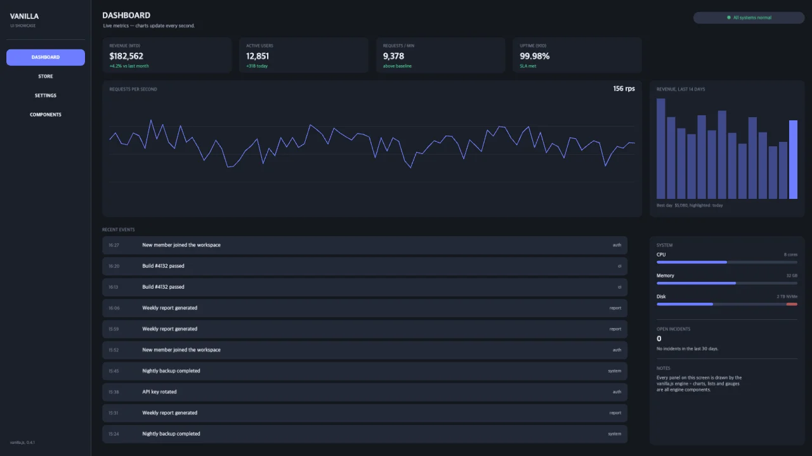
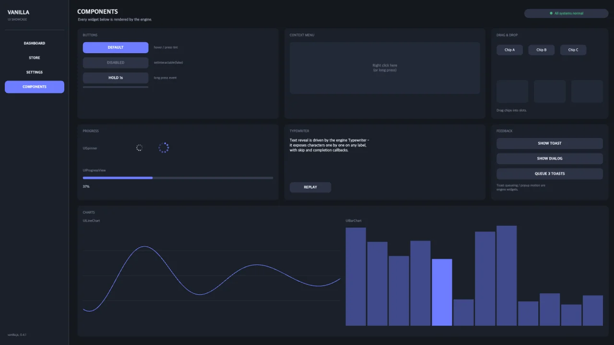

# UI

버튼, 라벨, 슬라이더 같은 UI 를 화면에 올리는 방법을 다룹니다. UI 를 위한 씬 `UIScene`, 노드에 붙이는 위젯 컴포넌트, 그 자체로 노드인 완성 위젯, UI Editor 문서를 읽는 `UIDocument`, 두 가지 배치 방법(`NodeLayout`, 제약 기반 `LayoutSolver`), 창 쌓기(`UIWindowLayer`), 단추 반응(`ButtonMotion`) 차례입니다. 노드와 컴포넌트 자체는 "노드와 컴포넌트" 장, 터치가 노드에 닿는 과정은 "입력" 장에서 다룹니다.



## 두 갈래 UI

엔진의 UI 는 노드를 놓는 방식에 따라 두 갈래입니다.

- **WorldNode 노선.** `WorldNode` 에 위젯 컴포넌트(`UILabel`, `UIButton`, `UISlider` 같은 `UIView` 계열)를 붙이고, 자리와 크기는 피봇, 앵커, `setLocalPosition`, `setContentSize` 로 직접 정합니다. `UIInputField`, `UIDropdown`, `UIDialog`, `UIToast`, `UIWindow` 처럼 `WorldNode` 를 이어받은 완성 위젯은 `new` 로 만들어 `addChild` 합니다. 터치를 받는 위젯은 모두 이 노선입니다.
- **UINode 노선.** `UINode` 는 왼쪽, 오른쪽, 위, 아래, 너비, 높이, 가운데 X, 가운데 Y 여덟 변수를 가진 노드이고, 제약을 걸면 `LayoutSolver` 가 그 값을 풉니다. 화면 크기와 세이프 에어리어에 맞춰 늘고 주는 배치에 씁니다. `UIButton` 처럼 누르는 위젯도 `UINode` 에 붙이면 솔버가 푼 자리로 눌립니다.

두 노선 모두 `UIScene` 에서 씁니다.

## UIScene

`UIScene` 은 `Scene` 을 이어받은 UI 용 씬입니다. 다음을 스스로 갖추고 있습니다.

- 터치 전달. `initialize` 에서 `TouchRecognizer` 를 만들어 루트 아래 위젯에 터치를 보냅니다. 평범한 `Scene` 도 씬의 `TouchRaycaster` 로 위젯에 터치를 넘깁니다. 스크롤 칸의 끌기 손짓까지 넘기려면 `setTouchRaycaster(new TouchRecognizer())` 로 바꿉니다(`examples/uisample` 이 그렇게 합니다).
- 로딩 화면. 검은 바탕, 가운데 그림(`setLoadingImageUrl`), 아래 막대를 그립니다. 기본으로 최소 3000 밀리초 동안 보이고 화면을 누르면 바로 넘어갑니다. `setLoadingMinDurationMs(milliseconds)` 로 바꿉니다.
- 애셋 읽기 자리 `loadAssets()`. 덮어쓸 때는 `await super.loadAssets()` 를 먼저 부릅니다.
- 바탕색 `setSceneBackgroundColor(color)`(기본 검정), 뷰 배율 방식 `setViewScaleMode(mode)`(기본 `ViewScaleMode.none`).
- 제약 솔버(`getSolver()`), 화면 가이드 노드(`getScreenNode()`), 세이프 에어리어 가이드 노드(`getSafeAreaLayoutGuide()`). 아래 "제약 배치" 절에서 씁니다.
- 개발자 도구. `EngineConfiguration.useDevTools` 가 꺼져 있으면 만들지 않습니다.

아래는 제목 라벨과 단추 하나를 놓는 씬입니다. 단추 노드에 `Paint`(바탕), `UIButton`(누름 처리), `UILabel`(글)을 함께 붙입니다.

```javascript
import { Engine, EngineConfiguration, UIScene, WorldNode, Paint, UIButton, UILabel, Pivot, Vector2, Color } from "./build/vanilla.js";

class MenuScene extends UIScene {
	constructor() {
		super();
		this.setLoadingMinDurationMs(0);
		this.setSceneBackgroundColor(new Color(0.08, 0.09, 0.12, 1));
	}

	initialize(engine) {
		super.initialize(engine);
		const root = this.getRoot();

		const titleNode = new WorldNode();
		titleNode.setPivot(Pivot.topLeft);
		titleNode.setAnchor(Pivot.topLeft);
		titleNode.setLocalPosition(Vector2.create(40, 40));
		titleNode.setContentSize(Vector2.create(400, 48));
		const titleLabel = titleNode.addComponent(UILabel);
		titleLabel.setText("Main Menu");
		titleLabel.setFontSize(32);
		titleLabel.setTextColor(new Color(0.95, 0.96, 1, 1));
		root.addChild(titleNode);

		const buttonNode = new WorldNode();
		buttonNode.setName("StartButton");
		buttonNode.setPivot(Pivot.topLeft);
		buttonNode.setAnchor(Pivot.topLeft);
		buttonNode.setLocalPosition(Vector2.create(40, 120));
		buttonNode.setContentSize(Vector2.create(200, 56));
		const buttonPaint = buttonNode.addComponent(Paint);
		buttonPaint.setColor(new Color(0.23, 0.51, 0.96, 1));
		buttonPaint.setRoundSize(12);
		const button = buttonNode.addComponent(UIButton);
		const buttonLabel = buttonNode.addComponent(UILabel);
		buttonLabel.setText("Start");
		buttonLabel.setFontSize(22);
		button.setClickedEvent((clickedButton) => {
			titleLabel.setText("Started");
		});
		button.setLongPressSeconds(0.8);
		button.setLongPressedEvent((pressedButton) => {
			titleLabel.setText("Long pressed");
		});
		root.addChild(buttonNode);
	}
}

const engineConfiguration = new EngineConfiguration();
engineConfiguration.referenceResolutionSize = Vector2.create(1280, 720);
engineConfiguration.autoResizeOnWindowResize = true;
const engine = new Engine(engineConfiguration);
engine.run(new MenuScene());
```

## 위젯 컴포넌트

`WorldNode` 에 `addComponent` 로 붙이는 위젯입니다. 노드의 내용 크기(`setContentSize`)를 영역으로 씁니다.



| 클래스 | 하는 일 |
| --- | --- |
| `UIView` | 바탕색(`setBackgroundColor`)과 내용 노드(`getContent()`)를 가진 판. 아래 위젯들의 바탕 클래스 |
| `UILabel` | 글. 붙이면 `Text` 와 `RichText` 를 함께 붙여 씁니다 |
| `UIImageView` | 그림. 붙이면 `Sprite` 를 만들어 씁니다 |
| `UIButton` | 누름 처리와 눌림 색 |
| `UIToggleButton` | 켜고 끄는 단추 (`UIButton` 파생) |
| `UISlider` | 끌어서 값을 고르는 막대 |
| `UIProgressView` | 진행 막대 (입력 없음) |
| `UIScrollView` | 끌어서 넘기는 영역. 자식을 잘라 그리도록 `Mask` 를 함께 붙입니다 |

`UIView` 계열 위젯은 붙을 때 노드 밑에 내용 노드(`content`)를 하나 만듭니다. 위젯 안에 넣을 자식은 `getContent()` 에 붙입니다.

### UIButton

- `UIButton` 은 스스로 아무것도 그리지 않습니다. 같은 노드와 그 아래 노드의 컴포넌트(`Paint`, `Sprite`, 글 같은 것) 색에 눌림 색을 섞습니다. 눌림 색 기본은 `(0, 0, 0, 0.3)`, 마우스를 올렸을 때 `(1, 1, 1, 0.12)`, 바뀌는 시간은 0.3 초이고 `setPressedTintColor`, `setHoverTintColor`, `setTransitionDuration` 으로 바꿉니다. 섞지 않을 것은 `excludeNodeFromTint(node)`, `excludeComponentFromTint(component)` 로 뺍니다.
- 알림: `setClickedEvent`, `setClickEvent`(클릭하면 이 둘이 차례로 불림), `setPressedEvent`, `setReleasedEvent`, `setHoverEvent`, `setLongPressedEvent`. 함수는 단추를 인자로 받습니다. 클릭은 뗀 자리가 단추 안일 때만 납니다.
- 길게 누름은 `setLongPressSeconds`(기본 0.5 초)를 넘기는 순간 한 번 알리고, 그 누름의 클릭은 삼킵니다.
- `setInteractable(false)` 면 누를 수 없고 어둡게 덮습니다(`(0, 0, 0, 0.5)`).
- `setMinimumPressedSeconds(seconds)` 를 주면 짧게 눌러도 눌린 모습을 그만큼 보여 준 뒤 뗌을 처리합니다(기본 0).

### 그 밖의 위젯

- `UILabel`: `setText`, `setFontSize`, `setTextColor`, `setTextAlign`, `setTextBaseline`, `setBold`, `setWordWrapWidth`(0 이면 한 줄), `setFitWidth`(그 너비에 맞춰 글자 크기를 줄임). `useRichText(true)` 면 `<b>`, `<i>`, `<u>`, `<s>`, `<color=...>`, `<size=N>` 마크업을 읽습니다.
- `UIImageView`: `setImage`(`HTMLImageElement`, `OffscreenCanvas`, `ImageAsset`), `setImageRect`, `setColor`(틴트), `setDrawMode`(`"simple"`, `"sliced"`, `"tiled"`), `setNineSlice`.
- `UIToggleButton`: `setToggledEvent`, `getIsOn`, `setOnTintColor`. `setIsOn(isOn)` 은 알림을 부르지 않고 상태만 바꿉니다.
- `UISlider`: `setRange(min, max)`(기본 0 ~ 1), `setValue`, `getValue`, `setValueChangedEvent`. 모양은 `setTrackColor`, `setFillColor`, `setThumbColor`, `setThumbRadius`(기본 16), `setTrackThickness`(0 이하면 노드 전체), `setCornerRadius`, `setDirection("horizontal" 또는 "vertical")`.
- `UIProgressView`: `setRange`, `setValue`, `setTrackColor`, `setFillColor`, `setCornerRadius`, `setDirection`. 값은 코드로만 바꿉니다.

```javascript
import { Engine, EngineConfiguration, UIScene, WorldNode, Paint, UILabel, UIImageView, UIToggleButton, UISlider, UIProgressView, ImageAsset, Pivot, Vector2, Rect, Color } from "./build/vanilla.js";

function createBoxNode(x, y, width, height) {
	const node = new WorldNode();
	node.setPivot(Pivot.topLeft);
	node.setAnchor(Pivot.topLeft);
	node.setLocalPosition(Vector2.create(x, y));
	node.setContentSize(Vector2.create(width, height));
	return node;
}

class WidgetScene extends UIScene {
	#imageAsset;

	constructor() {
		super();
		this.setLoadingMinDurationMs(0);
		this.#imageAsset = new ImageAsset();
	}

	async loadAssets() {
		await super.loadAssets();
		await this.#imageAsset.load("examples/assets/spritesheet.png");
	}

	initialize(engine) {
		super.initialize(engine);
		const root = this.getRoot();

		const imageNode = createBoxNode(40, 40, 160, 160);
		const imageView = imageNode.addComponent(UIImageView);
		imageView.setImage(this.#imageAsset);
		imageView.setImageRect(Rect.create(0, 0, 200, 200));
		root.addChild(imageNode);

		const valueNode = createBoxNode(240, 40, 320, 32);
		const valueLabel = valueNode.addComponent(UILabel);
		valueLabel.useRichText(true);
		valueLabel.setText("Volume <b>50</b>");
		valueLabel.setFontSize(20);
		root.addChild(valueNode);

		const progressNode = createBoxNode(240, 140, 320, 12);
		const progressView = progressNode.addComponent(UIProgressView);
		progressView.setTrackColor(new Color(1, 1, 1, 0.15));
		progressView.setFillColor(new Color(0.3, 0.8, 0.5, 1));
		progressView.setCornerRadius(6);
		progressView.setValue(0.5);
		root.addChild(progressNode);

		const sliderNode = createBoxNode(240, 90, 320, 32);
		const slider = sliderNode.addComponent(UISlider);
		slider.setRange(0, 100);
		slider.setValue(50);
		slider.setTrackThickness(6);
		slider.setCornerRadius(3);
		slider.setValueChangedEvent((changedSlider) => {
			const value = Math.round(changedSlider.getValue());
			valueLabel.setText("Volume <b>" + value + "</b>");
			progressView.setValue(value / 100);
		});
		root.addChild(sliderNode);

		const toggleNode = createBoxNode(240, 180, 160, 48);
		const togglePaint = toggleNode.addComponent(Paint);
		togglePaint.setColor(new Color(0.25, 0.6, 0.35, 1));
		togglePaint.setRoundSize(10);
		const toggleLabel = toggleNode.addComponent(UILabel);
		toggleLabel.setText("Mute");
		toggleLabel.setFontSize(18);
		const toggleButton = toggleNode.addComponent(UIToggleButton);
		toggleButton.setOnTintColor(new Color(0, 0, 0, 0.4));
		toggleButton.setToggledEvent((button) => {
			const isOn = button.getIsOn();
			slider.setInteractable(!isOn);
		});
		root.addChild(toggleNode);
	}
}

const engineConfiguration = new EngineConfiguration();
engineConfiguration.referenceResolutionSize = Vector2.create(640, 360);
const engine = new Engine(engineConfiguration);
engine.run(new WidgetScene());
```

### UIScrollView

스크롤 뷰를 붙인 노드의 내용 크기가 보이는 영역이고, 항목은 `getContent()` 에 붙입니다. `setScrollContentSize(size)` 로 끌 수 있는 전체 크기를 알려 줘야 하며 보이는 영역보다 커야 스크롤됩니다.

- `setHorizontal(false)`, `setVertical(false)` 로 축을 끕니다.
- `setScrollMode("clamp")` 는 경계를 넘지 않고(기본), `"elastic"` 은 넘으면 당기는 힘이 생기고 놓으면 튕겨 돌아옵니다.
- `setShowsVerticalScrollBar(true)`, `setShowsHorizontalScrollBar(true)` 로 스크롤바를 보입니다.
- `setScrollOffset(offset)` 은 자리를 옮깁니다. 아래로 내린 만큼 y 가 음수입니다.
- `setDragSensitivity`(끌기 배율, 기본 1), `setWheelScrollScale`(휠 배율), `setPassesCrossAxisDrag(true)`(스크롤하지 않는 축으로 더 많이 끈 손가락은 안쪽 위젯에 넘김, 세로 목록 안의 가로 슬라이더 같은 곳)도 있습니다.
- `TouchRecognizer` 는 스크롤 뷰 안을 누르면 누름 전달을 150 밀리초 미루고, 10 픽셀 넘게 끌면 안쪽 위젯의 누름을 취소하고 스크롤로 넘깁니다.

```javascript
import { Engine, EngineConfiguration, UIScene, UIScrollView, UILabel, WorldNode, Paint, Color, Pivot, Vector2 } from "./build/vanilla.js";

class ListScene extends UIScene {
	constructor() {
		super();
		this.setLoadingMinDurationMs(0);
	}

	initialize(engine) {
		super.initialize(engine);
		const viewportNode = new WorldNode();
		viewportNode.setPivot(Pivot.topLeft);
		viewportNode.setAnchor(Pivot.topLeft);
		viewportNode.setContentSize(Vector2.create(320, 240));
		viewportNode.setLocalPosition(Vector2.create(160, 60));
		const scrollView = viewportNode.addComponent(UIScrollView);
		scrollView.setBackgroundColor(new Color(0.1, 0.12, 0.16, 1));
		scrollView.setHorizontal(false);
		scrollView.setScrollMode("elastic");
		scrollView.setShowsVerticalScrollBar(true);

		const rowCount = 20;
		const rowHeight = 40;
		const content = scrollView.getContent();
		for (let rowIndex = 0; rowIndex < rowCount; ++rowIndex) {
			const rowNode = new WorldNode();
			rowNode.setPivot(Pivot.topLeft);
			rowNode.setAnchor(Pivot.topLeft);
			rowNode.setContentSize(Vector2.create(296, rowHeight - 4));
			rowNode.setLocalPosition(Vector2.create(8, rowIndex * rowHeight + 2));
			const rowPaint = rowNode.addComponent(Paint);
			rowPaint.setColor(new Color(1, 1, 1, 0.06));
			const rowLabel = rowNode.addComponent(UILabel);
			rowLabel.setText("Row " + rowIndex);
			content.addChild(rowNode);
		}
		scrollView.setScrollContentSize(Vector2.create(320, rowCount * rowHeight));
		const root = this.getRoot();
		root.addChild(viewportNode);
	}
}

const engineConfiguration = new EngineConfiguration();
engineConfiguration.referenceResolutionSize = Vector2.create(640, 360);
const engine = new Engine(engineConfiguration);
engine.run(new ListScene());
```

## 완성 위젯

`WorldNode` 를 이어받아 노드 하나에 모양과 동작을 다 갖춘 위젯입니다. `new` 로 만들어 붙입니다.

- `UIInputField`: 캔버스에 그리는 글 입력 칸. 기본은 캔버스가 키보드를 직접 받아 ASCII 위주로 입력합니다. 한글 IME, 모바일 소프트 키보드, 시스템 클립보드가 필요하면 `setUseDOMInput(true)` 로 숨은 DOM `<input>` 을 쓰고, 이때는 `setEngine(engine)` 도 불러 둡니다. 입력을 받기 시작하려면 `attach()` 를, 치울 때는 `detach()` 를 부릅니다. `setPlaceholder`, `setText`, `getText`, `setMaxLength`(0 이면 한없음), `setFontSize`(기본 28), `setOnChange((text) => {})`, `setOnSubmit((text) => {})`, `focus`, `blur`, `selectAll` 이 있습니다. 오른쪽 누름에는 잘라내기, 복사, 붙여넣기 메뉴가 뜹니다.
- `UIDropdown`: 머리 단추에 지금 값을 보이고 누르면 목록을 펼칩니다. `new UIDropdown({ width, height, optionHeight, fontSize, baseColor, popupColor, highlightColor, textColor })`(기본 너비 180, 높이 30, 줄 높이 28, 글자 12). `setOptionList`, `getSelectedIndex`, `getSelectedText`, `setChangedEvent` 가 있고, `setSelectedIndex` 는 알림 없이 고른 것만 바꿉니다.
- `UIToast`: `show(message)` 로 알약 모양 알림을 아래에서 띄워 잠시 보였다가 치웁니다. 여러 번 부르면 줄을 세웁니다. `new UIToast({ width, height, restY, restX, holdSeconds, fontSize, backgroundColor, textColor })`(기본 400 x 48, `restY` 560, 머무는 시간 1.8 초).
- `UIDialog`: 어둡게 가리는 막, 가운데 카드, 확인과 취소 단추를 `show(message, { onConfirm, onCancel, confirmText, cancelText })` 한 번으로 띄웁니다. `onCancel` 을 주지 않으면 확인만 있는 알림이 되고, 막을 누르면 취소로 칩니다. 단추 글 기본값이 한국어("확인", "취소")이므로 다른 언어면 글을 넘깁니다.

`UIToast` 와 `UIDialog` 는 다른 것 위에 그려지도록 루트의 마지막 자식으로 붙입니다. `UIContextMenu`, `UISpinner`, `UIListView`, `UILineChart`, `UIBarChart`, `UIProgressRing` 같은 위젯도 있습니다(`examples/uishowcase` 참고).

```javascript
import { Engine, EngineConfiguration, UIScene, UIInputField, UIDropdown, UIToast, UIDialog, WorldNode, Paint, UIButton, UILabel, Pivot, Vector2, Color } from "./build/vanilla.js";

class FormScene extends UIScene {
	constructor() {
		super();
		this.setLoadingMinDurationMs(0);
	}

	initialize(engine) {
		super.initialize(engine);
		const root = this.getRoot();

		const inputField = new UIInputField();
		inputField.setEngine(engine);
		inputField.setLocalPosition(Vector2.create(40, 40));
		inputField.setContentSize(Vector2.create(360, 56));
		inputField.setPlaceholder("Player name");
		inputField.setMaxLength(16);
		root.addChild(inputField);
		inputField.attach();

		const dropdown = new UIDropdown({ width: 200, height: 36, fontSize: 16 });
		dropdown.setLocalPosition(Vector2.create(420, 50));
		dropdown.setOptionList(["Low", "Medium", "High"]);
		dropdown.setSelectedIndex(1);
		root.addChild(dropdown);

		const buttonNode = new WorldNode();
		buttonNode.setPivot(Pivot.topLeft);
		buttonNode.setAnchor(Pivot.topLeft);
		buttonNode.setLocalPosition(Vector2.create(40, 130));
		buttonNode.setContentSize(Vector2.create(160, 48));
		const buttonPaint = buttonNode.addComponent(Paint);
		buttonPaint.setColor(new Color(0.23, 0.51, 0.96, 1));
		buttonPaint.setRoundSize(10);
		const button = buttonNode.addComponent(UIButton);
		const buttonLabel = buttonNode.addComponent(UILabel);
		buttonLabel.setText("Save");
		buttonLabel.setFontSize(18);
		root.addChild(buttonNode);

		const toast = new UIToast({ width: 320, height: 40, restY: 320 });
		const dialog = new UIDialog();
		root.addChild(toast);
		root.addChild(dialog);

		inputField.setOnSubmit((text) => {
			toast.show("Hello, " + text);
		});
		dropdown.setChangedEvent((changedDropdown) => {
			const selectedText = changedDropdown.getSelectedText();
			toast.show("Quality: " + selectedText);
		});
		button.setClickedEvent(() => {
			const playerName = inputField.getText();
			dialog.show("Save as " + playerName + "?", {
				confirmText: "Save",
				cancelText: "Cancel",
				onConfirm: () => {
					toast.show("Saved");
				},
				onCancel: () => {
					toast.show("Canceled");
				},
			});
		});
		toast.show("Ready");
	}
}

const engineConfiguration = new EngineConfiguration();
engineConfiguration.referenceResolutionSize = Vector2.create(640, 360);
const engine = new Engine(engineConfiguration);
engine.run(new FormScene());
```

## UIDocument 로 UI Editor 문서 읽기

UI Editor(저작 도구는 "저작 도구" 장)가 저장한 `.uiasset.json` 은 `WorldNode` 트리를 JSON 으로 적은 문서입니다. `UIDocument.fromJsonText(jsonText)` 는 그 글을 살아 있는 노드 트리로 되살려 뿌리 노드를 돌려줍니다. 되살린 노드는 엔진 노드 그대로이므로 이름으로 찾아 동작을 붙입니다.

- 문서는 그림 원본을 담지 않고 경로(`imagePath`)만 적습니다. 그림을 이으려면 `fromJsonText` 전에 `UIDocument.setImageResolver((imagePath) => image)` 로 경로를 `HTMLImageElement` 로 바꾸는 함수를 걸어 둡니다. 걸지 않으면 그림 없이 되살립니다.
- `UIDocument.toJsonText(rootNode, isPretty)` 는 반대로 노드 트리를 JSON 글로 적습니다.
- 기본으로 다루는 노드 종류는 `WorldNode`, 컴포넌트는 `Paint`, `Sprite`, `Text`, `RichText`, `Mask`, `Outline`, `SoftShade`, `ShadowText`, `UIProgressRing`, `UILabel`, `UIImageView`, `UIButton`, `UIToggleButton`, `UIProgressView`, `UISlider`, `UIScrollView`, `ShadowImage` 입니다(`UIDocument.getComponentTypeNames()`). 편집기가 다루는 나머지 종류는 `UIDocument.registerEditorTypes()` 로 한 번에, 하나씩은 `registerNodeType(typeName, nodeType)`, `registerComponentType(typeName, componentType)` 로 더합니다. 표에 없는 종류는 읽을 때 경고를 냅니다.
- 문서가 잘못되었으면(`root` 가 없으면) 예외를 냅니다.

```javascript
import { Engine, EngineConfiguration, UIScene, UIDocument, UIButton, UIProgressView, TextAsset, Vector2 } from "./build/vanilla.js";

class DocumentScene extends UIScene {
	#textAsset;
	#progressView;
	#elapsedSeconds;

	constructor() {
		super();
		this.setLoadingMinDurationMs(0);
		this.#textAsset = new TextAsset();
		this.#progressView = null;
		this.#elapsedSeconds = 0;
	}

	async loadAssets() {
		await super.loadAssets();
		this.#textAsset.setNoCache(true);
		await this.#textAsset.load("examples/uisample/assets/title.uiasset.json");
	}

	initialize(engine) {
		super.initialize(engine);
		const jsonText = this.#textAsset.text;
		const documentRootNode = UIDocument.fromJsonText(jsonText);
		const root = this.getRoot();
		root.addChild(documentRootNode);

		const startButtonNode = documentRootNode.findDescendantByName("StartButton");
		const startButton = startButtonNode.getComponent(UIButton);
		startButton.setClickedEvent(() => {
			console.log("start");
		});
		const progressNode = documentRootNode.findDescendantByName("ProgressTrack");
		this.#progressView = progressNode.getComponent(UIProgressView);
	}

	tick(timeDelta) {
		super.tick(timeDelta);
		this.#elapsedSeconds += timeDelta;
		const progress = Math.sin(this.#elapsedSeconds) * 0.5 + 0.5;
		this.#progressView.setValue(progress);
	}
}

const engineConfiguration = new EngineConfiguration();
engineConfiguration.referenceResolutionSize = Vector2.create(960, 640);
const engine = new Engine(engineConfiguration);
engine.run(new DocumentScene());
```

## NodeLayout 으로 선언하듯 짓기

노드를 하나씩 만들고 지역 변수에 담는 대신, 노드 계층을 사슬로 이어 적는 빌더입니다. `NodeLayout.create(nodeClass)`(주지 않으면 `WorldNode`)로 시작해 `name`, `active`, `pivot(pivot)`, `anchor(x, y)`, `anchoredPosition(x, y)`, `localPosition(x, y)`, `contentSize(x, y)`, `localScale(x, y)`, `maskEnabled(enabled)`, `component(componentType, callback)`, `children(...layouts)`, `apply(callback)`(빌더에 없는 설정)을 잇고, `build(parent)` 가 노드를 만들어 `parent` 에 붙이고 돌려줍니다. 위치와 크기는 `Vector2` 없이 숫자 둘로 줍니다.

```javascript
import { Engine, EngineConfiguration, UIScene, NodeLayout, WorldNode, Paint, UILabel, UIButton, Pivot, Vector2, Color } from "./build/vanilla.js";

class LayoutScene extends UIScene {
	constructor() {
		super();
		this.setLoadingMinDurationMs(0);
	}

	initialize(engine) {
		super.initialize(engine);
		const root = this.getRoot();
		NodeLayout.create(WorldNode)
			.name("Panel")
			.pivot(Pivot.topLeft)
			.anchor(0, 0)
			.localPosition(170, 60)
			.contentSize(300, 240)
			.component(Paint, (paint) => {
				paint.setColor(new Color(0.13, 0.15, 0.2, 1));
				paint.setRoundSize(16);
			})
			.children(
				NodeLayout.create(WorldNode)
					.name("Title")
					.pivot(Pivot.topLeft)
					.anchor(0, 0)
					.localPosition(24, 20)
					.contentSize(252, 40)
					.component(UILabel, (label) => {
						label.setText("Settings");
						label.setFontSize(24);
					}),
				NodeLayout.create(WorldNode)
					.name("CloseButton")
					.pivot(Pivot.topLeft)
					.anchor(0, 0)
					.localPosition(24, 168)
					.contentSize(252, 48)
					.component(Paint, (paint) => {
						paint.setColor(new Color(0.23, 0.51, 0.96, 1));
						paint.setRoundSize(10);
					})
					.component(UIButton, (button) => {
						button.setClickedEvent(() => {
							console.log("close");
						});
					})
					.component(UILabel, (label) => {
						label.setText("Close");
						label.setFontSize(18);
					})
			)
			.build(root);
	}
}

const engineConfiguration = new EngineConfiguration();
engineConfiguration.referenceResolutionSize = Vector2.create(640, 360);
const engine = new Engine(engineConfiguration);
engine.run(new LayoutScene());
```

정적 메서드 `NodeLayout.arrangeFan(nodeList, options)` 는 손패 카드처럼 노드 여러 개를 호 위에 펼칩니다.

## 제약 배치: UINode 와 LayoutSolver

`UINode` 는 자리와 크기를 제약으로 정하는 노드입니다(UIKit 오토레이아웃과 같은 생각입니다).

- 앵커 게터 `leftAnchor`, `rightAnchor`, `topAnchor`, `bottomAnchor`, `widthAnchor`, `heightAnchor`, `centerXAnchor`, `centerYAnchor`(그리고 `leadingAnchor`, `trailingAnchor`, `firstBaselineAnchor`, `lastBaselineAnchor`)는 부를 때마다 새 `LayoutExpression` 을 돌려줍니다.
- 식은 `add`, `subtract`, `multiply`, `divide` 로 새 식을 만들고, `equalTo`, `lessThanOrEqualTo`, `greaterThanOrEqualTo` 로 `LayoutConstraint` 를 만듭니다. 오른쪽에는 숫자, 변수, 식을 둘 수 있습니다.
- 이렇게 만든 제약은 반드시 지켜야 하는(required) 제약입니다. 양보해도 되는 제약은 `constraint.withStrength(LayoutStrength.strong)` 처럼 세기를 바꾼 새 제약을 씁니다. 세기는 `required`, `strong`, `medium`, `weak` 이고, 부딪히면 센 쪽이 이깁니다. 지킬 수 없는 required 제약을 넣으면 솔버가 예외를 냅니다.
- `node.addConstraint(constraint)` 로 노드에 겁니다. `UIScene` 은 매 프레임 트리 안의 `UINode` 를 자기 솔버에 붙이고 값을 풉니다. 푼 값은 `getLeft()`, `getTop()`, `getWidth()`, `getHeight()`, `getCenterX()`, `getCenterY()` 로 읽습니다.
- `getScreenNode()` 는 왼쪽 위 (0, 0) 에 고정되고 너비와 높이가 뷰 크기를 따르는 가이드입니다. `getSafeAreaLayoutGuide()` 는 그 안에서 세이프 에어리어만큼 들어간 가이드입니다(CSS `env()` 의 인셋을 읽어 맞춥니다).
- `UINode` 의 왼쪽과 위 값은 UI 트리 뿌리 기준의 절대 좌표입니다. 부모가 `UINode` 여도 자식의 값은 부모 기준이 아닙니다.
- 글처럼 제 크기가 있는 노드는 내재 크기(`getIntrinsicContentSize`)를 가지고, `setContentHuggingPriority`, `setContentCompressionResistancePriority` 로 늘고 줄기를 얼마나 버틸지 정합니다(`LayoutPriority.defaultLow` 250, `defaultHigh` 750, `required` 1000). `UILabel` 은 글이 바뀌면 노드의 내재 크기를 다시 재게 합니다.
- `setLayoutMargins({ top, left, bottom, right })`(기본 모두 8)와 `getLayoutMarginsGuide()` 로 안쪽 여백 가이드를 씁니다.

```javascript
import { Engine, EngineConfiguration, UIScene, UINode, UILabel, Paint, LayoutStrength, Vector2, Color } from "./build/vanilla.js";

class ConstraintScene extends UIScene {
	constructor() {
		super();
		this.setLoadingMinDurationMs(0);
		this.setSceneBackgroundColor(new Color(0.08, 0.09, 0.12, 1));
	}

	initialize(engine) {
		super.initialize(engine);
		const root = this.getRoot();
		const safeAreaGuide = this.getSafeAreaLayoutGuide();
		const screenNode = this.getScreenNode();

		const headerNode = new UINode();
		const headerPaint = headerNode.addComponent(Paint);
		headerPaint.setColor(new Color(0.2, 0.45, 0.85, 1));
		const headerLabel = headerNode.addComponent(UILabel);
		headerLabel.setText("Header");
		headerLabel.setFontSize(20);
		root.addChild(headerNode);

		const safeLeftAnchor = safeAreaGuide.leftAnchor;
		const safeRightAnchor = safeAreaGuide.rightAnchor;
		const safeTopAnchor = safeAreaGuide.topAnchor;
		const headerLeftAnchor = headerNode.leftAnchor;
		const headerRightAnchor = headerNode.rightAnchor;
		const headerTopAnchor = headerNode.topAnchor;
		const headerHeightAnchor = headerNode.heightAnchor;
		headerNode.addConstraint(headerLeftAnchor.equalTo(safeLeftAnchor.add(16)));
		headerNode.addConstraint(headerRightAnchor.equalTo(safeRightAnchor.subtract(16)));
		headerNode.addConstraint(headerTopAnchor.equalTo(safeTopAnchor.add(16)));
		headerNode.addConstraint(headerHeightAnchor.equalTo(56));

		const cardNode = new UINode();
		const cardPaint = cardNode.addComponent(Paint);
		cardPaint.setColor(new Color(0.13, 0.15, 0.2, 1));
		root.addChild(cardNode);

		const screenWidthAnchor = screenNode.widthAnchor;
		const screenCenterXAnchor = screenNode.centerXAnchor;
		const screenCenterYAnchor = screenNode.centerYAnchor;
		const cardWidthAnchor = cardNode.widthAnchor;
		const cardHeightAnchor = cardNode.heightAnchor;
		const cardCenterXAnchor = cardNode.centerXAnchor;
		const cardCenterYAnchor = cardNode.centerYAnchor;
		const halfWidthConstraint = cardWidthAnchor.equalTo(screenWidthAnchor.multiply(0.5));
		cardNode.addConstraint(halfWidthConstraint.withStrength(LayoutStrength.strong));
		cardNode.addConstraint(cardWidthAnchor.lessThanOrEqualTo(480));
		cardNode.addConstraint(cardHeightAnchor.equalTo(160));
		cardNode.addConstraint(cardCenterXAnchor.equalTo(screenCenterXAnchor));
		cardNode.addConstraint(cardCenterYAnchor.equalTo(screenCenterYAnchor));
	}
}

const engineConfiguration = new EngineConfiguration();
engineConfiguration.referenceResolutionSize = Vector2.create(640, 360);
engineConfiguration.autoResizeOnWindowResize = true;
const engine = new Engine(engineConfiguration);
engine.run(new ConstraintScene());
```

솔버는 엔진 없이 혼자도 씁니다. `LayoutVariable` 로 변수를 만들고 `LayoutExpression.fromVariable(variable)` 로 식을 만듭니다. 바깥에서 값을 밀어 넣을 변수는 `addEditVariable(variable, strength)` 로 등록하고 `suggestValue(variable, value)` 로 값을 줍니다. `updateVariables()` 를 부르면 변수에 푼 값이 들어갑니다.

```javascript
import { LayoutSolver, LayoutVariable, LayoutExpression, LayoutStrength } from "./build/vanilla.js";

const solver = new LayoutSolver();
const viewWidth = new LayoutVariable("viewWidth");
const left = new LayoutVariable("left");
const width = new LayoutVariable("width");
const viewWidthExpression = LayoutExpression.fromVariable(viewWidth);
const leftExpression = LayoutExpression.fromVariable(left);
const rightExpression = leftExpression.add(width);
const rightMarginExpression = viewWidthExpression.subtract(16);
solver.addConstraint(leftExpression.equalTo(16));
solver.addConstraint(rightExpression.equalTo(rightMarginExpression));
solver.addEditVariable(viewWidth, LayoutStrength.strong);
solver.suggestValue(viewWidth, 640);
solver.updateVariables();
const wideWidth = width.getValue();
solver.suggestValue(viewWidth, 360);
solver.updateVariables();
const narrowWidth = width.getValue();
console.log(wideWidth, narrowWidth);
```

## 창 쌓기

`UIWindowLayer` 는 영역 위에 `UIWindow` 를 쌓는 층입니다. 맨 위 창만 보이고, 위 창이 닫히면 아래 창이 다시 보입니다.

- 층은 영역 노드(보통 루트)의 마지막 자식으로 두고, 영역 크기가 바뀔 때마다 `setViewSize(width, height)` 로 알립니다. 세이프 에어리어까지 어둡게 덮으려면 `setViewBleed(top, right, bottom, left)` 도 알립니다.
- `openWindow(window)` 는 맨 위에 쌓고(이미 떠 있으면 맨 위로 올림), `closeWindow(window)`, `closeTopWindow()`(기기의 뒤로 가기 자리, 닫았으면 `true`), `closeAllWindows()` 로 닫습니다. `hasOpenWindow()`, `getWindowCount()`, `getTopWindow()`, `findWindow(name)` 으로 상태를 읽고, `setWindowChangeEvent(() => {})` 는 창이 뜨거나 닫힐 때 불립니다. 창이 떠 있는 동안 게임을 멈출 때 씁니다.
- 층은 작은 화면에서도 글이 읽히게 UI 배율(`UIScale.read`)만큼 커집니다. `setUIScaleOptions(null)` 이면 키우지 않습니다.

`UIWindow` 는 영역 전체를 어둡게 덮고(뒤로 누름이 가지 않음) 가운데에 판을 띄웁니다. 내용은 `getPanelNode()` 에 붙입니다. 판 가로는 영역에 맞춰 넓어지되 `setMaximumWidth`(기본 480)를 넘지 않고, 영역 가장자리와 `setMargin`(기본 16)만큼 띄웁니다. 세로는 `setPanelHeight`(기본 240)이고, 파생 클래스는 `layoutContent(panelWidth)` 를 덮어써 내용을 놓고 세로를 돌려줍니다. 바깥(어둠)을 누르면 닫히며 `setOutsideCloseEnabled(false)` 로 끕니다. `setPanelColor`, `setDimColor`, `setCloseEvent`, `close()` 도 있습니다. 열고 닫을 때는 `PopupMotion` 으로 움직입니다.

`UIConfirmWindow` 는 제목, 묻는 글, 취소와 확인 단추를 가진 `UIWindow` 입니다. `new UIConfirmWindow(name, { title, message, cancelText, confirmText })` 로 만들고(단추 글 기본값은 한국어 "취소", "확인"), `setConfirmEvent`, `setCancelEvent` 를 겁니다. 확인을 누르면 확인 알림 뒤 닫히고, 취소 단추, 바깥 누르기, `closeTopWindow`, `closeAllWindows` 로 닫히면 취소 알림입니다. 글이 길면 글 칸만 스크롤됩니다. `setRightToLeft(true)` 면 단추 차례를 뒤집습니다.

```javascript
import { Engine, EngineConfiguration, UIScene, UIWindowLayer, UIWindow, UIConfirmWindow, WorldNode, UILabel, Pivot, Vector2 } from "./build/vanilla.js";

class WindowScene extends UIScene {
	#windowLayer;

	constructor() {
		super();
		this.setLoadingMinDurationMs(0);
		this.#windowLayer = null;
	}

	initialize(engine) {
		super.initialize(engine);
		const root = this.getRoot();
		const windowLayer = new UIWindowLayer();
		root.addChild(windowLayer);
		this.#windowLayer = windowLayer;
		this.updateWindowLayerSize();
		windowLayer.setWindowChangeEvent(() => {
			const isPaused = windowLayer.hasOpenWindow();
			console.log("paused", isPaused);
		});

		const settingsWindow = new UIWindow("settings");
		settingsWindow.setPanelHeight(200);
		const labelNode = new WorldNode();
		labelNode.setPivot(Pivot.topLeft);
		labelNode.setAnchor(Pivot.topLeft);
		labelNode.setLocalPosition(Vector2.create(24, 24));
		labelNode.setContentSize(Vector2.create(300, 40));
		const label = labelNode.addComponent(UILabel);
		label.setText("Settings");
		label.setFontSize(24);
		const panelNode = settingsWindow.getPanelNode();
		panelNode.addChild(labelNode);
		windowLayer.openWindow(settingsWindow);

		const confirmWindow = new UIConfirmWindow("quit", {
			title: "Quit",
			message: "Do you really want to quit?",
			cancelText: "Cancel",
			confirmText: "Quit",
		});
		confirmWindow.setConfirmEvent(() => {
			console.log("quit");
		});
		confirmWindow.setCancelEvent(() => {
			console.log("stay");
		});
		windowLayer.openWindow(confirmWindow);
	}

	resize(canvasNativeSize) {
		super.resize(canvasNativeSize);
		this.updateWindowLayerSize();
	}

	updateWindowLayerSize() {
		const windowLayer = this.#windowLayer;
		if (windowLayer === null) {
			return;
		}
		const engine = this.getEngine();
		const viewManager = engine.getViewManager();
		const viewSize = viewManager.getViewSize();
		windowLayer.setViewSize(viewSize.x, viewSize.y);
	}
}

const engineConfiguration = new EngineConfiguration();
engineConfiguration.referenceResolutionSize = Vector2.create(640, 360);
engineConfiguration.autoResizeOnWindowResize = true;
const engine = new Engine(engineConfiguration);
engine.run(new WindowScene());
```

## ButtonMotion

단추에 크기 반응을 붙입니다. `UIButton` 이 붙은 노드에 `attachButtonMotion(node)` 를 부르면 매 프레임 단추 상태를 읽어 노드를 가운데를 두고 키우고 줄입니다. 색은 건드리지 않습니다.

- 꼴은 `ButtonMotionStyle.normal`(올리면 1.06 배, 누르는 동안 0.92 배, 떼면 1.04 배로 통 튐)과 `ButtonMotionStyle.inset`(창 안의 단추, 커지지 않고 올리면 바탕이 밝아지고 안쪽에 흰 테, 누르면 0.96 배)입니다.
- `buttonMotion.setStyle(style)` 로 단추마다 정하거나, `setButtonMotionArea(node, style)` 로 그 노드 아래 단추 모두의 꼴을 정합니다. 둘 다 없으면 `normal` 입니다.
- `shakeButton(node)` 는 누를 수 없을 때 단추를 좌우로 흔듭니다.
- 터치가 주된 기기에서는 올림 반응을 쓰지 않습니다.

```javascript
import { Engine, EngineConfiguration, UIScene, UIButton, UILabel, Paint, WorldNode, Color, Pivot, Vector2, ButtonMotionStyle, attachButtonMotion, shakeButton } from "./build/vanilla.js";

class ButtonMotionScene extends UIScene {
	constructor() {
		super();
		this.setLoadingMinDurationMs(0);
	}

	initialize(engine) {
		super.initialize(engine);
		const buttonNode = new WorldNode();
		buttonNode.setPivot(Pivot.topLeft);
		buttonNode.setAnchor(Pivot.topLeft);
		buttonNode.setContentSize(Vector2.create(160, 48));
		buttonNode.setLocalPosition(Vector2.create(240, 156));
		const buttonPaint = buttonNode.addComponent(Paint);
		buttonPaint.setColor(new Color(0.36, 0.42, 1, 1));
		buttonPaint.setRoundSize(10);
		const button = buttonNode.addComponent(UIButton);
		const buttonLabel = buttonNode.addComponent(UILabel);
		buttonLabel.setText("Buy");
		buttonLabel.setFontSize(18);
		const buttonMotion = attachButtonMotion(buttonNode);
		buttonMotion.setStyle(ButtonMotionStyle.normal);
		let coinCount = 40;
		button.setClickedEvent(() => {
			if (coinCount < 100) {
				shakeButton(buttonNode);
				return;
			}
			coinCount -= 100;
		});
		const root = this.getRoot();
		root.addChild(buttonNode);
	}
}

const engineConfiguration = new EngineConfiguration();
engineConfiguration.referenceResolutionSize = Vector2.create(640, 360);
const engine = new Engine(engineConfiguration);
engine.run(new ButtonMotionScene());
```

## 주의할 점

- `UIScene` 의 로딩 화면은 기본으로 3 초 동안 보입니다. 바로 넘기려면 `setLoadingMinDurationMs(0)` 을 줍니다.
- 평범한 `Scene` 도 위젯에 터치를 보냅니다. 스크롤 칸 안의 위젯이 있으면 `setTouchRaycaster(new TouchRecognizer())` 로 바꿉니다.
- 터치 판정은 `isInteractable` 과 `contains` 가 있는 노드에 합니다. `WorldNode` 와 `UINode` 모두 되고, `UIButton` 을 붙이면 노드의 `isInteractable` 이 켜집니다.
- `UIButton` 은 바탕을 그리지 않습니다. 같은 노드에 `Paint` 나 `UIImageView` 를 함께 붙여 모양을 만듭니다.
- `UIInputField` 는 `attach()` 를 불러야 키 입력을 받고, 치울 때 `detach()` 를 불러 문서에 건 처리기를 뗍니다. 한글 입력은 `setUseDOMInput(true)` 에서만 됩니다.
- `UIDialog`, `UIConfirmWindow` 의 단추 글 기본값은 한국어입니다.
- `UIDocument` 의 그림 해석기는 `fromJsonText` 전에 걸어야 합니다.

## 관련 클래스

UIScene, UINode, UIView, UILabel, UIImageView, UIControl, UIButton, UIToggleButton, UISlider, UIProgressView, UIScrollView, UIInputField, UIDropdown, UIToast, UIDialog, UIDocument, NodeLayout, LayoutSolver, LayoutVariable, LayoutExpression, LayoutConstraint, LayoutStrength, LayoutPriority, UIWindowLayer, UIWindow, UIConfirmWindow, UIScale, ButtonMotion, ButtonMotionStyle, TouchRecognizer
