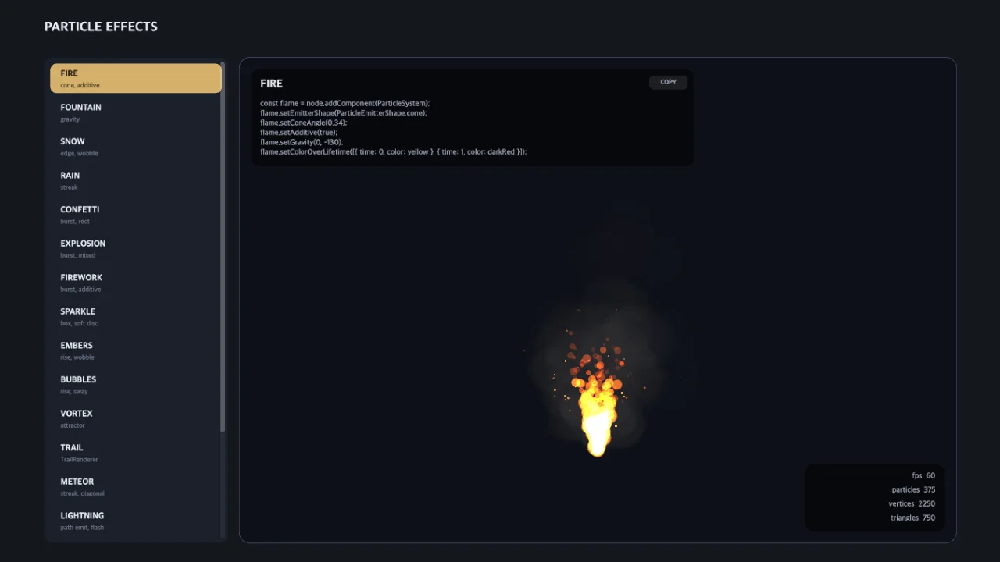
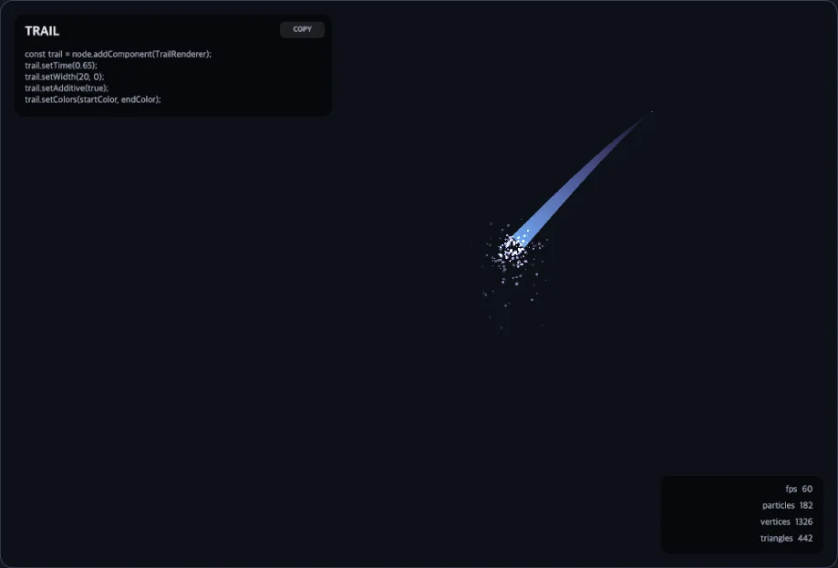
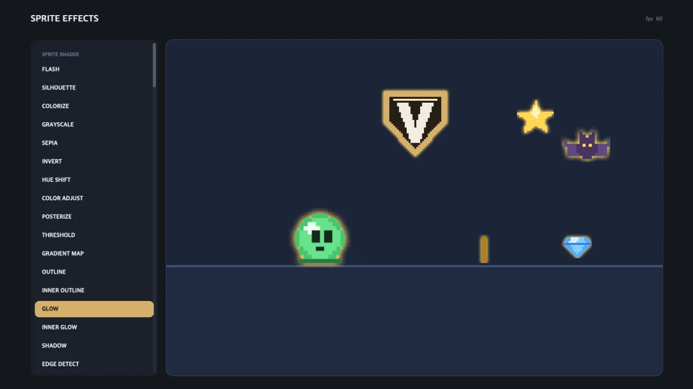
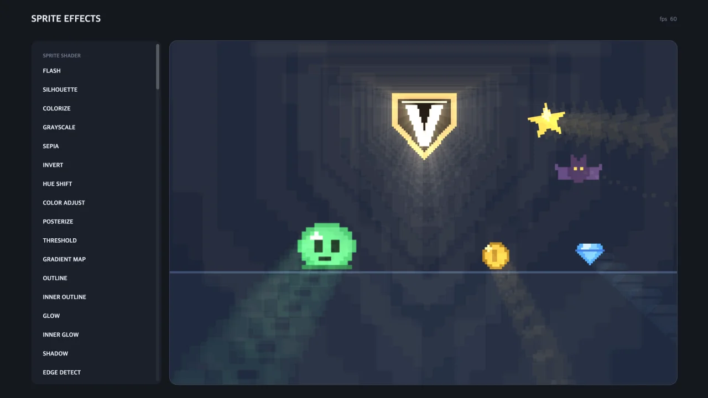

# 파티클

불꽃, 눈, 폭발 같은 파티클과 그 밖의 2D 효과를 다룹니다. 노드에 붙이는 `ParticleSystem` 과 `TrailRenderer`, 셰이더 효과를 거는 스프라이트 `ShaderSprite`, 화면 전체에 후처리를 거는 `ScreenEffect`, 아지랑이 `HeatHazeEffect` 차례입니다. 노드와 컴포넌트는 "노드와 컴포넌트" 장, 그리기 차례와 블렌드는 "그리기" 장, 3D 의 효과(`ToonVfx`)는 "3D" 장, Particle Editor 자체는 "저작 도구" 장에서 다룹니다.

## ParticleSystem

`ParticleSystem` 은 유니티 ParticleSystem 의 자주 쓰는 부분을 2D 로 옮긴 컴포넌트입니다. 노드에 붙이면 바로 방출을 시작하고(기본 재생, 반복, 초당 20 개), 파티클은 노드 원점을 기준으로 그립니다.



```javascript
import { Engine, EngineConfiguration, Scene, WorldNode, ParticleSystem, ParticleEmitterShape, Vector2, Color } from "./build/vanilla.js";

class FireScene extends Scene {
	async load(engine) {
		await super.load(engine);
		const fireNode = new WorldNode();
		fireNode.setLocalPosition(Vector2.create(640, 520));
		const particleSystem = fireNode.addComponent(ParticleSystem);
		particleSystem.setEmitterShape(ParticleEmitterShape.cone);
		particleSystem.setShapeRadius(20);
		particleSystem.setConeAngle(0.35);
		particleSystem.setEmissionRate(60);
		particleSystem.setStartLifetime(0.6, 1.2);
		particleSystem.setStartSpeed(80, 180);
		particleSystem.setStartSize(6, 14);
		particleSystem.setStartColor(new Color(1, 0.75, 0.3, 1), new Color(1, 0.5, 0.12, 1));
		particleSystem.setColorOverLifetime([
			{ time: 0, color: new Color(1, 1, 0.85, 1) },
			{ time: 0.5, color: new Color(1, 0.6, 0.2, 0.9) },
			{ time: 1, color: new Color(0.65, 0.1, 0.02, 0) },
		]);
		particleSystem.setSizeOverLifetime(1, 0.3);
		particleSystem.setGravity(0, -110);
		particleSystem.setDamping(1);
		particleSystem.setAdditive(true);
		particleSystem.setMaxParticleCount(800);
		const root = this.getRoot();
		root.addChild(fireNode);
	}
}

const engineConfiguration = new EngineConfiguration();
engineConfiguration.referenceResolutionSize = Vector2.create(1280, 720);
const engine = new Engine(engineConfiguration);
engine.run(new FireScene());
```

### 방출

- `setEmissionRate(count)`: 초당 방출 수(기본 20).
- `setLooping(isLooping)`(기본 `true`)와 `setDuration(seconds)`(기본 1): 반복하지 않으면 `duration` 동안만 방출합니다.
- `setBurstList([{ time, count }])`: 정한 때(초)에 한꺼번에 뿜습니다. 반복이면 `duration` 마다 되풀이합니다.
- `emit(count, offset)`: 그 자리에서 바로 여러 개를 뿜습니다. 누름 같은 일에 맞춰 쓰고, `offset` 은 노드 로컬 기준의 원점 보정(`Vector2`)입니다.
- `play()` 는 방출 시간과 버스트를 처음으로 되돌리고 방출을 시작합니다. `stop(isClearing)` 은 방출을 멈추고, 살아 있는 파티클은 `isClearing` 이 참이 아니면 수명까지 움직입니다.
- `isPlaying()`, `isFinished()`(살아 있는 파티클이 없고 더 뿜을 것도 없으면 참), `setMaxParticleCount(count)`(기본 512, 넘으면 새로 만들지 않음).

### 방출 모양 (ParticleEmitterShape)

| 값 | 나오는 자리 | 방향 |
| --- | --- | --- |
| `point` (기본) | 노드 원점 | 무작위 |
| `circle` | `setShapeRadius` 반지름 안 | 중심에서 바깥 |
| `cone` | 반지름 안 | 위쪽(-y)에서 `setConeAngle` 반각(라디안, 기본 0.5) 안 |
| `box` | `setBoxSize(width, height)` 사각형 안 | 위쪽(-y) |
| `edge` | 길이 `setEdgeWidth` 의 가로 선분 위 | 아래쪽(+y) |

크기는 모두 픽셀이고 기본은 0 입니다.

### 파티클 하나의 값

- 시작 범위: `setStartLifetime(min, max)`(초, 기본 1), `setStartSpeed(min, max)`(픽셀/초, 기본 60), `setStartSize(min, max)`(픽셀, 기본 6), `setStartRotation(min, max)`(라디안, 기본 0), `setStartColor(colorA, colorB)`(두 색 사이 무작위, 기본 흰색), `setAngularVelocity(min, max)`(라디안/초, 기본 0). 둘째 값을 빼면 첫째 값 하나입니다.
- 수명에 따른 변화: `setColorOverLifetime([{ time, color }])`(`time` 은 0 ~ 1, 시작 색에 곱하고 키 사이는 선형 보간), `setSizeOverLifetime(startScale, endScale)`(기본 1, 1).
- 힘: `setGravity(x, y)`(픽셀/초², 기본 0, 0, 화면 좌표라 위로는 음수), `setDamping(damping)`(초당 속도를 줄이는 비, 기본 0), `setAttractor(x, y, strength, swirl)`(노드 로컬 좌표의 점으로 끌고, `strength` 가 음수면 밀어냄, `swirl` 은 접선 방향으로 돌림, `clearAttractor()` 로 해제).
- `setWobble(amplitude, frequency)`(기본 빈도 4)는 그릴 때만 좌우로 흔들고 움직임에는 넣지 않습니다.

### 그리기

- `setRenderShape(shape)`: `ParticleRenderShape.circle`(부드러운 원, 기본), `rect`(회전하는 판), `streak`(진행 방향으로 늘인 띠, 길이 배율 `setStreakScale`, 기본 0.06), `image`(`setImage(image)` 로 넣은 그림).
- `setAdditive(true)` 는 더하기 합성(`"lighter"`)이고, `setBlendMode(mode)` 로 다른 블렌드를 줍니다(기본 `"source-over"`).
- `circle`, `rect`, `streak` 은 한 번에 묶어 그리고, `image` 는 파티클마다 따로 그리므로 수가 적은 연출에 씁니다.

### 월드 공간

`setWorldSpace(true)` 면 태어날 때 노드의 그때 자리를 파티클에 더해 고정합니다. 노드가 움직여도 이미 나온 파티클은 따라가지 않아 연기 꼬리처럼 남습니다(기본 `false` 는 노드를 따라 함께 움직임). 아래는 움직이는 노드에서 월드 공간으로 뿜고, 누르면 그 자리에 끌개가 있는 폭발을 한 번 냅니다.

```javascript
import { Engine, EngineConfiguration, Scene, WorldNode, ParticleSystem, ParticleEmitterShape, ParticleRenderShape, Vector2, Color } from "./build/vanilla.js";

class BurstScene extends Scene {
	#emitterNode;
	#burstSystem;
	#elapsedSeconds;

	constructor() {
		super();
		this.#emitterNode = null;
		this.#burstSystem = null;
		this.#elapsedSeconds = 0;
	}

	async load(engine) {
		await super.load(engine);
		const root = this.getRoot();

		const emitterNode = new WorldNode();
		emitterNode.setLocalPosition(Vector2.create(640, 360));
		const smoke = emitterNode.addComponent(ParticleSystem);
		smoke.setEmissionRate(40);
		smoke.setStartSpeed(10, 30);
		smoke.setStartLifetime(1, 2);
		smoke.setStartColor(new Color(0.8, 0.85, 1, 0.6));
		smoke.setSizeOverLifetime(1, 3);
		smoke.setWorldSpace(true);
		root.addChild(emitterNode);
		this.#emitterNode = emitterNode;

		const burstNode = new WorldNode();
		burstNode.setLocalPosition(Vector2.create(640, 360));
		const burstSystem = burstNode.addComponent(ParticleSystem);
		burstSystem.setEmissionRate(0);
		burstSystem.setLooping(false);
		burstSystem.setEmitterShape(ParticleEmitterShape.circle);
		burstSystem.setShapeRadius(8);
		burstSystem.setStartSpeed(200, 420);
		burstSystem.setStartLifetime(0.5, 1);
		burstSystem.setStartColor(new Color(1, 0.9, 0.4, 1), new Color(1, 0.4, 0.2, 1));
		burstSystem.setRenderShape(ParticleRenderShape.streak);
		burstSystem.setAttractor(0, 0, -200, 300);
		burstSystem.setDamping(2);
		burstSystem.setAdditive(true);
		root.addChild(burstNode);
		this.#burstSystem = burstSystem;
	}

	tick(timeDelta) {
		super.tick(timeDelta);
		this.#elapsedSeconds += timeDelta;
		const positionX = 640 + Math.cos(this.#elapsedSeconds) * 300;
		const positionY = 360 + Math.sin(this.#elapsedSeconds * 2) * 120;
		this.#emitterNode.setLocalPosition(Vector2.create(positionX, positionY));
	}

	touchPress(viewInputPosition) {
		super.touchPress(viewInputPosition);
		const burstSystem = this.#burstSystem;
		const burstNode = burstSystem.getNode();
		burstNode.setLocalPosition(viewInputPosition);
		burstSystem.emit(80);
	}
}

const engineConfiguration = new EngineConfiguration();
engineConfiguration.referenceResolutionSize = Vector2.create(1280, 720);
const engine = new Engine(engineConfiguration);
engine.run(new BurstScene());
```

### Particle Editor 프리셋 읽기

Particle Editor 는 `{ systems: [{ name, ...서술 }] }` 꼴의 `.vfx.json` 을 저장합니다. 서술 하나는 `applyDescription(description)` 이 그대로 읽습니다. 모든 칸은 빼도 되고 준 것만 바꿉니다. 색은 `[r, g, b, a]` 배열, 범위는 `[min, max]` 배열입니다.

| 칸 | 메서드 |
| --- | --- |
| `looping`, `duration`, `maxParticleCount`, `emissionRate` | `setLooping`, `setDuration`, `setMaxParticleCount`, `setEmissionRate` |
| `bursts` | `setBurstList` |
| `shape`, `shapeRadius`, `coneAngle`, `boxSize`, `edgeWidth` | 방출 모양 |
| `lifetime`, `speed`, `size`, `rotation`, `angularVelocity` | 시작 범위 |
| `startColorA`, `startColorB`, `colorOverLifetime`, `sizeOverLifetime` | 색과 크기 |
| `gravity`, `damping`, `attractor`(`{ x, y, strength, swirl }` 또는 `null`), `wobble` | 힘 |
| `renderShape`, `blendMode`, `streakScale`, `worldSpace` | 그리기 |

```javascript
import { Engine, EngineConfiguration, Scene, WorldNode, ParticleSystem, Vector2 } from "./build/vanilla.js";

const vfxAsset = {
	systems: [
		{
			name: "Snow",
			emissionRate: 70,
			shape: "edge",
			edgeWidth: 1200,
			lifetime: [5, 8],
			speed: [30, 70],
			size: [2.5, 6],
			gravity: [0, 12],
			damping: 0.1,
			wobble: [14, 1.4],
			renderShape: "circle",
			blendMode: "source-over",
			startColorA: [1, 1, 1, 0.95],
			startColorB: [0.8, 0.88, 1, 0.55],
			colorOverLifetime: [
				{ time: 0, color: [1, 1, 1, 0] },
				{ time: 0.06, color: [1, 1, 1, 1] },
				{ time: 1, color: [1, 1, 1, 0] },
			],
		},
	],
};

class SnowScene extends Scene {
	async load(engine) {
		await super.load(engine);
		const root = this.getRoot();
		for (const description of vfxAsset.systems) {
			const node = new WorldNode();
			node.setName(description.name);
			node.setLocalPosition(Vector2.create(640, 0));
			const particleSystem = node.addComponent(ParticleSystem);
			particleSystem.applyDescription(description);
			root.addChild(node);
		}
	}
}

const engineConfiguration = new EngineConfiguration();
engineConfiguration.referenceResolutionSize = Vector2.create(1280, 720);
const engine = new Engine(engineConfiguration);
engine.run(new SnowScene());
```

### 시간을 직접 다루기

`setManualTick(true)` 면 노드 갱신에서 시간이 가지 않고 `simulate(timeDelta)` 를 부를 때만 갑니다. `setRandomSeed(seed)` 를 주면 생성 난수가 그 시드를 따르고 `stop(true)` 마다 시드로 돌아가, 되감아도 같은 모양이 나옵니다. `Timeline` 이 파티클 노드를 이렇게 다룹니다("트윈과 타임라인" 장).

## TrailRenderer

노드가 지나간 자리를 점으로 기록해, 굵기와 색이 잦아드는 띠로 그립니다(유니티 TrailRenderer 의 2D 대응). 점은 노드의 로컬 위치로 기록합니다.



- `setTime(seconds)`: 점이 남는 시간, 곧 띠의 길이(기본 0.5).
- `setWidth(startWidth, endWidth)`: 갓 생긴 점에서 끝으로 가며 바뀌는 굵기(기본 10, 0).
- `setColors(startColor, endColor)`: 기본 `(1, 1, 1, 0.9)` 에서 `(1, 1, 1, 0)`.
- `setMinVertexDistance(distance)`: 이만큼 움직여야 점을 더합니다(픽셀, 기본 3).
- `setAdditive(isAdditive)`, `setEmitting(isEmitting)`(끄면 새 점을 만들지 않음), `clear()`.

```javascript
import { Engine, EngineConfiguration, Scene, WorldNode, Paint, TrailRenderer, Vector2, Color } from "./build/vanilla.js";

class TrailScene extends Scene {
	#cometNode;
	#elapsedSeconds;

	constructor() {
		super();
		this.#cometNode = null;
		this.#elapsedSeconds = 0;
	}

	async load(engine) {
		await super.load(engine);
		const cometNode = new WorldNode();
		cometNode.setContentSize(Vector2.create(16, 16));
		cometNode.setLocalPosition(Vector2.create(640, 360));
		const trail = cometNode.addComponent(TrailRenderer);
		trail.setTime(0.5);
		trail.setWidth(14, 0);
		trail.setColors(new Color(0.4, 0.8, 1, 0.9), new Color(0.4, 0.8, 1, 0));
		trail.setAdditive(true);
		const paint = cometNode.addComponent(Paint);
		paint.setColor(new Color(1, 1, 1, 1));
		paint.setRoundSize(8);
		const root = this.getRoot();
		root.addChild(cometNode);
		this.#cometNode = cometNode;
	}

	tick(timeDelta) {
		super.tick(timeDelta);
		this.#elapsedSeconds += timeDelta;
		const angle = this.#elapsedSeconds * 2;
		const position = Vector2.create(640 + Math.cos(angle) * 260, 360 + Math.sin(angle) * 160);
		this.#cometNode.setLocalPosition(position);
	}
}

const engineConfiguration = new EngineConfiguration();
engineConfiguration.referenceResolutionSize = Vector2.create(1280, 720);
const engine = new Engine(engineConfiguration);
engine.run(new TrailScene());
```

## ShaderSprite

`Sprite` 를 이어받아 프래그먼트 셰이더 효과를 거는 스프라이트입니다. `ShaderSpriteEffect` 에 `none` 을 빼고 49 가지 효과가 있습니다(섬광 `flash`, 외곽선 `outline`, 광택 `shine`, 디졸브 `dissolve`, 홀로그램 `hologram`, 물결 `wave`, 모자이크 `pixelate`, 글리치 `glitch`, 와이프 `wipe` 같은 것). 효과마다 기본 파라미터와 색이 있고, 소스의 `ShaderSpriteEffect` 주석에 효과마다 진행도, 색, 파라미터의 뜻이 적혀 있습니다.



- `setEffect(effect)` 는 효과를 바꾸고 그 효과의 기본 파라미터와 색으로 되돌립니다. `none` 이거나 그림이 없으면 `Sprite` 와 같게 그립니다.
- `setEffectProgress(progress)`(0 ~ 1)는 트윈이나 타임라인이 밀어 넣는 진행도입니다. 효과 시간(`setEffectTime`)은 `tick` 에서 스스로 흐릅니다.
- `setEffectColor(color)`, `setEffectParameters(x, y, z, w)`, `setEffectSeed(seed)`(같은 노이즈 무늬를 원할 때), 정적 `ShaderSprite.getDefaultParameters(effect)`, `ShaderSprite.getDefaultColor(effect)`.

```javascript
import { Engine, EngineConfiguration, Scene, WorldNode, ShaderSprite, ShaderSpriteEffect, ImageAsset, Tween, Vector2, Rect, Color } from "./build/vanilla.js";

class DissolveScene extends Scene {
	#shaderSprite;

	constructor() {
		super();
		this.#shaderSprite = null;
	}

	async load(engine) {
		await super.load(engine);
		const imageAsset = new ImageAsset();
		await imageAsset.load("examples/assets/spritesheet.png");
		const node = new WorldNode();
		node.setContentSize(Vector2.create(300, 300));
		node.setLocalPosition(Vector2.create(640, 360));
		const shaderSprite = node.addComponent(ShaderSprite);
		shaderSprite.setImage(imageAsset);
		shaderSprite.setImageRect(Rect.create(0, 0, 200, 200));
		shaderSprite.setEffect(ShaderSpriteEffect.dissolve);
		shaderSprite.setEffectColor(new Color(1, 0.5, 0.1, 1));
		const root = this.getRoot();
		root.addChild(node);
		this.#shaderSprite = shaderSprite;
	}

	initialize(engine) {
		super.initialize(engine);
		this.startDissolve(0, 1);
	}

	startDissolve(startProgress, endProgress) {
		const shaderSprite = this.#shaderSprite;
		const tween = new Tween({ progress: startProgress });
		tween.to({ progress: endProgress }, 1.5);
		tween.easing(Tween.easingFunction.sinusoidal.easeInOut);
		tween.setUpdate((values) => {
			shaderSprite.setEffectProgress(values.progress);
		});
		tween.setComplete(() => {
			this.startDissolve(endProgress, startProgress);
		});
		this.startTween(tween);
	}
}

const engineConfiguration = new EngineConfiguration();
engineConfiguration.referenceResolutionSize = Vector2.create(1280, 720);
const engine = new Engine(engineConfiguration);
engine.run(new DissolveScene());
```

## ScreenEffect

씬 전체에 거는 후처리 사슬입니다. 씬은 화면에 그대로 그리고, `end` 에서 화면(또는 정한 영역)을 떠 와 켜진 효과를 차례로 건 뒤 같은 자리에 되돌려 놓습니다. `ScreenEffectType` 에 59 가지 효과가 있습니다(비네트 `vignette`, 충격파 `shockwave`, 번짐 `bloom`, 색 보정 `colorGrade`, 색수차 `chromatic`, 그레인 `grain`, 안개 `fog`, 페이드 `fade` 같은 것).



- `new ScreenEffect()` 로 만들고, 씬의 `preDraw` 첫머리에서 `begin(graphic)`, `postDraw` 끝에서 `end(graphic)`, `tick` 에서 `tick(timeDelta)` 를 부릅니다.
- `setEnabled(type, isEnabled)`, `setStrength(type, strength)`(0 이면 꺼진 것과 같음), `setParameters(type, x, y, z, w)`, `setParameter(type, name, value)`(이름은 `SCREEN_EFFECT_PARAMETER_NAMES`), `setColor(type, color)`, `disableAll()`, `resetAll()`.
- `setRegion(x, y, width, height, cornerRadius)` 는 캔버스 픽셀(왼쪽 위 원점) 영역에만 겁니다. `clearRegion()` 으로 화면 전체로 돌아갑니다.
- 효과를 거는 차례는 정해져 있습니다(형태 왜곡, 흐림, 글리치, 색, 무늬, 전환 차례, `ScreenEffect.getEffectOrder()`).
- `setTimelineProperty(name, value)` 가 있어 `Timeline` 의 대상이 될 수 있습니다. `"vignette"` 는 세기(0 이면 끔), `"shockwave.radius"` 는 파라미터, `"fade.color"` 는 색입니다.
- WebGL 자원을 쓰므로 다 쓰면 `destroy()` 를 부릅니다.

```javascript
import { Engine, EngineConfiguration, Scene, WorldNode, Paint, ScreenEffect, ScreenEffectType, Vector2, Color } from "./build/vanilla.js";

class ScreenEffectScene extends Scene {
	#screenEffect;
	#shockwaveSeconds;

	constructor() {
		super();
		this.#screenEffect = null;
		this.#shockwaveSeconds = -1;
	}

	async load(engine) {
		await super.load(engine);
		const graphic = engine.getGraphic();
		const screenEffect = new ScreenEffect();
		screenEffect.setEnabled(ScreenEffectType.vignette, true);
		screenEffect.setColor(ScreenEffectType.vignette, new Color(0, 0, 0, 1));
		this.#screenEffect = screenEffect;

		const root = this.getRoot();
		for (let index = 0; index < 5; ++index) {
			const node = new WorldNode();
			node.setContentSize(Vector2.create(160, 160));
			node.setLocalPosition(Vector2.create(240 + index * 200, 360));
			const paint = node.addComponent(Paint);
			paint.setColor(new Color(0.2 + index * 0.15, 0.5, 1 - index * 0.15, 1));
			paint.setRoundSize(24);
			root.addChild(node);
		}
	}

	async unload(engine) {
		await super.unload(engine);
		this.#screenEffect.destroy();
	}

	tick(timeDelta) {
		super.tick(timeDelta);
		const screenEffect = this.#screenEffect;
		screenEffect.tick(timeDelta);
		if (this.#shockwaveSeconds >= 0) {
			this.#shockwaveSeconds += timeDelta;
			const radius = this.#shockwaveSeconds * 1.5;
			screenEffect.setParameter(ScreenEffectType.shockwave, "radius", radius);
			if (radius > 1.5) {
				screenEffect.setEnabled(ScreenEffectType.shockwave, false);
				this.#shockwaveSeconds = -1;
			}
		}
	}

	preDraw(graphic) {
		super.preDraw(graphic);
		this.#screenEffect.begin(graphic);
	}

	postDraw(graphic) {
		super.postDraw(graphic);
		this.#screenEffect.end(graphic);
	}

	touchPress(viewInputPosition) {
		super.touchPress(viewInputPosition);
		const engine = this.getEngine();
		const viewManager = engine.getViewManager();
		const viewSize = viewManager.getViewSize();
		const screenEffect = this.#screenEffect;
		screenEffect.setEnabled(ScreenEffectType.shockwave, true);
		screenEffect.setParameter(ScreenEffectType.shockwave, "centerX", viewInputPosition.x / viewSize.x);
		screenEffect.setParameter(ScreenEffectType.shockwave, "centerY", viewInputPosition.y / viewSize.y);
		this.#shockwaveSeconds = 0;
	}
}

const engineConfiguration = new EngineConfiguration();
engineConfiguration.referenceResolutionSize = Vector2.create(1280, 720);
const engine = new Engine(engineConfiguration);
engine.run(new ScreenEffectScene());
```

## HeatHazeEffect

붙은 노드가 그려지기 전까지의 캔버스 내용을 노드 영역만큼 떠 와 줄마다 좌우로 일렁이게 다시 그립니다. 영역은 노드의 내용 크기와 피봇을 쓰고, 붙을 때 내용 크기가 비어 있으면 300 x 300 으로 정합니다.

- 앞서 그린 것을 떠 오므로 씬에서 가장 나중에 그려지는 노드에 붙여야 효과가 보입니다. 그 노드의 자식은 효과 위에 그려집니다.
- `setAmplitude(pixels)`(흔들림 폭, 기본 3), `setFrequency(value)`(줄 위치에 곱하는 빈도, 기본 0.05), `setSpeed(value)`(시간에 곱하는 빠르기, 기본 2).
- 영역이 화면 밖으로 나가면 화면 가장자리 픽셀을 늘입니다. 떠 온 텍스처는 GL 자원이라 다 쓰면 `destroy()` 를 부릅니다.

```javascript
import { Engine, EngineConfiguration, Scene, WorldNode, Paint, HeatHazeEffect, Vector2, Color } from "./build/vanilla.js";

class HeatHazeScene extends Scene {
	async load(engine) {
		await super.load(engine);
		const root = this.getRoot();
		for (let index = 0; index < 6; ++index) {
			const stripeNode = new WorldNode();
			stripeNode.setContentSize(Vector2.create(40, 400));
			stripeNode.setLocalPosition(Vector2.create(390 + index * 100, 360));
			const paint = stripeNode.addComponent(Paint);
			paint.setColor(new Color(1, 0.6 + index * 0.06, 0.2, 1));
			root.addChild(stripeNode);
		}

		const hazeNode = new WorldNode();
		hazeNode.setContentSize(Vector2.create(600, 300));
		hazeNode.setLocalPosition(Vector2.create(640, 360));
		const heatHazeEffect = hazeNode.addComponent(HeatHazeEffect);
		heatHazeEffect.setAmplitude(4);
		heatHazeEffect.setFrequency(0.08);
		heatHazeEffect.setSpeed(3);
		root.addChild(hazeNode);
	}
}

const engineConfiguration = new EngineConfiguration();
engineConfiguration.referenceResolutionSize = Vector2.create(1280, 720);
const engine = new Engine(engineConfiguration);
engine.run(new HeatHazeScene());
```

## 주의할 점

- `ParticleSystem` 은 붙자마자 반복 방출을 시작합니다. 한 번만 뿜을 것은 `setEmissionRate(0)` 으로 두고 `emit` 이나 버스트를 씁니다.
- 회전과 원뿔 각은 라디안입니다(노드의 회전은 도입니다).
- 화면 좌표는 아래가 +y 라서 위로 끌어올리는 중력은 음수입니다.
- `ParticleRenderShape.image` 는 파티클마다 따로 그리므로 많이 뿜으면 느려집니다.
- `HeatHazeEffect` 와 `ScreenEffect` 는 이미 그린 화면을 떠 오는 효과입니다. 그리는 차례(어느 노드가 나중인지, `begin` 과 `end` 를 어디서 부르는지)가 결과를 정합니다.

## 관련 클래스

ParticleSystem, ParticleEmitterShape, ParticleRenderShape, TrailRenderer, ShaderSprite, ShaderSpriteEffect, ScreenEffect, ScreenEffectType, HeatHazeEffect, Sprite, Tween, Timeline
