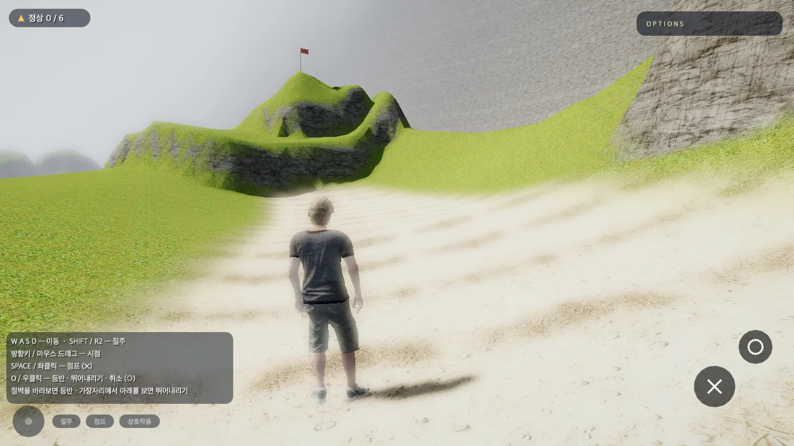
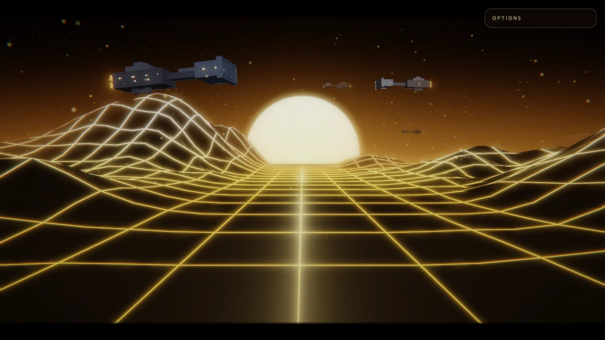
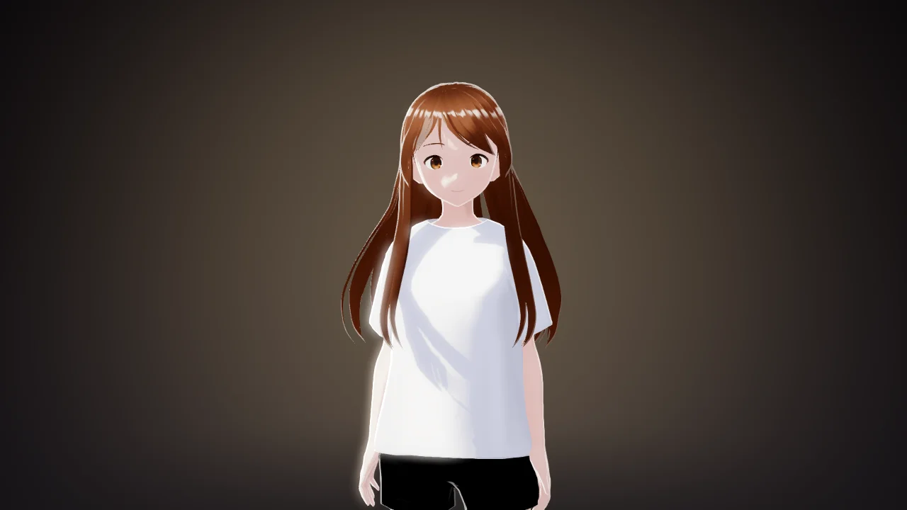
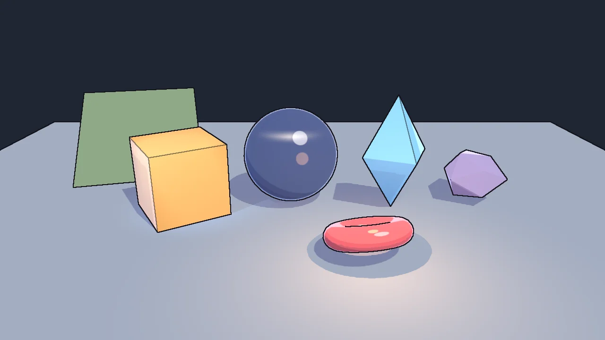
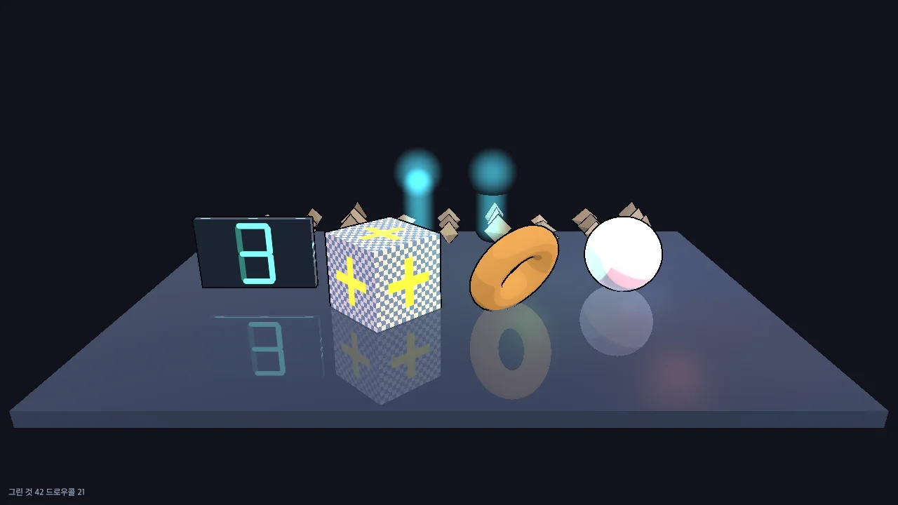

# 3D

glTF(GLB)와 FBX 모형을 불러 애니메이션을 틀고, 엔진의 2D 화면 사이에 3D 로 그리는 방법을 다룹니다. 모형을 담는 `SkinnedModel`, 그리는 `SkinnedModelRenderer`, 보기와 투영을 맡는 `Camera3D`, 재질 `Material`, 그림자 `ShadowMap`, 화면 밖 그림판 `RenderTarget`, 후처리 `BloomEffect` 와 `FullscreenPass` 차례로 보고, 끝에 툰 3D 를 짧게 소개합니다.



3D 의 소스는 `src/graphics3d` 아래에 있습니다. (README 의 "3D", 화면 단위 패스 `FullscreenPass` 는 `src/core`)

## 3D 의 짜임

3D 쪽은 노드와 컴포넌트로 된 씬 그래프가 아닙니다. 로더가 메시, 본, 스킨, 재질, 애니메이션이 다 이어진 `SkinnedModel` 인스턴스를 만들고, 게임은 모델 행렬과 카메라 행렬을 직접 들고 렌더러에 넘겨 그립니다. 모델은 데이터와 포즈만 갖고, 그리기와 환경 상태(태양, 안개, 그림자)는 렌더러가 맡습니다.

| 클래스 | 하는 일 |
| --- | --- |
| `SkinnedModel` | GLB(바이너리 glTF)와 바이너리 FBX 를 읽은 모델 인스턴스. 포즈 계산, 애니메이션 크로스페이드, 모프 가중치 |
| `SkinnedModelRenderer` | 스키닝 PBR 셰이더로 모델을 그림. 태양 방향, 안개, 그림자 받기 상태를 가짐 (씬마다 하나) |
| `Camera3D` | 원근이나 직교 투영과 보는 자리. 보기, 투영 행렬과 월드 점 ↔ 화면 자리 셈 |
| `Material` | metallic-roughness PBR 값과 텍스처 |
| `ShadowMap` | 방향광 그림자의 깊이 텍스처와 광원 행렬 |
| `RenderTarget` | 화면 밖 프레임버퍼(컬러, 깊이, 멀티샘플, 실수 컬러) |
| `FullscreenPass` | 화면 전체를 덮는 삼각형 하나와 프래그먼트 셰이더 |
| `BloomEffect`, `MultiLevelBloomEffect` | 밝은 곳을 뽑아 흐리는 블룸 |

## 엔진 화면에 3D 끼우기

엔진의 `Graphic`(2D)과 3D 클래스는 같은 `WebGL2RenderingContext` 를 함께 씁니다. 컨텍스트는 `graphic.getWebGL2RenderingContext()` 로 꺼냅니다. 2D 그리기 사이에 3D 를 그릴 때는 `graphic.runExternalPass(callback, options)` 로 감쌉니다.

- 앞에 쌓인 2D 묶음을 먼저 그리고, 깊이 버퍼를 비우고(`options.clearDepth` 가 `false` 면 비우지 않음), 상태 기억을 잊은 뒤 `callback(webGL2RenderingContext)` 를 부릅니다.
- `callback` 안에서는 프로그램, 버텍스 어레이, 뷰포트, 섞기, 깊이, 면 가리기를 마음대로 바꿔도 됩니다. 끝나면(던져도) `restoreRenderState` 가 뷰포트, 2D 프로그램, 버텍스 어레이를 되돌리고 섞기를 켜고 깊이 시험과 면 가리기를 끕니다.
- 프레임버퍼 묶음과 스텐실 상태는 되돌리지 않습니다. 렌더 타겟에 그렸으면 `callback` 끝에서 기본 프레임버퍼(`null`)를 다시 묶고, 스텐실은 바꾸지 않습니다.

아래 예제는 `fox.glb` 를 불러 걷는 애니메이션을 틀고, 씬의 `draw` 에서 3D 를 먼저 그린 뒤 `super.draw` 로 2D 노드(글자)를 그 위에 그립니다.

```javascript
import { Engine, EngineConfiguration, Scene, WorldNode, Text, SkinnedModel, SkinnedModelRenderer, Camera3D, Matrix4, Vector2, Vector3, Colors } from "./build/vanilla.js";

class FoxScene extends Scene {
	#skinnedModelRenderer;
	#foxModel;
	#camera;
	#modelMatrix;
	#angle;

	constructor() {
		super();
		this.#skinnedModelRenderer = null;
		this.#foxModel = null;
		this.#camera = new Camera3D();
		this.#modelMatrix = Matrix4.createIdentity();
		this.#angle = 0;
	}

	async load(engine) {
		await super.load(engine);
		const graphic = engine.getGraphic();
		const webGL2RenderingContext = graphic.getWebGL2RenderingContext();
		const skinnedModelRenderer = new SkinnedModelRenderer(webGL2RenderingContext);
		skinnedModelRenderer.setSunDirection(0.45, 0.76, 0.47);
		skinnedModelRenderer.setFogRange(300, 800);
		const foxModel = await SkinnedModel.loadFromUrl(webGL2RenderingContext, "examples/ancientmountain/assets/fox.glb", skinnedModelRenderer);
		foxModel.playAnimation("Walk", 0);
		this.#skinnedModelRenderer = skinnedModelRenderer;
		this.#foxModel = foxModel;

		const camera = this.#camera;
		camera.setPerspective(Math.PI / 3, 1, 2000);
		const eyePosition = Vector3.create(0, 80, 220);
		const targetPosition = Vector3.create(0, 45, 0);
		camera.lookAt(eyePosition, targetPosition);

		const labelNode = new WorldNode();
		labelNode.setContentSize(Vector2.create(400, 60));
		labelNode.setLocalPosition(Vector2.create(640, 80));
		const text = labelNode.addComponent(Text);
		text.setFontSize(40);
		text.setTextColor(Colors.white);
		text.setText("fox.glb");
		const root = this.getRoot();
		root.addChild(labelNode);
	}

	tick(timeDelta) {
		super.tick(timeDelta);
		this.#angle += timeDelta * 0.5;
		this.#modelMatrix = Matrix4.createRotationY(this.#angle);
		const foxModel = this.#foxModel;
		foxModel.update(timeDelta);
	}

	draw(graphic) {
		const canvas = graphic.getCanvas();
		const width = canvas.width;
		const height = canvas.height;
		const camera = this.#camera;
		const skinnedModelRenderer = this.#skinnedModelRenderer;
		const foxModel = this.#foxModel;
		const modelMatrix = this.#modelMatrix;
		graphic.runExternalPass((webGL2RenderingContext) => {
			webGL2RenderingContext.viewport(0, 0, width, height);
			webGL2RenderingContext.enable(webGL2RenderingContext.DEPTH_TEST);
			webGL2RenderingContext.enable(webGL2RenderingContext.CULL_FACE);
			webGL2RenderingContext.disable(webGL2RenderingContext.BLEND);
			camera.setAspectRatio(width / height);
			const viewProjectionMatrix = camera.getViewProjectionMatrix();
			const viewProjectionElements = viewProjectionMatrix.getElements();
			const modelMatrixElements = modelMatrix.getElements();
			const eyePosition = camera.getEyePosition();
			skinnedModelRenderer.draw(foxModel, viewProjectionElements, modelMatrixElements, eyePosition.x, eyePosition.y, eyePosition.z);
		});
		super.draw(graphic);
	}
}

const engineConfiguration = new EngineConfiguration();
engineConfiguration.referenceResolutionSize = Vector2.create(1280, 720);
engineConfiguration.autoResizeOnWindowResize = true;
const engine = new Engine(engineConfiguration);
engine.run(new FoxScene());
```

- `SkinnedModelRenderer(webGL2RenderingContext)` 는 씬에 하나 만듭니다. 모델을 읽을 때 이 렌더러의 셰이더로 재질을 짓기 때문에 모델보다 먼저 만듭니다.
- `SkinnedModel.loadFromUrl(webGL2RenderingContext, url, skinnedModelRenderer)` 는 GLB 파일을 받아 모델을 돌려줍니다. 응답이 실패면 오류를 던지고, GLB 가 아니면(머리가 다르면) 오류를 던집니다. 이미 받은 바이트는 `loadFromBytes(webGL2RenderingContext, arrayBuffer, skinnedModelRenderer)` 로 읽습니다. (`BlobAsset` 으로 받은 `Blob` 의 `arrayBuffer()` 같은 것)
- `update(deltaTime)` 은 시간을 흘리고 포즈를 샘플링해 조인트 행렬을 셈합니다. 애니메이션이 없는 정적 모델도 기본 포즈의 행렬을 셈하려면 그리기 전에 한 번은 부릅니다.
- `draw(skinnedModel, viewProjectionElements, modelMatrixElements, cameraX, cameraY, cameraZ)` 의 행렬은 열 우선 `Float32Array` 16 칸입니다. `Matrix4.getElements()` 가 이 꼴을 돌려줍니다. 카메라 자리는 반사광과 안개 거리 셈에 씁니다.
- 렌더러는 깊이 시험, 면 가리기, 섞기를 건드리지 않습니다. 그리기 전에 부르는 쪽이 정합니다.
- 렌더러의 처음 값은 태양 방향 (0, 1, 0), 안개 색 (0.8, 0.85, 0.92), 안개 거리 55 ~ 250, 그림자 세기 0 입니다. `setSunDirection(x, y, z)`, `setFogColor(red, green, blue)`, `setFogRange(startDistance, endDistance)` 로 바꿉니다. 안개 거리는 월드 단위라서, 위 예제처럼 모형이 크면(여우는 키가 약 79 단위) 늘립니다.
- 모델 행렬은 `Matrix4.createTranslation`, `createRotationY`, `createScale` 같은 것으로 만듭니다. `multiply`, `translate`, `rotateY`, `scale` 은 오른쪽에 곱해 쌓습니다(`this = this x other`).

엔진의 루프를 쓰지 않고 자기 캔버스와 `requestAnimationFrame` 으로 3D 를 그려도 됩니다. Ancient Mountain 예제([`examples/ancientmountain`](https://github.com/ddukbaek2/vanilla.js/blob/release/examples/ancientmountain))가 이렇게 그림자 깊이 패스, 씬 패스, 블룸을 직접 짜서 그립니다.

## Camera3D

`Camera3D` 는 원근이나 직교 투영과 보는 자리를 들고, 값이 바뀐 뒤 처음 읽을 때만 행렬을 다시 셈합니다. 좌표는 y 가 위인 오른손 좌표이고, 카메라는 -Z 쪽을 봅니다. 처음 값은 원근, 세로 시야각 0.8 라디안, 가로 세로 비 1, 거리 0.1 ~ 1000, 눈 (0, 0, 10) 에서 원점을 보는 자리입니다.

```javascript
import { Camera3D, Rect, Vector2, Vector3 } from "./build/vanilla.js";

const camera = new Camera3D();
camera.setPerspective(Math.PI / 3, 0.1, 500);
camera.setAspectRatio(1280 / 720);
const eyePosition = Vector3.create(0, 10, 20);
const targetPosition = Vector3.create(0, 0, 0);
camera.lookAt(eyePosition, targetPosition);

const viewRect = Rect.create(0, 0, 1280, 720);
const screenPoint = camera.projectToView(0, 2, 0, viewRect);
console.log(screenPoint.x, screenPoint.y, screenPoint.depth, screenPoint.isInFront);

const tapPosition = Vector2.create(640, 500);
const groundPoint = camera.unprojectToPlane(tapPosition, 0, viewRect);
if (groundPoint !== null) {
	console.log(groundPoint.x, groundPoint.y, groundPoint.z);
}

camera.setOrthographic(30, 0.1, 500);
console.log(camera.isOrthographic(), camera.readViewDepth(0, 0, 0));
```

- `setPerspective(fieldOfViewRadian, nearDistance, farDistance)`, `setOrthographic(orthographicHeight, nearDistance, farDistance)`(너비는 높이 x 가로 세로 비), `setAspectRatio(aspectRatio)`(그리는 사각형이 바뀔 때마다 넣음), `lookAt(eyePosition, targetPosition, upDirection = Vector3.up())`.
- `getViewMatrix()`, `getProjectionMatrix()`, `getViewProjectionMatrix()`, `getInverseViewProjectionMatrix()` 는 담아 둔 행렬을 돌려줍니다. 고치지 않고, 고칠 것은 `clone()` 합니다.
- `projectToView(x, y, z, viewRect, result)` 는 월드 점을 `viewRect` 안의 자리(왼쪽 위가 원점, 아래로 늘어남)로 옮겨 `{ x, y, depth, isInFront }` 를 돌려줍니다. 눈의 면보다 뒤면 `isInFront` 가 거짓이고 x, y 는 0 입니다. 3D 점 위에 이름표나 단추를 얹을 때 씁니다. `result` 를 주면 거기에 담아 매 프레임 새 객체를 만들지 않습니다.
- `unprojectToPlane(viewPosition, planeHeight, viewRect)` 는 화면 자리에서 나간 시선이 수평면 `y = planeHeight` 와 만나는 월드 점(`Vector3`)을, 만나지 않으면 `null` 을 돌려줍니다. 땅을 누른 자리를 찾을 때 씁니다.
- `readViewDepth(x, y, z)` 는 카메라가 보는 쪽으로 잰 깊이(눈의 면보다 뒤면 음수)입니다. 비치는 것을 먼 것부터 그리도록 정렬할 때 씁니다.
- `setMatrices(viewMatrix, projectionMatrix)` 로 게임이 셈한 행렬을 그대로 쓸 수 있습니다. `setPerspective`, `setOrthographic`, `lookAt` 을 부르면 그 행렬을 버리고 셈하는 길로 돌아갑니다.

## 애니메이션

모형 파일에 든 클립은 `getAnimationNameList()` 로 이름을 봅니다. `fox.glb` 에는 `Survey`, `Walk`, `Run` 이 있습니다.

```javascript
import { SkinnedModel, SkinnedModelRenderer, Quaternion } from "./build/vanilla.js";

const canvas = document.createElement("canvas");
const webGL2RenderingContext = canvas.getContext("webgl2");
const skinnedModelRenderer = new SkinnedModelRenderer(webGL2RenderingContext);
const foxModel = await SkinnedModel.loadFromUrl(webGL2RenderingContext, "examples/ancientmountain/assets/fox.glb", skinnedModelRenderer);
console.log(foxModel.getAnimationNameList());

foxModel.playAnimation("Survey", 0);
foxModel.update(0.5);
foxModel.playAnimation("Run", 0.3);
foxModel.setTimeScale(1.5);
foxModel.update(0.1);

const headTilt = Quaternion.createFromEuler(0, 0, 0.3);
foxModel.setJointRotationOffset("Head", headTilt);
foxModel.update(0.016);
foxModel.clearJointRotationOffsets();

foxModel.destroy();
```

- `playAnimation(animationName, fadeDuration = 0.25)` 는 지금 클립에서 새 클립으로 `fadeDuration` 초 동안 섞어 넘어갑니다. 0 이면 바로 바뀝니다. 지금 트는 클립과 같은 이름이거나 없는 이름이면 아무것도 하지 않습니다.
- 클립은 늘 반복합니다. 한 번만 트는 갈래나 끝 알림은 없으므로, 필요하면 게임이 클립 길이만큼 시간을 재어 다음 클립으로 넘깁니다.
- `setTimeScale(timeScale)` 는 재생 빠르기입니다. (처음 1)
- `setJointRotationOffset(jointNamePart, offsetRotation)` 는 이름에 `jointNamePart` 가 든 모든 노드의 로컬 회전에 `Quaternion` 을 더 곱합니다. 애니메이션을 샘플링한 뒤에 걸리므로 고개 돌리기 같은 절차 포즈에 씁니다. `clearJointRotationOffsets()` 로 모두 풉니다. (여우의 머리 본 이름은 `b_Head_05` 입니다)
- 모프 타깃(glTF 의 `weights` 와 애니메이션)은 `setMorphWeight(targetName, weight)`, `getMorphWeight(targetName)` 로 다룹니다. `addMorphTarget(drawableIndex, targetName, positionDeltas, normalDeltas)` 로 코드에서 타깃을 더할 수도 있습니다. 드로어블 하나에 타깃은 96 개까지입니다.
- 기본 스키닝 셰이더의 조인트 행렬 배열은 96 칸입니다.
- `destroy()` 는 모델의 GL 리소스(버텍스 어레이, 버퍼, 모프 텍스처, 이 모델이 읽으며 지은 재질의 텍스처)를 지웁니다.

## FBX 모형과 애니메이션 더하기

바이너리 FBX 는 `SkinnedModel.loadFromFbxUrl(webGL2RenderingContext, url, skinnedModelRenderer)` 로 읽습니다. (받은 바이트는 `loadFromFbxBytes`) 애니메이션을 클립마다 따로 내보낸 FBX 는 `addAnimationsFromFbxUrl(url, clipName, ignoreTranslation = false)` 로 같은 뼈대의 모델에 클립을 더합니다. 본 이름을 맞춰 지금 모델의 노드로 다시 잇고, `ignoreTranslation` 이 참이면 이동 채널을 버립니다. (위치를 게임이 정하는데 클립에 루트 이동이 박혀 있을 때)

```javascript
import { SkinnedModel, SkinnedModelRenderer } from "./build/vanilla.js";

const canvas = document.createElement("canvas");
const webGL2RenderingContext = canvas.getContext("webgl2");
const skinnedModelRenderer = new SkinnedModelRenderer(webGL2RenderingContext);
const characterModel = await SkinnedModel.loadFromFbxUrl(webGL2RenderingContext, "examples/ancientmountain/assets/mannequin.fbx", skinnedModelRenderer);
await characterModel.addAnimationsFromFbxUrl("examples/ancientmountain/assets/anims/idle.fbx", "Idle");
await characterModel.addAnimationsFromFbxUrl("examples/ancientmountain/assets/anims/walk.fbx", "Walk");
await characterModel.addAnimationsFromFbxUrl("examples/ancientmountain/assets/anims/climb.fbx", "Climb", true);
characterModel.playAnimation("Idle", 0);
characterModel.update(0);
console.log(characterModel.getAnimationNameList());
```

예제 마네킹(Quaternius, CC0)은 미터 단위라 크기를 그대로 씁니다. 센티미터 단위로 내보낸 모형은 모델 행렬에 0.01 배를 곱해 줄입니다.

## Material

모형을 읽으면 파일의 재질로 `Material` 이 저절로 지어집니다. 다른 텍스처나 색으로 바꾸려면 재질을 지어 `setMaterial(drawableIndex, material)` 로 드로어블에 넣습니다.

```javascript
import { SkinnedModel, SkinnedModelRenderer, Material } from "./build/vanilla.js";

const canvas = document.createElement("canvas");
const webGL2RenderingContext = canvas.getContext("webgl2");
const skinnedModelRenderer = new SkinnedModelRenderer(webGL2RenderingContext);
const foxModel = await SkinnedModel.loadFromUrl(webGL2RenderingContext, "examples/ancientmountain/assets/fox.glb", skinnedModelRenderer);

const description = Material.createDefaultDescription();
description.baseColorFactor = [1, 0.85, 0.7];
description.metallicFactor = 0;
description.roughnessFactor = 0.6;
description.baseColorImage = await Material.loadImageDescription("examples/assets/spritesheet.png", { flipY: false, anisotropy: 4 });
const shaderProgram = skinnedModelRenderer.getShaderProgram();
const material = await Material.createFromDescription(webGL2RenderingContext, shaderProgram, description);
foxModel.setMaterial(0, material);

const drawableList = foxModel.getDrawableList();
console.log(drawableList.length, material.getRoughnessFactor());

foxModel.destroy();
material.destroy();
```

- `Material.createDefaultDescription()` 은 흰색, 메탈릭 0, 러프니스 1, 빛남 0 과 비어 있는 그림 칸 8 개(`baseColorImage`, `normalImage`, `metallicRoughnessImage`, `glossinessImage`, `occlusionImage`, `emissiveImage`, `specularImage`, `opacityImage`)를 가진 서술을 돌려줍니다. 비어 있는 그림 칸은 1x1 단색 텍스처가 됩니다.
- 그림 서술은 `Material.loadImageDescription(url, options)`(받아서) 이나 `Material.createImageDescription(bytes, mimeType, options)`(이미 받은 바이트로) 로 만듭니다. `options` 는 `{ flipY, isColorData, anisotropy }` 입니다(처음 값 `false`, `false`, 0). `isColorData` 가 참이면 sRGB 로 저장된 색으로 보고 텍스처를 `SRGB8_ALPHA8` 로 올려 선형으로 풀어 읽습니다. 모형 파일에서 지은 재질은 이 칸을 켜지 않습니다. `anisotropy` 는 이방성 거르기 단계이고, 확장을 받지 못하는 기기에서는 무시됩니다.
- `Material.createFromDescription(webGL2RenderingContext, shaderProgram, description)` 에는 그 재질을 쓸 렌더러의 셰이더(`skinnedModelRenderer.getShaderProgram()`)를 줍니다.
- 텍스처 유닛은 0 이 기본 색, 1 이 그림자 맵 자리(재질에 쓰지 않음), 2 ~ 8 이 노멀, 메탈릭 러프니스, 글로스, 차폐, 빛남, 스펙큘러, 불투명도입니다. 셰이더에 따로 둔 텍스처는 `setTexture(uniformName, textureUnit, glTexture)` 로 9 번부터 겁니다.
- 불투명도 그림이 있으면 알파 컷아웃(머리카락 카드의 투명한 곳 버리기)을 씁니다. 나중에 붙인 경우 `setUseAlphaCutout(true)` 로 켭니다.
- `setMaterial` 로 넣은 재질은 모델의 `destroy()` 가 지우지 않습니다. 다 쓰면 `material.destroy()` 를 부릅니다. (기본 슬롯 텍스처만 지우고, `setTexture` 로 넣은 텍스처는 남깁니다)

## 그림자와 후처리

그림자는 빛의 자리에서 깊이만 그리는 패스(깊이 패스)를 먼저 그린 뒤, 본 패스에서 그 깊이 텍스처를 읽어 받습니다. 블룸 같은 후처리는 본 패스를 화면 대신 `RenderTarget` 에 그린 뒤, 그 텍스처를 가공해 화면에 합칩니다. 아래 예제는 엔진 씬 안에서 깊이 패스, 멀티샘플 렌더 타겟에 그리는 본 패스, 블룸, 합성을 차례로 그립니다.



```javascript
import { Engine, EngineConfiguration, Scene, SkinnedModel, SkinnedModelRenderer, Camera3D, ShadowMap, RenderTarget, BloomEffect, FullscreenPass, Matrix4, Vector2, Vector3 } from "./build/vanilla.js";

const COMPOSITE_FRAGMENTSHADER_SOURCE = `#version 300 es
precision highp float;
in vec2 fragmentTextureCoordinate;
uniform sampler2D sceneTexture;
uniform sampler2D bloomTexture;
uniform float bloomStrength;
out vec4 outputColor;
void main() {
	vec3 sceneColor = texture(sceneTexture, fragmentTextureCoordinate).rgb;
	vec3 bloomColor = texture(bloomTexture, fragmentTextureCoordinate).rgb;
	outputColor = vec4(sceneColor + bloomColor * bloomStrength, 1.0);
}
`;

class PostProcessScene extends Scene {
	#skinnedModelRenderer;
	#foxModel;
	#camera;
	#modelMatrix;
	#angle;
	#shadowMap;
	#sceneRenderTarget;
	#bloomEffect;
	#compositePass;

	constructor() {
		super();
		this.#skinnedModelRenderer = null;
		this.#foxModel = null;
		this.#camera = new Camera3D();
		this.#modelMatrix = Matrix4.createIdentity();
		this.#angle = 0;
		this.#shadowMap = null;
		this.#sceneRenderTarget = null;
		this.#bloomEffect = null;
		this.#compositePass = null;
	}

	async load(engine) {
		await super.load(engine);
		const graphic = engine.getGraphic();
		const webGL2RenderingContext = graphic.getWebGL2RenderingContext();
		const skinnedModelRenderer = new SkinnedModelRenderer(webGL2RenderingContext);
		skinnedModelRenderer.setSunDirection(0.45, 0.76, 0.47);
		skinnedModelRenderer.setFogRange(300, 800);
		skinnedModelRenderer.setShadowStrength(0.8);
		const foxModel = await SkinnedModel.loadFromUrl(webGL2RenderingContext, "examples/ancientmountain/assets/fox.glb", skinnedModelRenderer);
		foxModel.playAnimation("Run", 0);
		this.#skinnedModelRenderer = skinnedModelRenderer;
		this.#foxModel = foxModel;

		this.#shadowMap = new ShadowMap(webGL2RenderingContext, 1024);
		this.#sceneRenderTarget = new RenderTarget(webGL2RenderingContext, 2, 2, true, { sampleCount: 4 });
		const bloomEffect = new BloomEffect(webGL2RenderingContext);
		bloomEffect.setThreshold(0.6, 0.9);
		bloomEffect.setIterationCount(3);
		this.#bloomEffect = bloomEffect;
		this.#compositePass = new FullscreenPass(webGL2RenderingContext, COMPOSITE_FRAGMENTSHADER_SOURCE);

		const camera = this.#camera;
		camera.setPerspective(Math.PI / 3, 1, 2000);
		const eyePosition = Vector3.create(0, 80, 220);
		const targetPosition = Vector3.create(0, 45, 0);
		camera.lookAt(eyePosition, targetPosition);
	}

	tick(timeDelta) {
		super.tick(timeDelta);
		this.#angle += timeDelta * 0.5;
		this.#modelMatrix = Matrix4.createRotationY(this.#angle);
		const foxModel = this.#foxModel;
		foxModel.update(timeDelta);
	}

	draw(graphic) {
		const canvas = graphic.getCanvas();
		const width = canvas.width;
		const height = canvas.height;
		graphic.runExternalPass((webGL2RenderingContext) => {
			this.drawShadowPass(webGL2RenderingContext);
			this.drawScenePass(webGL2RenderingContext, width, height);
			this.drawCompositePass(webGL2RenderingContext, width, height);
		});
		super.draw(graphic);
	}

	drawShadowPass(webGL2RenderingContext) {
		const shadowMap = this.#shadowMap;
		const skinnedModelRenderer = this.#skinnedModelRenderer;
		const foxModel = this.#foxModel;
		const modelMatrix = this.#modelMatrix;
		const focusPosition = Vector3.create(0, 40, 0);
		const lightDirection = Vector3.create(-0.45, -0.76, -0.47);
		shadowMap.updateLightMatrix(focusPosition, lightDirection, 150, 1, 600);
		const lightViewProjectionMatrix = shadowMap.getLightViewProjectionMatrix();
		const lightViewProjectionElements = lightViewProjectionMatrix.getElements();
		const modelMatrixElements = modelMatrix.getElements();
		shadowMap.beginRender();
		webGL2RenderingContext.disable(webGL2RenderingContext.BLEND);
		skinnedModelRenderer.drawDepth(foxModel, lightViewProjectionElements, modelMatrixElements);
		const depthTexture = shadowMap.getDepthTexture();
		const resolution = shadowMap.getResolution();
		skinnedModelRenderer.setShadowMap(depthTexture, lightViewProjectionElements, 1 / resolution);
	}

	drawScenePass(webGL2RenderingContext, width, height) {
		const sceneRenderTarget = this.#sceneRenderTarget;
		const skinnedModelRenderer = this.#skinnedModelRenderer;
		const foxModel = this.#foxModel;
		const modelMatrix = this.#modelMatrix;
		const camera = this.#camera;
		sceneRenderTarget.resize(width, height);
		sceneRenderTarget.bind();
		webGL2RenderingContext.clearColor(0.16, 0.2, 0.26, 1);
		webGL2RenderingContext.clear(webGL2RenderingContext.COLOR_BUFFER_BIT | webGL2RenderingContext.DEPTH_BUFFER_BIT);
		webGL2RenderingContext.enable(webGL2RenderingContext.DEPTH_TEST);
		webGL2RenderingContext.enable(webGL2RenderingContext.CULL_FACE);
		camera.setAspectRatio(width / height);
		const viewProjectionMatrix = camera.getViewProjectionMatrix();
		const viewProjectionElements = viewProjectionMatrix.getElements();
		const modelMatrixElements = modelMatrix.getElements();
		const eyePosition = camera.getEyePosition();
		skinnedModelRenderer.draw(foxModel, viewProjectionElements, modelMatrixElements, eyePosition.x, eyePosition.y, eyePosition.z);
		sceneRenderTarget.resolve();
	}

	drawCompositePass(webGL2RenderingContext, width, height) {
		const sceneRenderTarget = this.#sceneRenderTarget;
		const bloomEffect = this.#bloomEffect;
		const compositePass = this.#compositePass;
		const sceneColorTexture = sceneRenderTarget.getColorTexture();
		bloomEffect.resize(width, height);
		bloomEffect.render(sceneColorTexture);
		const bloomTexture = bloomEffect.getResultTexture();

		webGL2RenderingContext.bindFramebuffer(webGL2RenderingContext.FRAMEBUFFER, null);
		webGL2RenderingContext.viewport(0, 0, width, height);
		compositePass.useProgram();
		const sceneTextureLocation = compositePass.getUniformLocation("sceneTexture");
		const bloomTextureLocation = compositePass.getUniformLocation("bloomTexture");
		const bloomStrengthLocation = compositePass.getUniformLocation("bloomStrength");
		webGL2RenderingContext.uniform1i(sceneTextureLocation, 0);
		webGL2RenderingContext.uniform1i(bloomTextureLocation, 1);
		webGL2RenderingContext.uniform1f(bloomStrengthLocation, 0.8);
		webGL2RenderingContext.activeTexture(webGL2RenderingContext.TEXTURE0);
		webGL2RenderingContext.bindTexture(webGL2RenderingContext.TEXTURE_2D, sceneColorTexture);
		webGL2RenderingContext.activeTexture(webGL2RenderingContext.TEXTURE1);
		webGL2RenderingContext.bindTexture(webGL2RenderingContext.TEXTURE_2D, bloomTexture);
		compositePass.draw();
		webGL2RenderingContext.activeTexture(webGL2RenderingContext.TEXTURE0);
	}
}

const engineConfiguration = new EngineConfiguration();
engineConfiguration.referenceResolutionSize = Vector2.create(1280, 720);
engineConfiguration.autoResizeOnWindowResize = true;
const engine = new Engine(engineConfiguration);
engine.run(new PostProcessScene());
```

### ShadowMap

- `new ShadowMap(webGL2RenderingContext, resolution = 2048)` 은 한 변 `resolution` 픽셀의 깊이 텍스처(24 비트, 비교 샘플링)와 깊이 전용 프레임버퍼를 짓습니다.
- `updateLightMatrix(focusPosition, lightDirection, extent, nearDistance, farDistance)` 는 `focusPosition` 둘레 `extent`(가운데부터 한쪽 폭)를 덮는 직교 광원 행렬을 셈합니다. `lightDirection` 은 빛이 나아가는 방향이라, 렌더러의 `setSunDirection`(해가 있는 쪽)과 부호가 반대입니다. 광원의 눈은 초점에서 빛 반대쪽으로 `(nearDistance + farDistance) / 2` 만큼 떨어지고, 움직일 때 그림자 가장자리가 떨리지 않게 텍셀 단위로 맞춥니다.
- `beginRender()` 는 그 프레임버퍼를 묶고 뷰포트를 맞추고 깊이 시험을 켜고 깊이를 비웁니다. 그 뒤 그림자를 드리울 모델마다 `skinnedModelRenderer.drawDepth(model, lightViewProjectionElements, modelMatrixElements)` 를 부릅니다.
- 본 패스 전에 `skinnedModelRenderer.setShadowMap(depthTexture, lightViewProjectionElements, texelSize)` 와 `setShadowStrength(strength)`(0 이면 받지 않음)를 겁니다.
- `destroy()` 는 프레임버퍼와 깊이 텍스처를 지웁니다.

이 예제에는 바닥이 없어 여우가 제 몸에 드리운 그림자만 보입니다. 바닥 같은 다른 메시가 그림자를 받으려면 그 메시의 셰이더가 같은 깊이 텍스처와 광원 행렬을 읽어야 합니다.

### RenderTarget

- `new RenderTarget(webGL2RenderingContext, width, height, useDepth, options)` 의 `options` 는 `{ colorAttachmentCount = 1, useFloatColor = false, useDepthTexture = false, sampleCount = 0, depthBits = 16 }` 입니다(`null` 이면 모두 처음 값).
- `bind()` 는 프레임버퍼를 묶고 뷰포트를 그 크기로 맞춥니다. `resize(width, height)` 는 크기가 같으면 아무것도 하지 않고, 다르면 리소스를 다시 짓습니다.
- `sampleCount` 가 2 이상이면 멀티샘플 렌더버퍼에 그리고, `resolve()` 가 컬러 텍스처(와 깊이 텍스처)로 풉니다. 텍스처를 읽기 전에 `resolve()` 를 부릅니다. 기기가 받는 수를 넘으면 그 밑의 가장 큰 수로 줄이고, 받지 못하면 멀티샘플 없이 짓습니다(`getSampleCount()`). 멀티샘플이 아니면 `resolve()` 는 아무것도 하지 않습니다.
- `useFloatColor` 는 RGBA16F 컬러(HDR)이고, `colorAttachmentCount` 가 2 이상이면 여러 컬러 어태치먼트(MRT)입니다. `getColorTexture(attachmentIndex)`, `getDepthTexture()` 로 텍스처를 꺼냅니다.

### BloomEffect 와 FullscreenPass

- `BloomEffect` 는 밝은 곳을 반 해상도로 뽑아 가로, 세로 가우시안 블러를 되풀이합니다. `resize(sceneWidth, sceneHeight)`, `render(sceneColorTexture)`, `getResultTexture()` 차례로 쓰고, 결과 텍스처를 합성 패스에서 더합니다.
- `setThreshold(thresholdStart, thresholdEnd)`(처음 0.5, 0.95)는 세 채널 가운데 가장 큰 밝기로 뽑기 시작하는 값과 다 뽑는 값입니다. `setIterationCount(iterationCount)`(처음 2)는 블러 한 쌍을 되풀이할 수입니다. 판은 처음에 RGBA8 이라 1 을 넘는 값이 잘리고, `setUseFloatColor(true)` 면 RGBA16F 로 지어 HDR 값을 그대로 흐립니다.
- `render` 는 깊이 시험과 섞기를 끄고, 0 번 텍스처 유닛을 활성으로 두고, 프레임버퍼 묶음을 바꿉니다. 그 뒤에 화면에 그리려면 기본 프레임버퍼를 다시 묶고 뷰포트를 맞춥니다.
- `MultiLevelBloomEffect(webGL2RenderingContext, levelCount = 5, useFloatColor = true)` 는 반씩 줄여 가며 흐리고 거꾸로 키우며 더하는 다단 블룸입니다. `setThreshold(threshold, knee)`(처음 1, 0.25)이고 쓰는 차례는 `BloomEffect` 와 같습니다.
- `FullscreenPass(webGL2RenderingContext, fragmentShaderSource)` 는 화면 전체를 덮는 삼각형 하나를 그립니다. 프래그먼트 셰이더는 GLSL ES 3.00 이고 `in vec2 fragmentTextureCoordinate`(0 ~ 1)와 `in vec2 fragmentCoordinate`(-1 ~ 1)를 받습니다. `useProgram()`, `getUniformLocation(uniformName)`, 유니폼 설정, `draw()` 차례로 부르고 `destroy()` 로 지웁니다.

## 그 밖의 3D 클래스

- `HumanSkinRenderer`: `SkinnedModelRenderer` 의 스키닝 경로 위에 피부, 눈, 머리카락 셰이딩을 세운 렌더러. 여러 버퍼(MRT)로 나눠 그리고 합성은 부르는 쪽이 합니다.
- `SubsurfaceScatteringEffect`: 화면 공간 피하 산란. 조도 텍스처를 깊이를 보며 흐려 피부를 부드럽게 합니다.
- `AmbientOcclusionEffect`: 화면 공간 앰비언트 오클루전. 깊이와 노멀 버퍼로 가려진 정도를 셈합니다.
- `SkinnedModelRenderer` 생성자에 프래그먼트 셰이더(와 버텍스 셰이더) 소스를 주면 같은 스키닝, 모프 경로 위에 다른 셰이딩을 세웁니다. 바꾼 버텍스 셰이더는 기본과 같은 어트리뷰트와 출력 규약을 지키고, 모프 타깃은 `MORPH_GLSL` 조각을 넣어 씁니다.
- `drawWireframe(skinnedModel, viewProjectionElements, modelMatrixElements, red, green, blue, alpha)` 는 모서리 선을 그립니다. 섞기와 깊이 상태는 부르는 쪽이 정합니다.

앞의 셋이 `HumanSkinRenderer` 의 피부 그리기 길입니다. 쓰는 법은 위 코드를 봅니다.

## 툰 3D

툰 3D 는 셀 셰이딩으로 그리는 따로 된 3D 묶음입니다(`src/graphics3d/toon`). 이 장에서는 무엇이 있는지만 적습니다.







- `ToonRenderer`: 셀 셰이딩 렌더러. 껍데기 바깥선, 인스턴싱, 그림자를 가집니다.
- `MeshBuilder` 와 `createBoxGeometry` 같은 도형 함수, `readGlbArrays` 같은 GLB 읽기 함수: 메시 배열을 짓는 함수와 GLB 에서 메시를 읽는 함수. (이름마다 낸다, 러스트 판과 같다)
- `ToonLightSet`, `ToonMaterial`: 빛 묶음(점광 포함)과 머티리얼 셰이더 조각.
- `ToonDrawQueue`: 한 프레임에 그릴 모형과 단계 콜백을 담아 두었다가 불투명한 것, 바깥선, 비치는 것 차례로 맞춰 그리는 줄.
- `ToonScreenOutline`, `ToonVfx`, `ToonPostProcess`: 화면 공간 바깥선, 3D 효과, 후처리(MSAA, 다단 블룸, 색 보정).
- `ToonView3D`: 노드의 사각형 안에 툰 3D 를 그리는 컴포넌트. 안에서 `runExternalPass` 를 씁니다.

쓰는 모습은 [`examples/toonmaterial`](https://github.com/ddukbaek2/vanilla.js/blob/release/examples/toonmaterial) 의 소스에서 봅니다.

## 주의할 점

- `runExternalPass` 는 프레임버퍼 묶음을 되돌리지 않습니다. 렌더 타겟에 그렸으면 끝에서 기본 프레임버퍼를 묶습니다.
- 렌더러는 깊이 시험, 면 가리기, 섞기를 정하지 않습니다. 3D 를 그리기 전에 켜고 끕니다.
- 모델은 매 프레임 `update` 를 불러야 움직이고, 정적 모델도 그리기 전에 한 번은 부릅니다.
- 클립은 늘 반복합니다. 한 번만 트는 동작은 게임이 시간을 재어 넘깁니다.
- `ShadowMap.updateLightMatrix` 의 빛 방향은 렌더러의 태양 방향과 부호가 반대입니다.
- `setMaterial` 로 넣은 재질과 직접 지은 `ShadowMap`, `RenderTarget`, `BloomEffect`, `FullscreenPass` 는 다 쓰면 `destroy()` 를 부릅니다.
- 엔진의 그리기 통계(`getLastFrameDrawCallCount` 같은 것)에는 3D 패스가 들어가지 않습니다.

## 관련 클래스

SkinnedModel, SkinnedModelRenderer, Camera3D, Material, ShadowMap, RenderTarget, FullscreenPass, BloomEffect, MultiLevelBloomEffect, HumanSkinRenderer, SubsurfaceScatteringEffect, AmbientOcclusionEffect, Matrix4, Vector3, Quaternion, Graphic, ToonRenderer, ToonView3D
