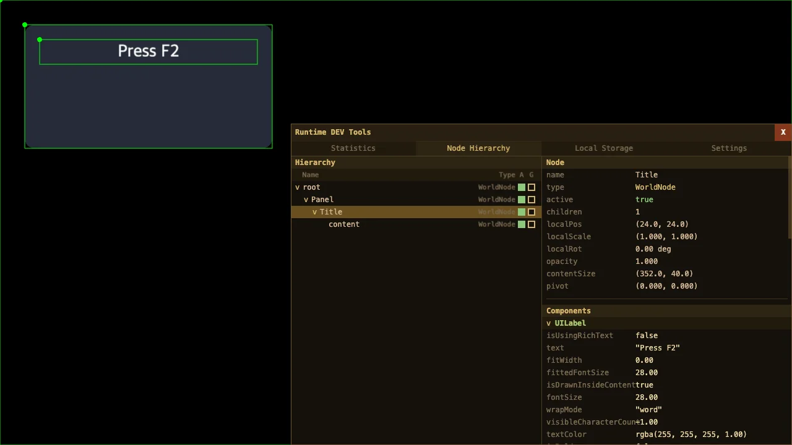

# 개발자 도구

개발하는 동안 화면 위에 정보를 띄우고, 노드를 살펴보고, 기기 성능을 재는 기능을 다룹니다. F2 로 여닫는 개발자 도구 패널, 엔진 정보창(`useStatistics`), 기즈모, 그리기 통계, 검증용 화면 저장, 처지는 기기를 가리는 `FrameProbe` 와 `GraphicsQualityGovernor`, 배포 판을 읽는 `BuildInfo` 차례로 봅니다.

## F2 개발자 도구 패널

`EngineConfiguration.useDevTools` 가 켜져 있으면(처음 값 `true`) `UIScene` 이 초기화할 때 개발자 도구 패널을 만듭니다. 게임 화면에서 F2 를 누르면 패널이 캔버스 오른쪽 아래에 붙어 열리고, 다시 누르면 닫힙니다. 기본 `Scene` 은 패널을 만들지 않으므로 패널을 쓰려면 `UIScene` 을 이어받습니다.



```javascript
import { Engine, EngineConfiguration, UIScene, WorldNode, Paint, UILabel, Pivot, Vector2, Color } from "./build/vanilla.js";

class DebugScene extends UIScene {
	constructor() {
		super();
		this.setLoadingMinDurationMs(0);
	}

	initialize(engine) {
		super.initialize(engine);
		const panelNode = new WorldNode();
		panelNode.setName("Panel");
		panelNode.setPivot(Pivot.topLeft);
		panelNode.setAnchor(Pivot.topLeft);
		panelNode.setLocalPosition(Vector2.create(40, 40));
		panelNode.setContentSize(Vector2.create(400, 200));
		const paint = panelNode.addComponent(Paint);
		paint.setColor(new Color(0.15, 0.17, 0.22, 1));
		paint.setRoundSize(16);

		const titleNode = new WorldNode();
		titleNode.setName("Title");
		titleNode.setPivot(Pivot.topLeft);
		titleNode.setAnchor(Pivot.topLeft);
		titleNode.setLocalPosition(Vector2.create(24, 24));
		titleNode.setContentSize(Vector2.create(352, 40));
		const label = titleNode.addComponent(UILabel);
		label.setText("Press F2");
		label.setFontSize(28);
		panelNode.addChild(titleNode);

		const root = this.getRoot();
		root.addChild(panelNode);
	}
}

const engineConfiguration = new EngineConfiguration();
engineConfiguration.referenceResolutionSize = Vector2.create(1280, 720);
engineConfiguration.autoResizeOnWindowResize = true;
engineConfiguration.useDevTools = true;
const engine = new Engine(engineConfiguration);
engine.run(new DebugScene());
```

패널은 처음 810 x 520 크기(가장 작게 300 x 200)입니다. 제목 줄을 끌어 옮기고, 가장자리와 귀퉁이를 끌어 크기를 바꾸고, 가운데 구분선을 끌어 좌우 비율을 바꿉니다. 제목 줄 오른쪽의 닫기 단추로도 닫습니다. 패널이 열려 있고 포인터가 그 위에 있는 동안에는 `UIScene` 이 터치(`touchPress`, `touchMove`, `touchRelease`, `touchCancel`, `touchWheel`)를 UI 노드로 넘기지 않습니다. 씬에서 터치를 직접 다룰 때는 `isDevToolsCapturingInput()` 이 참이면 건너뜁니다.

패널에는 탭이 넷 있습니다. 처음 열리는 탭은 Node Hierarchy 입니다.

| 탭 | 보이는 것 |
| --- | --- |
| Statistics | Platform(엔진 판, 플랫폼, 브라우저), Screen(창, 캔버스, 기준 해상도, 뷰 배율 모드, 뷰 영역, 입력 자리), Time(시작 뒤 시간, 엔진 시간, FPS, 프레임 간격), Memory(크롬에서만, JS 힙 크기) |
| Node Hierarchy | 왼쪽은 씬 루트부터의 노드 트리(이름, 종류, 켜짐 A, 기즈모 G 칸), 오른쪽은 고른 노드의 이름, 종류, 켜짐, 자식 수, 위치, 배율, 회전, 투명도, 내용 크기, 피벗과 붙은 컴포넌트마다 `get`, `is` 로 읽히는 값 |
| Local Storage | `LocalStorage` 의 키와 값 목록. + Add 로 더하고, Clear 로 모두 지우고, 줄의 × 로 하나를 지웁니다. 줄을 고르면 Edit Key, Edit Value, Duplicate, Remove 단추가 나옵니다 |
| Settings | Dim Background, Show All Gizmos, Show Height Aspect Guide, Show Width Aspect Guide, Show FPS 켜고 끄기 |

- 트리의 A 칸을 누르면 그 노드의 `setActive` 가, G 칸을 누르면 `setGizmoVisible` 이 바뀝니다. 인스펙터의 컴포넌트 머리를 누르면 그 컴포넌트의 값 목록을 접고 폅니다.
- Local Storage 탭의 더하기, 고치기, 지우기는 브라우저의 `prompt` 와 `confirm` 창으로 묻습니다. Clear 는 `LocalStorage.clear()` 라서 같은 출처의 값을 모두 지웁니다.
- Settings 의 Dim Background 는 패널 밖의 화면을 어둡게 덮습니다. Show All Gizmos(처음 켜짐)는 패널이 열려 있는 동안 모든 노드의 기즈모를 그립니다. 두 비율 안내선은 뷰 배율 모드가 늘이는 모드(`stretchWidth`, `stretchHeight`, `stretchShort` 와 그 `Expand` 갈래)일 때만, 화면 가운데에 세로 기준(가로 = 세로 x 1, 0.75, 0.5)이나 가로 기준(세로 = 가로 x 1, 0.75, 0.5) 사각형을 그립니다. Show FPS 칸은 값을 저장하지만 지금 소스에서는 이 값을 읽는 곳이 없어 화면에 바뀌는 것이 없습니다.
- Settings 의 값은 `LocalStorage` 의 `hierarchy.settings` 키에 JSON 으로 저장되어 다음에 켤 때도 남습니다.

출시 빌드처럼 사용자에게 보이면 안 되는 곳에서는 `engineConfiguration.useDevTools = false` 로 끕니다. 끄면 패널을 만들지 않고 F2 도 받지 않습니다.

## 엔진 정보창

`EngineConfiguration.useStatistics` 를 켜면(처음 값 `false`) 엔진이 매 프레임 모든 씬을 그린 뒤 화면 왼쪽 위에 정보창을 그립니다. 씬 종류와 상관없이 동작하고, 엔진 기본 글꼴(`16px DOSGothic`)을 1.4 배로 키워 씁니다.

```javascript
import { Engine, EngineConfiguration, Scene, WorldNode, Paint, Vector2, Color } from "./build/vanilla.js";

class StatisticsScene extends Scene {
	async load(engine) {
		await super.load(engine);
		const root = this.getRoot();
		for (let index = 0; index < 20; ++index) {
			const boxNode = new WorldNode();
			boxNode.setContentSize(Vector2.create(40, 40));
			boxNode.setLocalPosition(Vector2.create(200 + index * 45, 500));
			const paint = boxNode.addComponent(Paint);
			paint.setColor(new Color(0.3, 0.6, 0.9, 1));
			root.addChild(boxNode);
		}
	}
}

const engineConfiguration = new EngineConfiguration();
engineConfiguration.referenceResolutionSize = Vector2.create(1280, 720);
engineConfiguration.useStatistics = true;
const engine = new Engine(engineConfiguration);
engine.run(new StatisticsScene());
```

정보창에는 엔진 판(`engineVersion`), 플랫폼과 브라우저 이름, 캔버스 크기(`canvasNativeSize`), 기준 해상도, 뷰 배율 모드, 뷰 영역(`viewNativeRect`), 뷰 크기, 입력 자리(캔버스 좌표와 뷰 좌표), 엔진 시간, FPS, 프레임 간격, 지난 프레임의 드로우 콜 수, 정점 수, 삼각형 수, 화면 밖이라 건너뛴 노드 수가 나옵니다.

## 기즈모

기즈모는 개발 중에만 보는 표시(영역, 기준점, 시야 범위 같은 것)입니다. 씬, 노드, 컴포넌트가 저마다 `setGizmoVisible(isVisible)` 와 `isGizmoVisible()`, 덮어쓸 수 있는 `drawGizmos(graphic)` 를 가집니다. 처음에는 모두 꺼져 있습니다.

- 씬: `setGizmoVisible(true)` 면 엔진이 그 씬의 `preDraw`, `draw`, `postDraw` 뒤에 `drawGizmos(graphic)` 를 부릅니다. `Scene` 의 기본 `drawGizmos` 는 아무것도 그리지 않으므로 덮어써서 그립니다.
- 노드: `setGizmoVisible(true)` 면 그 노드를 그린 뒤(자식까지 그린 뒤) 노드의 좌표계에서 `drawGizmos` 를 부릅니다. `WorldNode` 는 내용 영역 테두리와 피벗 자리의 점(반지름 4)을 초록색으로 그리고, 기즈모가 켜진 컴포넌트의 `drawGizmos` 를 부릅니다.
- 컴포넌트: 노드의 `drawGizmos` 가 불릴 때만 그 안에서 불립니다. 컴포넌트의 기즈모를 보려면 컴포넌트와 노드를 둘 다 켭니다.
- `graphic.setForceGizmosVisible(true)` 는 노드마다의 설정과 상관없이 모든 노드의 `drawGizmos` 를 부르게 합니다. 개발자 도구 패널의 Show All Gizmos 가 이것을 씁니다.

```javascript
import { Engine, EngineConfiguration, Scene, WorldNode, Paint, Component, Vector2, Color } from "./build/vanilla.js";

class SightGizmo extends Component {
	#radius;

	constructor() {
		super();
		this.#radius = 120;
	}

	drawGizmos(graphic) {
		super.drawGizmos(graphic);
		const node = this.getNode();
		const contentSize = node.getContentSize();
		const center = Vector2.create(contentSize.x * 0.5, contentSize.y * 0.5);
		graphic.setStrokeColor("#ffcc00");
		graphic.drawStrokeCircle(center, this.#radius, 2);
	}
}

class GizmoScene extends Scene {
	async load(engine) {
		await super.load(engine);
		const enemyNode = new WorldNode();
		enemyNode.setContentSize(Vector2.create(80, 80));
		enemyNode.setLocalPosition(Vector2.create(640, 360));
		const paint = enemyNode.addComponent(Paint);
		paint.setColor(new Color(0.8, 0.3, 0.3, 1));
		const sightGizmo = enemyNode.addComponent(SightGizmo);
		sightGizmo.setGizmoVisible(true);
		enemyNode.setGizmoVisible(true);
		const root = this.getRoot();
		root.addChild(enemyNode);
		this.setGizmoVisible(true);
	}

	drawGizmos(graphic) {
		super.drawGizmos(graphic);
		const engine = this.getEngine();
		const viewManager = engine.getViewManager();
		viewManager.applyViewRect(graphic);
		const viewSize = viewManager.getViewSize();
		graphic.setStrokeColor("#00ffff");
		graphic.drawLine([Vector2.create(viewSize.x * 0.5, 0), Vector2.create(viewSize.x * 0.5, viewSize.y)], 1);
		graphic.drawLine([Vector2.create(0, viewSize.y * 0.5), Vector2.create(viewSize.x, viewSize.y * 0.5)], 1);
	}
}

const engineConfiguration = new EngineConfiguration();
engineConfiguration.referenceResolutionSize = Vector2.create(1280, 720);
const engine = new Engine(engineConfiguration);
engine.run(new GizmoScene());
```

씬의 `drawGizmos` 가 불릴 때의 좌표계는 그 앞에서 그린 것이 남긴 그대로입니다. 뷰 좌표로 그리려면 위 예제처럼 `viewManager.applyViewRect(graphic)` 를 먼저 부릅니다. 노드와 컴포넌트의 `drawGizmos` 는 노드의 좌표계(내용 영역의 왼쪽 위가 0, 0)에서 불립니다.

## 그리기 통계 읽기

정보창에 나오는 값은 코드에서도 읽습니다. 엔진은 씬을 그리기 전에 지난 프레임의 값을 넘겨 두고 이번 프레임을 새로 셉니다.

- `graphic.getLastFrameDrawCallCount()`, `getLastFrameVertexCount()`, `getLastFrameTriangleCount()`: 지난 프레임의 드로우 콜, 정점, 삼각형 수. 2D 경로만 세고 3D 렌더러와 화면 효과 패스는 세지 않습니다.
- `graphic.getLastFrameCulledNodeCount()`: 지난 프레임에 화면 밖이라 컴포넌트를 건너뛴 노드 수.
- `timeManager.getFramePerSecond()`: 지난 1 초 동안 센 프레임 수(처음 1 초 동안은 0).

```javascript
import { Engine, EngineConfiguration, Scene, WorldNode, Paint, Vector2, Color } from "./build/vanilla.js";

class ProfileScene extends Scene {
	#elapsedSeconds;

	constructor() {
		super();
		this.#elapsedSeconds = 0;
	}

	async load(engine) {
		await super.load(engine);
		const root = this.getRoot();
		for (let index = 0; index < 100; ++index) {
			const boxNode = new WorldNode();
			boxNode.setContentSize(Vector2.create(20, 20));
			boxNode.setLocalPosition(Vector2.create((index % 10) * 120 + 60, Math.floor(index / 10) * 70 + 40));
			const paint = boxNode.addComponent(Paint);
			paint.setColor(new Color(0.9, 0.6, 0.2, 1));
			root.addChild(boxNode);
		}
	}

	tick(timeDelta) {
		super.tick(timeDelta);
		this.#elapsedSeconds += timeDelta;
		if (this.#elapsedSeconds < 0.5) {
			return;
		}
		this.#elapsedSeconds = 0;
		const engine = this.getEngine();
		const graphic = engine.getGraphic();
		const timeManager = engine.getTimeManager();
		const drawCallCount = graphic.getLastFrameDrawCallCount();
		const triangleCount = graphic.getLastFrameTriangleCount();
		const culledNodeCount = graphic.getLastFrameCulledNodeCount();
		const framePerSecond = timeManager.getFramePerSecond();
		console.log(framePerSecond, drawCallCount, triangleCount, culledNodeCount);
	}
}

const engineConfiguration = new EngineConfiguration();
engineConfiguration.referenceResolutionSize = Vector2.create(1280, 720);
const engine = new Engine(engineConfiguration);
engine.run(new ProfileScene());
```

## 검증용 화면 저장

`engine.requestFrameCapture(frameNumber)` 는 그 프레임을 다 그린 뒤 캔버스를 PNG data URL 로 넘기는 Promise 를 돌려줍니다. 이미 지난 번호면 지금 프레임을 저장합니다. 프레임 번호는 `run` 을 부르면 1 이 되고 프레임을 마칠 때마다 1 씩 늘어납니다(`getFrameNumber()`).

```javascript
import { Engine, EngineConfiguration, Scene, WorldNode, Paint, Vector2, Color } from "./build/vanilla.js";

class CaptureScene extends Scene {
	async load(engine) {
		await super.load(engine);
		const boxNode = new WorldNode();
		boxNode.setContentSize(Vector2.create(200, 200));
		boxNode.setLocalPosition(Vector2.create(640, 360));
		const paint = boxNode.addComponent(Paint);
		paint.setColor(new Color(0.4, 0.8, 0.5, 1));
		const root = this.getRoot();
		root.addChild(boxNode);
	}
}

const engineConfiguration = new EngineConfiguration();
engineConfiguration.referenceResolutionSize = Vector2.create(1280, 720);
const engine = new Engine(engineConfiguration);
engine.run(new CaptureScene());

const capturePromise = engine.requestFrameCapture(30);
capturePromise.then((dataUrl) => {
	console.log(engine.getFrameNumber(), dataUrl.length);
});
```

코드를 고치지 않고 페이지 주소로도 겁니다. 엔진을 만들 때 주소의 쿼리를 읽습니다.

```text
index.html?capture=120,240&captureName=shot_{frame}.png&captureExit=1
```

- `capture`: 저장할 프레임 번호들(쉼표로 나눔). 맞는 번호가 하나도 없으면 120 입니다.
- `captureName`: 내려받을 파일 이름. `{frame}` 은 프레임 번호로 바뀝니다. 처음 값은 `capture_{frame}.png` 입니다.
- `captureExit=1`: 마지막 저장 뒤 `exitApplication()` 을 부릅니다. (Capacitor 앱이면 앱을 끝내고, 웹이면 창 닫기를 시도합니다)

저장할 때마다 콘솔에 파일 이름과 캔버스 크기를 찍습니다. 헤드리스 브라우저로 화면을 비교하는 검증에 씁니다.

## 처지는 기기 가리기

`FrameProbe` 는 켜진 뒤 처음 몇 초의 프레임 간격을 재어 처지는 기기인지 정합니다. 엔진과 브라우저를 들여오지 않는 계산기라서 프레임 간격과 최대 FPS 는 부르는 쪽이 넘깁니다.

- 재기 시작한 뒤 기다리는 초(처음 2)가 지나면, 재는 초(처음 4) 동안 매 프레임의 간격을 봅니다. 처음 몇 초는 모형과 그림을 받느라 끊기기 때문입니다. `setSeconds(warmupSeconds, probeSeconds)` 로 바꿉니다.
- 목표 간격은 최대 FPS 의 한 칸(최대 FPS 가 0 이면 `setUnlimitedTargetFramePerSecond` 의 값, 처음 60)입니다. 목표 간격의 1.4 배를 넘긴 프레임을 처진 프레임으로 세고, 처진 프레임이 0.25 몫 이상이면 처지는 기기입니다. `setSlowFrameThreshold(slowFrameRatio, slowFrameShare)` 로 바꿉니다. (1.4 배로 보는 까닭: 90 Hz 화면에서 최대 60 이면 엔진이 한 장 걸러 그려 늘 약 22 ms 간격이고, 그것은 처지는 것이 아닙니다)
- `measureFrame(frameSeconds, maximumFramePerSecond)` 를 매 프레임 부르면 다 재는 프레임에 `true` 를 돌려줍니다. 그 뒤 `isFinished()`, `isSlow()` 를 읽습니다. `readSlowFrameShare()` 는 지금까지의 처진 프레임 몫입니다.
- 처지는 기기로 정하면 다시 재지 않습니다. 다 재기 전에 창이 가려지면 `restart()` 로 처음부터 다시 잽니다. 처지지 않았으면 무거운 장면에서 `measureAgain()` 으로 한 번 더 잴 수 있습니다.

## 그래픽 품질 정하기

`GraphicsQualityGovernor` 는 설정과 `FrameProbe` 로 가벼운 길(`isLite()`)을 쓸지 정하고, 길마다 렌더 배율 상한을 겁니다. 가벼운 길에서 무엇을 줄일지(그림자, 바깥선, 효과, 그리는 수)는 게임이 `isLite()` 를 읽어 정합니다.

- 가벼운 길을 정하는 차례: 덮어쓰기(`setLiteOverride`, `applySearchText`) → 품질 설정(`setQuality`, `GraphicsQuality.low` 는 늘 가벼움, `high` 는 늘 아님) → 자동(`auto`, 처음 값). 자동이면 `setAutoLiteDefault(true)`(손가락 기기처럼 재기 전부터 가볍게 갈 때)이거나 `FrameProbe` 가 처지는 기기로 잰 때 가벼운 길입니다.
- `applySearchText(searchText, liteKey = "light")` 는 주소의 쿼리 글에 `light` 가 있으면 가벼운 길로, 값이 `"0"` 이나 `"false"` 면 늘 보통 길로 덮어씁니다.
- `update(frameSeconds, maximumFramePerSecond)` 를 매 프레임 부르면 자동일 때만 프레임을 재고, 가벼운 길이 바뀐 프레임에 `true` 를 돌려줍니다.
- `setRenderPixelRatioLimits(normal, lite)` 로 길마다 렌더 배율 상한(0 이면 제한 없음)을 주고, `applyRenderPixelRatio(viewManager)` 가 `ViewManager.setMaxRenderPixelRatio` 로 겁니다. 값이 같으면 다시 걸지 않습니다.
- `getFrameProbe()` 로 안의 `FrameProbe` 를 꺼내 기다리는 초나 판정 문턱을 바꿉니다.

```javascript
import { Engine, EngineConfiguration, Scene, GraphicsQualityGovernor, GraphicsQuality, Vector2 } from "./build/vanilla.js";

class QualityScene extends Scene {
	#governor;

	constructor() {
		super();
		const governor = new GraphicsQualityGovernor();
		governor.setQuality(GraphicsQuality.auto);
		governor.applySearchText(window.location.search);
		governor.setRenderPixelRatioLimits(0, 1.5);
		const frameProbe = governor.getFrameProbe();
		frameProbe.setSeconds(2, 4);
		this.#governor = governor;
	}

	initialize(engine) {
		super.initialize(engine);
		const viewManager = engine.getViewManager();
		this.#governor.applyRenderPixelRatio(viewManager);
	}

	tick(timeDelta) {
		super.tick(timeDelta);
		const engine = this.getEngine();
		const timeManager = engine.getTimeManager();
		const frameSeconds = timeManager.getUnscaleDeltaTime();
		const maximumFramePerSecond = engine.getMaximumFramePerSecond();
		const governor = this.#governor;
		const isChanged = governor.update(frameSeconds, maximumFramePerSecond);
		if (isChanged) {
			const viewManager = engine.getViewManager();
			governor.applyRenderPixelRatio(viewManager);
			console.log("lite", governor.isLite());
		}
	}
}

const engineConfiguration = new EngineConfiguration();
engineConfiguration.referenceResolutionSize = Vector2.create(1280, 720);
engineConfiguration.maximumFramePerSecond = 60;
const engine = new Engine(engineConfiguration);
engine.run(new QualityScene());
```

## 빌드 정보

`BuildInfo` 는 배포 빌드가 적어 둔 판을 앱이 켜질 때 한 번 읽어, 설정 화면 구석 같은 곳에 보이게 합니다. `load()` 는 이 차례로 읽고, 실패해도 예외를 내지 않습니다.

1. 페이지 머리의 `<meta name="build-version" content="...">` 의 `content`. 있으면 그 글 그대로입니다. 이름은 `setMetaName` 으로 바꿉니다.
2. 없으면 생성자에 준 파일(처음 `./version.json`, `setVersionJsonPath` 로 바꿈, 빈 글이면 받지 않음)을 캐시 없이(`cache: "no-cache"`) 받습니다. 새 판을 올려도 옛 판 표시가 남지 않게 하려는 것입니다.
3. 다 없으면 `setPackageVersion` 으로 넣은 판, 그것도 없으면 빈 글입니다.

```text
<meta name="build-version" content="2026-11-26 07:30 (a1b2c3d)">
```

```json
{ "version": "1.2.0", "date": "2026-11-26", "time": "07:30", "hash": "a1b2c3d" }
```

`version.json` 에서 읽으면 글은 `"날짜 시각 (해시)"` 꼴이고, 해시가 없으면 `version`, 그것도 없으면 빈 글입니다(`BuildInfo.composeText`). 게임마다 판을 쓰는 꼴이 다르면 `readVersionData()` 로 받은 객체를 게임이 엮습니다.

```javascript
import { BuildInfo } from "./build/vanilla.js";

const buildInfo = new BuildInfo("./version.json");
buildInfo.setPackageVersion("0.4.0-dev");
const versionText = await buildInfo.load();
console.log(versionText, buildInfo.isLoaded(), buildInfo.readVersionData());

const composedText = BuildInfo.composeText({ version: "1.2.0", date: "2026-11-26", time: "07:30", hash: "a1b2c3d" });
console.log(composedText);
```

`readText()` 는 읽은 글(meta, version.json, 넣은 판 차례)을, `readVersionData()` 는 `version.json` 에서 읽은 객체(meta 로 읽었거나 읽지 못했으면 `null`)를, `isLoaded()` 는 읽기를 마쳤는지(실패해도 마친 것)를 돌려줍니다.

## 주의할 점

- 개발자 도구 패널은 `UIScene` 이 만듭니다. `Scene` 을 바로 이어받은 씬에서는 F2 를 눌러도 열리지 않습니다.
- 출시 빌드에서는 `useDevTools` 를 끄고 `useStatistics` 를 켜지 않습니다.
- 패널의 Local Storage 탭에서 Clear 를 누르면 같은 출처의 저장 값이 모두 지워집니다.
- 컴포넌트의 기즈모는 노드의 기즈모가 그려질 때만 그려집니다.
- 그리기 통계는 2D 경로만 셉니다. 3D 패스의 드로우 콜은 들어가지 않습니다.
- `FrameProbe` 는 한 번 처지는 기기로 정하면 다시 재지 않습니다.

## 관련 클래스

EngineConfiguration, Engine, UIScene, Scene, Component, WorldNode, Graphic, TimeManager, ViewManager, LocalStorage, FrameProbe, GraphicsQualityGovernor, GraphicsQuality, BuildInfo
