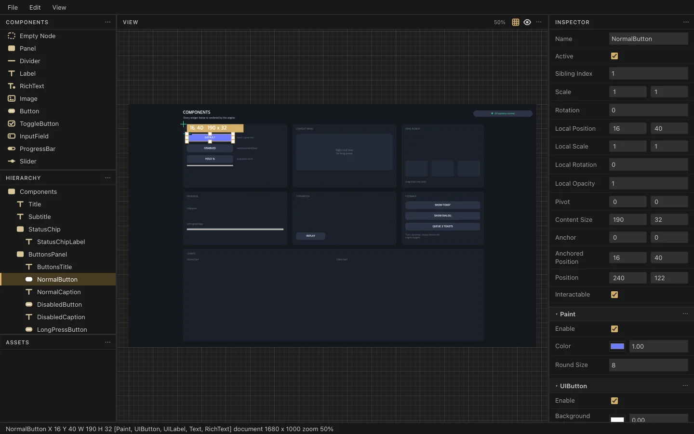
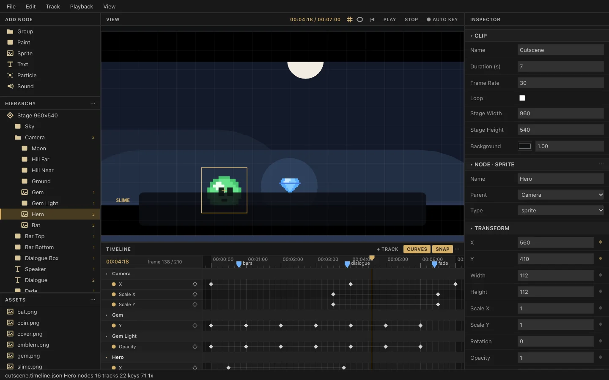
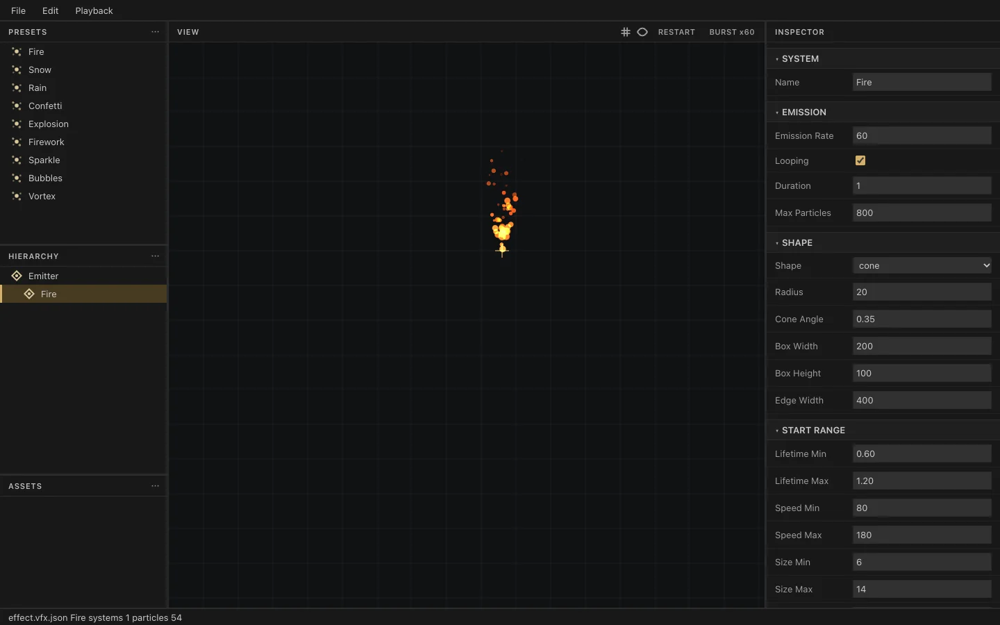
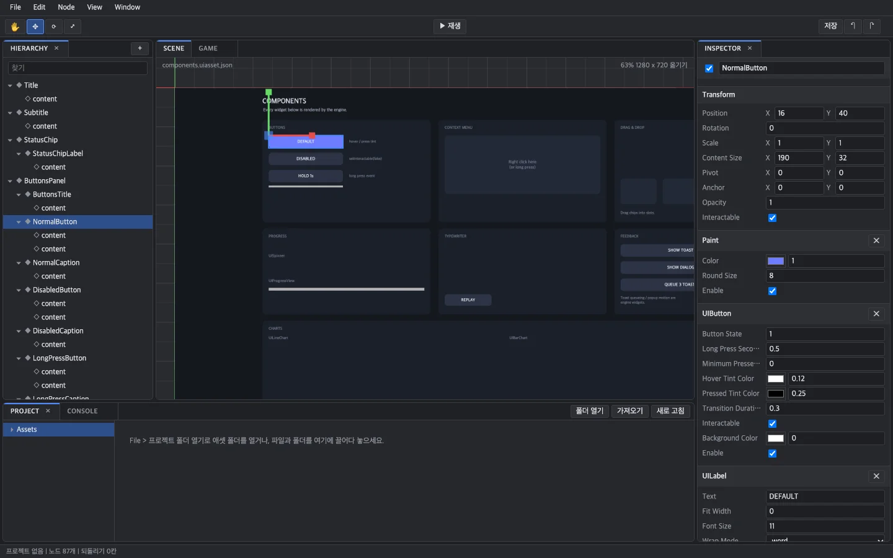

# 저작 도구

엔진과 함께 오는 저작 도구가 만드는 파일을 게임에서 불러 쓰는 방법을 다룹니다. UI Editor 의 `.uiasset.json`, Timeline Editor 의 `.timeline.json`, Particle Editor 의 `.vfx.json`, Visual Editor 의 `.scene.json` 과 `.prefab.json` 차례로 보고, 끝에 명령줄 도구가 만든 결과를 어디에 쓰는지 정리합니다. 도구 목록과 여는 곳은 "도구" 장에 있습니다.

## 도구와 파일

| 도구 | 데모 | 만드는 파일 | 엔진에서 읽는 곳 |
| --- | --- | --- | --- |
| UI Editor | [열기](https://vanillapunch.com/tools/editor/uieditor/) | `.uiasset.json` (처음 이름 `ui.uiasset.json`) | `new UIDocument().fromJsonText` |
| Timeline Editor | [열기](https://vanillapunch.com/tools/editor/timelineeditor/) | `.timeline.json` (처음 이름 `titlecard.timeline.json`) | `Timeline.loadFromUrl`, `loadFromText`, `createFromJsonAsset` |
| Particle Editor | [열기](https://vanillapunch.com/tools/editor/particleeditor/) | `.vfx.json` (처음 이름 `effect.vfx.json`) | `ParticleSystem.applyDescription` |
| Visual Editor | [열기](https://vanillapunch.com/tools/editor/visualeditor/) | `scenes/*.scene.json`, `prefabs/*.prefab.json` | `new UIDocument().fromJsonText` |

- 도구마다 `tools/<도구 이름>/<도구 이름>.html` 이 엔진까지 한 파일에 담은 빌드라서, 서버 없이 파일로 열어도 동작합니다. 소스를 고친 뒤에는 `node tools/<도구 이름>/build.mjs` 로 다시 만듭니다.
- UI Editor, Timeline Editor, Particle Editor 는 저장하면 브라우저 내려받기로 파일을 받습니다. Visual Editor 는 크롬 계열 브라우저에서 폴더 열기로 연 폴더에 바로 쓰고, 그 밖의 브라우저에서는 내려받기로 받습니다.
- 받은 파일은 게임의 애셋 폴더에 두고 아래처럼 불러옵니다.

## UI Editor 문서 불러오기

`.uiasset.json` 은 노드 트리를 그대로 적은 UI 문서입니다. 판 번호와 뿌리 노드 하나로 되어 있고, 노드마다 종류, 이름, 위치, 배율, 회전, 투명도, 피벗, 앵커, 내용 크기, 컴포넌트, 자식을 적습니다.



```json
{
	"version": 1,
	"root": {
		"type": "WorldNode",
		"name": "Root",
		"position": [0, 0],
		"contentSize": [960, 640],
		"components": [],
		"children": [
			{
				"type": "WorldNode",
				"name": "StartButton",
				"position": [40, 300],
				"contentSize": [240, 64],
				"components": [
					{ "type": "Paint", "color": [0.25, 0.5, 0.9, 1], "roundSize": 12 },
					{ "type": "UIButton" },
					{ "type": "UILabel", "text": "Start", "fontSize": 24 }
				],
				"children": []
			}
		]
	}
}
```

`new UIDocument()` 로 지은 문서의 `fromJsonText(jsonText)` 는 이 글을 살아 있는 엔진 노드 트리(`WorldNode`)로 되살려 뿌리를 돌려줍니다. 문서는 전역 상태가 없는 객체이고, 종류 표와 그림 해석기를 문서마다 따로 듭니다. 씬의 루트에 붙이면 그대로 보이고, 이름으로 노드를 찾아 동작을 붙입니다. `UIDocument.findNodeByPath(rootNode, pathText)` 는 문서 뿌리부터 이름을 `/` 로 이은 경로(뿌리 이름은 빼고 `/` 로 시작)로 노드를 찾고, 없으면 `null` 입니다.

```javascript
import { Engine, EngineConfiguration, UIScene, UIDocument, UIButton, UILabel, TextAsset, Vector2 } from "./build/vanilla.js";

class TitleScene extends UIScene {
	#documentRoot;

	constructor() {
		super();
		this.setLoadingMinDurationMs(0);
		this.#documentRoot = null;
	}

	async loadAssets() {
		await super.loadAssets();
		const textAsset = new TextAsset();
		await textAsset.load("examples/uisample/assets/title.uiasset.json");
		this.#documentRoot = new UIDocument().fromJsonText(textAsset.text);
	}

	initialize(engine) {
		super.initialize(engine);
		const documentRoot = this.#documentRoot;
		const root = this.getRoot();
		root.addChild(documentRoot);

		const startButtonNode = UIDocument.findNodeByPath(documentRoot, "/Panel/StartButton");
		const descriptionNode = UIDocument.findNodeByPath(documentRoot, "/Panel/Description");
		const startButton = startButtonNode.getComponent(UIButton);
		const descriptionLabel = descriptionNode.getComponent(UILabel);
		startButton.setClickedEvent(() => {
			descriptionLabel.setText("Start pressed");
		});
	}
}

const engineConfiguration = new EngineConfiguration();
engineConfiguration.referenceResolutionSize = Vector2.create(960, 640);
engineConfiguration.autoResizeOnWindowResize = true;
const engine = new Engine(engineConfiguration);
engine.run(new TitleScene());
```

- `UIScene.loadAssets()` 는 `UIScene` 이 로딩 화면을 보이는 동안 부르는 자리입니다. 덮어쓸 때는 `super.loadAssets()` 를 부릅니다. `Scene` 을 바로 이어받았으면 `load` 에서 읽습니다.
- 스크롤 뷰처럼 `UIView` 계열 위젯은 붙을 때 안쪽 content 노드를 스스로 만듭니다. 그래서 문서에는 위젯만 적고, content 안에 넣은 자식(목록 항목 등)은 `contentChildren` 으로 따로 적었다가 되살릴 때 content 아래에 붙입니다. content 노드의 이름은 `content` 이므로 경로에 넣어 찾습니다. (예: `/Panel/ItemList/content/Item0`)
- 다른 노드를 가리키는 값(노드 참조)은 문서에 `$nodeRef` 와 뿌리 기준 경로로 적혀 있고, 트리를 다 만든 뒤 이어 붙입니다.
- 노드 생성자가 스스로 만드는 컴포넌트와 자식(`UIWindow` 의 제목 막대, `UIImageView` 가 붙이는 `Sprite` 같은)은 문서의 앞에서부터 차례와 종류(자식은 이름)가 맞으면 그것에 문서 값을 넣고 겹쳐 만들지 않습니다. 그래서 읽고 다시 저장하면 같은 문서입니다.

### 그림 경로 해석

문서에는 그림 원본이 아니라 경로(`imagePath`)만 적힙니다. `Sprite` 와 `UIImageView` 가 이 칸을 씁니다. 되살릴 때 그림을 이으려면 `fromJsonText` 를 부르기 전에 그 문서의 `uiDocument.setImageResolver(resolver)` 로 경로 → `HTMLImageElement` 함수를 겁니다. 이 함수는 바로 돌려줘야 하므로(비동기 불가) 그림은 먼저 받아 둡니다. 해석기 대신 `await Promise.all(uiDocument.loadImages(jsonText))` 로 문서의 그림을 경로대로 받아 둘 수도 있습니다. 아직 읽히는 그림은 문서가 맡아 두었다가 `uiDocument.bindPendingImages()` 가 넣습니다(남은 수를 돌려줍니다). 찾지 못한 그림은 경고를 내고, 그 컴포넌트는 그림 없이 경로만 `imagePath` 에 남깁니다.

### 컴포넌트와 노드 종류 등록

게임 쪽 `UIDocument` 가 처음부터 아는 컴포넌트는 `Paint`, `Sprite`, `Text`, `RichText`, `Mask`, `Outline`, `SoftShade`, `ShadowText`, `UIProgressRing`, `UILabel`, `UIImageView`, `UIButton`, `UIToggleButton`, `UIProgressView`, `UISlider`, `UIScrollView`, `ShadowImage` 이고(`new UIDocument().getComponentTypeNames()`), 노드 종류는 `WorldNode` 하나입니다. UI Editor 는 엔진이 내보내는 모든 컴포넌트와 `WorldNode` 파생 노드를 문서 형식에 등록해 씁니다. 그래서 편집기에서 쓴 종류가 게임 쪽 표에 없으면, 그 컴포넌트는 읽을 때 경고를 내고 빠지고 그 노드는 경고를 내고 `WorldNode` 로 되살아납니다.

편집기가 저장한 문서를 읽는 게임은 `fromJsonText` 앞에 `uiDocument.registerEditorTypes()` 를 한 번 부릅니다. 편집기가 등록하는 종류(컴포넌트 35, 노드 종류 12)를 같은 이름으로 모두 등록하고, 이미 등록한 이름은 그대로 둡니다. 하나씩 등록할 때는 `registerNodeType`, `registerComponentType` 을 씁니다. 예를 들어 입력칸(`UIInputField`)과 스크롤 바(`UIScrollBar`)는 `WorldNode` 를 이어받은 노드이고, 스냅 스크롤 뷰(`UISnapScrollView`)는 컴포넌트입니다.

```javascript
import { UIDocument, UIInputField, UIScrollBar, UISnapScrollView, SoftShade, WorldNode } from "./build/vanilla.js";

const uiDocument = new UIDocument();
uiDocument.registerNodeType("UIInputField", UIInputField);
uiDocument.registerNodeType("UIScrollBar", UIScrollBar);
uiDocument.registerComponentType("UISnapScrollView", UISnapScrollView);
uiDocument.registerEditorTypes();

const componentTypeNames = uiDocument.getComponentTypeNames();
console.log(componentTypeNames.includes("UISnapScrollView"), componentTypeNames.length, uiDocument.createComponent(new WorldNode(), "SoftShade") instanceof SoftShade);
```

전용 저장 규칙이 없는 컴포넌트는 짝이 맞는 `get`, `set` 메서드로 읽고 쓰는 값(`saveByReflection`, `loadByReflection`)으로 저장되고 되살아납니다.

### 게임에서 문서 저장하기

`uiDocument.toJsonText(rootNode, isPretty = true)` 는 노드 트리를 같은 꼴의 글로 바꿉니다. 노드와 컴포넌트의 종류 이름은 표에 등록한 이름으로 적으므로, 클래스 이름을 줄이는 번들(esbuild 의 `--minify`)에서도 같은 문서가 됩니다. 표에 등록하지 않은 종류만 자바스크립트 클래스 이름(`constructor.name`)으로 적으므로, 그런 종류까지 저장하려면 클래스 이름을 지키는 번들(`--keep-names`)을 씁니다. README 의 명령과 `tools/project.cjs build` 는 `--keep-names` 를 붙여 줄입니다. 읽기(`fromJsonText`)는 문서의 이름으로 표를 찾으므로 어느 번들에서나 됩니다.

## Timeline Editor 문서 재생하기

`.timeline.json` 은 무대 노드 목록, 트랙(대상 이름, 속성, 키), 마커로 이루어진 문서입니다. 맨 위에 `name`, `duration`(초), `frameRate`, `loop`, `stage`(`width`, `height`, `backgroundColor`, `nodes`), `tracks`, `markers` 가 있습니다.



```javascript
import { Engine, EngineConfiguration, Scene, Timeline, ImageAsset, Vector2 } from "./build/vanilla.js";

class LogoScene extends Scene {
	#timeline;

	constructor() {
		super();
		this.#timeline = null;
	}

	async load(engine) {
		await super.load(engine);
		const emblemAsset = new ImageAsset();
		await emblemAsset.load("examples/timelineshowcase/assets/emblem.png");
		const timeline = await Timeline.loadFromUrl("examples/timelineshowcase/assets/logo.timeline.json");
		const root = this.getRoot();
		timeline.buildStage(root, (imageName) => {
			return imageName === "emblem.png" ? emblemAsset.getImage() : null;
		});
		timeline.setMarkerHandler((markerName) => {
			console.log("marker", markerName);
		});
		timeline.setCompleteHandler(() => {
			console.log("complete");
		});
		timeline.setLoop(false);
		timeline.play();
		this.#timeline = timeline;
	}

	tick(timeDelta) {
		super.tick(timeDelta);
		this.#timeline.tick(timeDelta);
	}
}

const engineConfiguration = new EngineConfiguration();
engineConfiguration.referenceResolutionSize = Vector2.create(960, 540);
const engine = new Engine(engineConfiguration);
engine.run(new LogoScene());
```

- 읽기: `Timeline.loadFromUrl(url)`(받아서 만듦), `Timeline.loadFromText(text)`(JSON 글에서), `Timeline.createFromJsonAsset(jsonAsset)`(읽은 `JsonAsset` 에서, 문서를 복사해 씀, 안 읽혔으면 `null`). `AssetLoader` 로 다른 애셋과 함께 받을 때는 `addJson` 으로 받은 뒤 `createFromJsonAsset` 을 씁니다.
- 무대: `buildStage(parentNode, imageResolver)` 는 문서의 무대 노드를 만들어 `parentNode` 아래에 붙이고, 이름 → 노드 `Map` 을 돌려줍니다. 이미 만든 노드 트리에 트랙을 걸려면 `bind(rootNode)` 로 트랙의 대상 이름과 같은 이름의 노드를 찾아 붙이고, 노드가 아닌 객체는 `setTarget(name, target)` 이나 `setTargetResolver(resolver)` 로 겁니다.
- 그림: 편집기에서 가져온 그림은 문서의 `image` 칸에 `data:` 주소로 들어가고, 런타임이 스스로 읽습니다. 위 예제처럼 이름(`"emblem.png"`)으로 적힌 그림은 `imageResolver` 가 돌려줘야 합니다.
- 재생: `play()`, `pause()`, `stop()`(처음으로), `seek(time)`(이벤트를 내지 않음)과, 매 프레임 `tick(timeDelta)` 를 부릅니다. `setLoop`, `setSpeed` 로 반복과 빠르기를 바꿉니다.
- 알림: `setMarkerHandler((markerName, marker, timeline) => {})`, `setEventHandler((targetName, eventName, key, timeline) => {})`, `setCompleteHandler((timeline) => {})`. 완료는 반복이 아닐 때 끝에 닿으면 불립니다.
- 소리 노드가 있는 문서는 `Timeline.setAudioManager(engine.getAudioManager())` 를 먼저 불러야 소리를 냅니다.

트랙, 이징, 키의 자세한 규칙은 "트윈과 타임라인" 장에서 다룹니다.

## Particle Editor 애셋 쓰기

`.vfx.json` 은 파티클 시스템 서술의 목록입니다. 시스템마다 이름과 `ParticleSystem.applyDescription` 이 받는 서술 칸을 함께 적습니다.



```json
{
	"systems": [
		{ "name": "Fire", "looping": true, "duration": 1, "emissionRate": 60, "shape": "cone", "lifetime": [0.6, 1.2], "speed": [80, 180], "renderShape": "circle", "blendMode": "lighter" }
	]
}
```

엔진에서는 시스템마다 노드를 하나 만들어 `ParticleSystem` 을 붙이고 서술을 넣습니다. `ParticleSystem` 은 붙이면 바로 재생합니다. 편집기에서 파티클 그림을 가져왔으면 그 그림이 서술의 `imageDataUrl` 칸에 `data:` 주소로 들어가는데, `applyDescription` 은 이 칸을 읽지 않으므로 그림을 직접 읽어 `setImage` 로 줍니다.

```javascript
import { Engine, EngineConfiguration, Scene, WorldNode, ParticleSystem, Vector2 } from "./build/vanilla.js";

const vfxAssetText = `{
	"systems": [
		{
			"name": "Sparks",
			"looping": true,
			"duration": 1,
			"emissionRate": 80,
			"shape": "circle",
			"shapeRadius": 10,
			"lifetime": [0.4, 0.8],
			"speed": [120, 260],
			"size": [3, 6],
			"gravity": [0, 300],
			"startColorA": [1, 0.9, 0.4, 1],
			"startColorB": [1, 0.5, 0.1, 1],
			"colorOverLifetime": [{ "time": 0, "color": [1, 1, 1, 1] }, { "time": 1, "color": [1, 0.3, 0.05, 0] }],
			"renderShape": "streak",
			"blendMode": "lighter"
		}
	]
}`;

class EffectScene extends Scene {
	async load(engine) {
		await super.load(engine);
		const vfxAsset = JSON.parse(vfxAssetText);
		const root = this.getRoot();
		for (const description of vfxAsset.systems) {
			const systemNode = new WorldNode();
			systemNode.setName(description.name);
			systemNode.setLocalPosition(Vector2.create(640, 360));
			const particleSystem = systemNode.addComponent(ParticleSystem);
			particleSystem.applyDescription(description);
			if (description.imageDataUrl) {
				const imageElement = new Image();
				imageElement.src = description.imageDataUrl;
				await imageElement.decode();
				particleSystem.setImage(imageElement);
			}
			root.addChild(systemNode);
		}
	}
}

const engineConfiguration = new EngineConfiguration();
engineConfiguration.referenceResolutionSize = Vector2.create(1280, 720);
const engine = new Engine(engineConfiguration);
engine.run(new EffectScene());
```

게임에서는 파일을 `JsonAsset` 으로 받아 `jsonAsset.data.systems` 를 위와 같이 돕니다. 편집기는 `systems` 가 없는 옛 꼴(서술 하나만 있는 객체)도 읽으므로, 그런 파일이면 객체 하나를 서술로 씁니다. 서술 칸의 뜻은 "파티클" 장에서 다룹니다.

## Visual Editor 씬 불러오기

Visual Editor 는 씬을 UI 문서와 같은 꼴(`UIDocument`)로 저장합니다. 처음 저장 경로는 `scenes/untitled.scene.json` 이고, 편집기만 쓰는 틀 크기(`frameSize`)를 같은 JSON 에 함께 둡니다. `UIDocument` 는 모르는 키를 건너뛰므로 게임은 `new UIDocument()` 의 `fromJsonText` 로 그대로 읽습니다. 씬 뿌리는 이름이 `sceneRoot` 이고 피벗이 왼쪽 위인 `WorldNode` 입니다.



고른 노드를 프리팹으로 저장하면 `prefabs/<이름>.prefab.json` 에 그 노드 하나를 뿌리로 하는 UI 문서가 생깁니다. 게임에서 같은 프리팹을 여러 번 쓰려면 글을 한 번 받아 두고 `fromJsonText` 를 쓸 때마다 부릅니다. 부를 때마다 새 노드 트리가 나옵니다.

Visual Editor 의 `Sprite` 는 그림의 프로젝트 기준 경로를 `imagePath` 에 적습니다. 게임에서는 그 경로의 그림을 먼저 받아 두고 해석기에서 돌려줍니다. 아래 예제는 Visual Editor 가 저장하는 꼴을 줄여 코드에 둔 것입니다.

```javascript
import { Engine, EngineConfiguration, Scene, UIDocument, ImageAsset, Vector2 } from "./build/vanilla.js";

const sceneJsonText = JSON.stringify({
	version: 1,
	frameSize: [1280, 720],
	root: {
		type: "WorldNode",
		name: "sceneRoot",
		pivot: [0, 0],
		contentSize: [0, 0],
		components: [],
		children: [
			{
				type: "WorldNode",
				name: "Hero",
				position: [640, 360],
				contentSize: [300, 300],
				components: [{ type: "Sprite", imagePath: "images/spritesheet.png" }],
				children: [],
			},
		],
	},
});

const prefabJsonText = JSON.stringify({
	version: 1,
	root: {
		type: "WorldNode",
		name: "Coin",
		contentSize: [80, 80],
		components: [{ type: "Paint", color: [1, 0.8, 0.2, 1], roundSize: 40 }],
		children: [],
	},
});

class VisualScene extends Scene {
	async load(engine) {
		await super.load(engine);
		const imageTable = new Map();
		const spritesheetAsset = new ImageAsset();
		await spritesheetAsset.load("examples/assets/spritesheet.png");
		imageTable.set("images/spritesheet.png", spritesheetAsset.getImage());
		const uiDocument = new UIDocument();
		uiDocument.setImageResolver((imagePath) => {
			return imageTable.has(imagePath) ? imageTable.get(imagePath) : null;
		});

		const root = this.getRoot();
		const sceneRoot = uiDocument.fromJsonText(sceneJsonText);
		root.addChild(sceneRoot);

		for (let index = 0; index < 3; ++index) {
			const coinNode = uiDocument.fromJsonText(prefabJsonText);
			coinNode.setLocalPosition(Vector2.create(200 + index * 120, 120));
			sceneRoot.addChild(coinNode);
		}
	}
}

const engineConfiguration = new EngineConfiguration();
engineConfiguration.referenceResolutionSize = Vector2.create(1280, 720);
const engine = new Engine(engineConfiguration);
engine.run(new VisualScene());
```

게임에서는 `TextAsset` 으로 `scenes/main.scene.json` 같은 파일을 받아 `textAsset.text` 를 넘깁니다.

## 명령줄 도구

명령줄 도구는 Node.js 로 실행합니다. 쓰는 법의 전체는 [`tools/TOOLS.md`](https://github.com/ddukbaek2/vanilla.js/blob/release/tools/TOOLS.md) 에 있고, 여기서는 결과물을 엔진 어디에 쓰는지만 정리합니다.

```bash
node tools/atlas.cjs assets/ui --extrude 1 --padding 2
node tools/webm.cjs assets/sounds
node tools/project.cjs build --script main.js --input . --output build/web
node tools/project.cjs check --input .
node tools/project.cjs stage --source build/web --destination ../site/game --skip README.md
node tools/mangle.cjs build/web/js/bundle.min.js build/web/js/bundle.mangled.js images x y width height
node tools/apidoc.cjs 0.4.0 --check-examples
```

| 도구 | 결과 | 엔진에서 쓰는 곳 |
| --- | --- | --- |
| `atlas.cjs` | 입력 폴더 옆에 `<폴더 이름>.json` 과 쪽 그림. npm 패키지 `canvas` 가 필요합니다 | `SpriteAtlas.load` ("애셋 불러오기" 장) |
| `webm.cjs` | 폴더 아래의 음원(mp3, wav, ogg, flac, aac, m4a, wma, opus, aiff, au)마다 같은 자리에 libopus 코덱의 `.webm`. 원본은 지우지 않습니다. npm 패키지 `fluent-ffmpeg`, `ffmpeg-static` 이 필요합니다 | `AudioAsset`, `AssetLoader.addAudio` ("소리" 장) |
| `project.cjs build` | 출력 폴더를 비운 뒤 빌드 템플릿(처음은 `tools/buildtemplate`, `-t` 나 `--template` 로 바꿈)과 `<입력>/assets` 를 복사하고, 진입 파일을 esbuild 로 묶어 `<출력>/js/bundle.min.js`(iife, 압축)에 씁니다 | 템플릿의 `index.html` 이 `./js/bundle.min.js` 를 불러옵니다 |
| `project.cjs check` | `<입력>/assets/sprites` 아래의 그림과 아틀라스 현황 보고. npm 패키지 `canvas` 가 필요합니다 | 없음 (점검용) |
| `project.cjs stage` | 소스 폴더를 대상 폴더로 복사(대상은 먼저 비움). `--skip` 에 쉼표로 준 맨 위 이름은 건너뜁니다 | 없음 (배포 준비) |
| `mangle.cjs` | 묶은 파일에서 문자열 밖의 `.이름` 꼴 프로퍼티 이름을 `$a`, `$b` 같은 짧은 이름으로 바꾸고, 바꾼 표를 `<출력>.map.json` 에 씁니다 | 없음 (용량 줄이기) |
| `apidoc.cjs` | `docs/api/<판>.json`. `--check-examples` 는 API 예제와 이 가이드의 코드 칸을 돌려 봅니다 | 없음 (문서 사이트) |

`mangle.cjs` 는 실행 중에 읽는 JSON 의 키를 바꾸지 않습니다. 코드에서 `.이름` 으로 읽는 JSON 키(도구가 만든 문서의 칸 같은 것)는 셋째 인자부터 제외 목록으로 넘겨야 바뀌지 않습니다. 도구 머리말의 예는 아틀라스 JSON 의 키인 `images x y width height` 를 넘깁니다. 메서드 이름을 글로 엮어 부르는 기능(`UIDocument` 의 `get`, `set` 짝 읽기 같은 것)도 이름이 바뀌면 동작하지 않습니다.

`tools/excel.cjs` 는 함수만 내보내는 모듈이라 다른 스크립트에서 `require` 로 불러 씁니다. ("도구" 장)

## 주의할 점

- UI 문서의 그림은 경로만 적힙니다. `fromJsonText` 앞에 그림을 받아 두고 `setImageResolver` 를 겁니다.
- 편집기에서 쓴 컴포넌트와 노드 종류가 게임 쪽 `UIDocument` 표에 없으면 조용히 빠지거나 `WorldNode` 가 됩니다. 기본 16 컴포넌트 밖의 종류는 등록합니다.
- 게임에서 `uiDocument.toJsonText` 로 저장하려면 클래스 이름을 지키는 번들을 씁니다.
- `Timeline` 은 매 프레임 `tick` 을 불러야 움직입니다. 소리가 있는 문서는 `Timeline.setAudioManager` 를 먼저 부릅니다.
- `.vfx.json` 의 `imageDataUrl` 은 `applyDescription` 이 읽지 않습니다. 그림은 직접 읽어 `setImage` 로 줍니다.
- `mangle.cjs` 를 쓰면 실행 중에 읽는 JSON 키를 제외 목록에 넣습니다.

## 관련 클래스

UIDocument, UIScene, TextAsset, JsonAsset, ImageAsset, Timeline, ParticleSystem, WorldNode, UIButton, UILabel, UIInputField, UIScrollBar, UISnapScrollView, SpriteAtlas, AudioAsset
