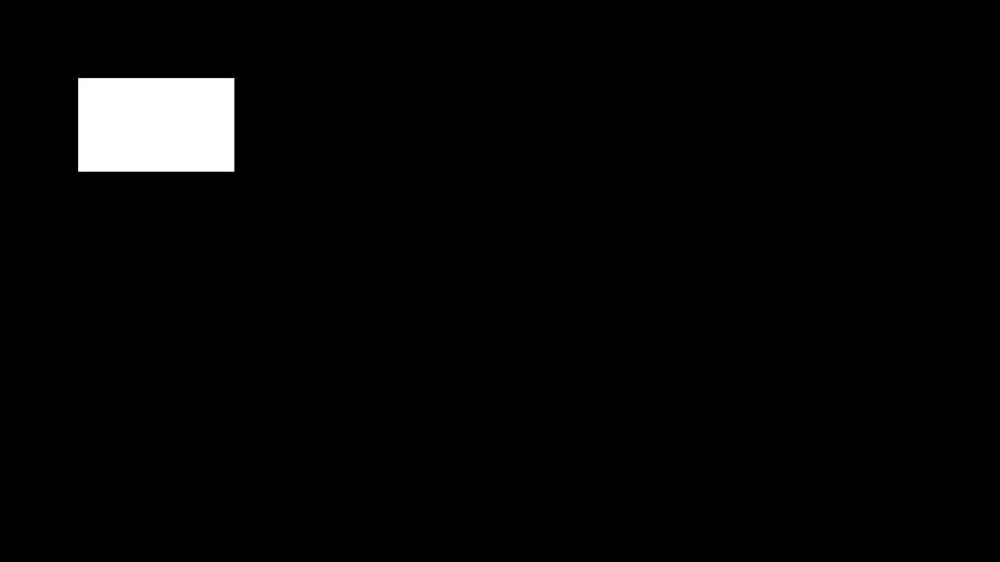

# 빠른 시작

```html
<canvas id="mainCanvas"></canvas>
<script type="module">
	import { Engine, EngineConfiguration, Scene, Vector2, Rect, Colors } from "./build/vanilla.js";

	class MainScene extends Scene {
		draw(graphic) {
			super.draw(graphic);
			graphic.setFillColor(Colors.white);
			graphic.drawRect(Rect.create(100, 100, 200, 120));
		}
	}

	const engineConfiguration = new EngineConfiguration();
	engineConfiguration.canvasId = "mainCanvas";
	engineConfiguration.referenceResolutionSize = Vector2.create(1280, 720);
	engineConfiguration.autoResizeOnWindowResize = true;
	const engine = new Engine(engineConfiguration);
	engine.run(new MainScene());
</script>
```



번들을 직접 만들 때는 esbuild 를 씁니다.

```bash
esbuild import.js --bundle --outfile=build/vanilla.js --format=esm --keep-names --sourcemap '--banner:js=/*! vanilla.js | (c) 2026 vanillapunch | MIT License | https://github.com/ddukbaek2/vanilla.js/blob/release/LICENSE | Third-party notices: https://github.com/ddukbaek2/vanilla.js/blob/release/THIRD_PARTY_LICENSES.md */'
esbuild import.js --bundle --outfile=build/vanilla.min.js --format=esm --minify --keep-names '--banner:js=/*! vanilla.js | (c) 2026 vanillapunch | MIT License | https://github.com/ddukbaek2/vanilla.js/blob/release/LICENSE | Third-party notices: https://github.com/ddukbaek2/vanilla.js/blob/release/THIRD_PARTY_LICENSES.md */'
```

## 샘플

모두 저장소의 `examples/` 에 소스가 있고, 아래 링크는 배포본입니다.

| 샘플 | 설명 | 데모 | 소스 |
| --- | --- | --- | --- |
| Toon Shading | VRM 1.0 캐릭터의 애니풍 렌더링. 3 톤 램프, 구면 노멀 얼굴 그림자, 앞머리 그림자, 천사 고리, 화면 공간 림, 아웃라인, 스프링 본, Quaternius(CC0) 본 애니메이션 8 종 | [열기](https://vanillapunch.com/tools/demo/toonshading/) | [`examples/toonshading`](https://github.com/ddukbaek2/vanilla.js/blob/release/examples/toonshading) |
| Ancient Mountain | 절차 지형(경사, 고도 3 중 블렌딩)과 하늘, 구름, 섀도우 맵, 걷기 / 달리기 / 등반하는 캐릭터 | [열기](https://vanillapunch.com/tools/demo/ancientmountain/) | [`examples/ancientmountain`](https://github.com/ddukbaek2/vanilla.js/blob/release/examples/ancientmountain) |
| Neon Horizon | 절차 하늘(초콜릿 하늘, 바닐라 태양)과 함대 3D 모델, 엔진 글로우, 기함 주포 연출 | [열기](https://vanillapunch.com/tools/demo/neonhorizon/) | [`examples/neonhorizon`](https://github.com/ddukbaek2/vanilla.js/blob/release/examples/neonhorizon) |
| UI Showcase | UI 컴포넌트 전시. 버튼, 스크롤 뷰, 리스트, 차트, 다이얼로그, 레이아웃 | [열기](https://vanillapunch.com/tools/demo/uishowcase/) | [`examples/uishowcase`](https://github.com/ddukbaek2/vanilla.js/blob/release/examples/uishowcase) |
| Particle Effects | 불 / 분수 / 눈 / 비 / 폭발 등 파티클 프리셋 18 종 | [열기](https://vanillapunch.com/tools/demo/particleeffects/) | [`examples/particleeffects`](https://github.com/ddukbaek2/vanilla.js/blob/release/examples/particleeffects) |
| Timeline Showcase | 타임라인 편집기로 만든 문서 8 종 재생. 트랜스포트, 스크럽, 마커 / 이벤트 | [열기](https://vanillapunch.com/tools/demo/timelineshowcase/) | [`examples/timelineshowcase`](https://github.com/ddukbaek2/vanilla.js/blob/release/examples/timelineshowcase) |
| Sprite Effects | `ShaderSprite` 49 종, `ScreenEffect` 58 종, 게임 연출 조합 시연 | [열기](https://vanillapunch.com/tools/demo/spriteeffects/) | [`examples/spriteeffects`](https://github.com/ddukbaek2/vanilla.js/blob/release/examples/spriteeffects) |

배포본이 없는 예제: [`examples/cameratour`](https://github.com/ddukbaek2/vanilla.js/blob/release/examples/cameratour)(돌아가는 `Camera2D`, 노드 트윈, `Indicator`), [`examples/toonmaterial`](https://github.com/ddukbaek2/vanilla.js/blob/release/examples/toonmaterial)(툰 확장 시험 장면: 머티리얼 셰이더 조각, 텍스처와 데칼, 점광, 반 램버트 띠, 더하기 홀로그램, 평면 거울, 영구 인스턴스 버퍼)
